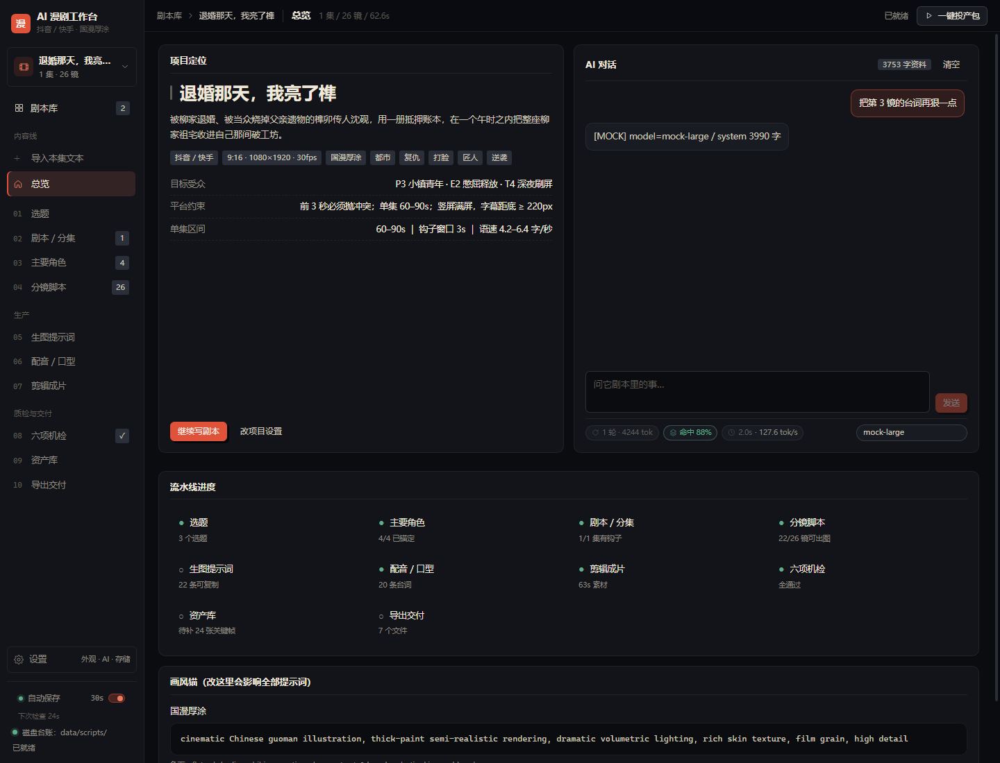

# HANDOFF — AI 漫剧工作台交接包

> 给接手这个包的人 / AI 读。目标：**冷启动 5 分钟跑起来，改完把包原样发回**。
> 这份文档是唯一入口；`README.md` 是给最终用户看的说明书，两者不冲突时以本文为准。

- 包版本：`0.1.0` · 打包时间 2026-11-03 22:xx（见 `MANIFEST.sha256` 首行注释）
- 技术栈：Vite 5 + React 18（**只用这两个**）+ Node 内置 `http`（无 Express）
- 数据：全部本地文件。AI 走本机 `/api/ai` 代理，key 只落 `data/ai-config.json`（不进包、浏览器拿不到）；**没配 key 也能全流程跑通**
- 当前状态：12 项导航（导入本集文本 / 总览 / 01–10）+ 剧本库主页 + 侧栏设置抽屉，多剧本隔离，示例剧本机检 100 分，`npm run build` / `npm run verify` 全通

---

## 0. 三十秒上手

```bash
npm install --registry=https://registry.npmmirror.com
npm run build      # 必须通过，50 modules / ~233KB js
npm run verify     # 必须输出「机检：分数 100 | error 0 | warn 0 | info 0」
npm start          # http://127.0.0.1:5273  （生产：静态 dist + 同一套 /api）
npm run dev        # 开发：vite HMR，同端口
```

Windows 上双击 `start.bat` 也行（会自动装依赖并开浏览器）。

Node 18+（实测 v24.21.0）。端口 5273，被占用时改 `vite.config.js` 的 `port` 或 `PORT=5280 npm start`。

---

## 1. 硬约束（改之前先读，破了就得整套返工）

1. **不许加运行时依赖**。`dependencies` 只有 `react` / `react-dom`，`devDependencies` 只有 `vite` / `@vitejs/plugin-react`。样式是手写 CSS（`src/styles.css`），**不要引 Tailwind / styled-components / UI 库**。要图标就用 `src/ui.jsx` 里现有的 `Icon(name)`（24 网格、1.6px 描边、`currentColor`）。
2. **AI 能力只能走本机 `/api/ai` 代理，key 只落本地 `data/ai-config.json`**。浏览器永不接触 key，也不许把 key 打进交接包、写进 README、塞进 localStorage。没有配置 key 时，全部能力必须能用本地规则跑通——**不许**把某个功能做成"必须有 key 才能用"。也不许换成前端直连第三方域名。
3. **数据契约不许改名**：`data/library.json`、`data/scripts/{id}.json`、字段名（见第 4 节）。外部已有脚本按这个读。
4. **两台机器都要跑**：`npm start`（生产）与 `npm run dev`（开发）必须共用同一份 `api.mjs`。
5. **中文界面**。代码标识符英文，界面文案、注释、文档全中文。
6. **改完必须两条命令都过**：`npm run build`、`npm run verify`。只改文档也必须过。

---

## 2. 目录与文件职责

```
ai-manju-workbench/
├─ index.html                 挂 /src/main.jsx
├─ vite.config.js             插件 local-project-api：把 api.mjs 挂进 vite 中间件；port 5273
├─ api.mjs                    createApi(rootDir) → (req,res)=>bool。多剧本库 + AI 代理 + 小说转剧本
├─ server.mjs                 生产：静态 dist + createApi；MIME 表 + SPA 回退
├─ 启动工作台.bat             桌面快捷方式指向它：装依赖 → build → 起生产服务 → 开浏览器（GBK 编码，别用 UTF-8 存）
├─ start.bat                  开发模式启动（npm run dev）
├─ public/seed.json           示例剧本《退婚那天，我亮了榫》：3 角色 / 2 选题 / 1 集 26 镜 62.6s
├─ data/library.json          剧本库索引（这是列表页的数据源）
├─ data/scripts/{id}.json     每部剧本的完整台账
├─ data/ai-config.json        AI 接口配置（**含 key，已在 .gitignore 与打包脚本里排除**）
├─ data/project.json          旧版单项目台账，首次启动自动迁移成 sc_seed_legacy，之后只读
├─ uploads/                   界面上传的图片（台账只存相对路径，/media 出图）
├─ exports/                   投产包落盘目录（9 件）；handoff/ 是打包交接的 zip
├─ assets/                    icon.* + ref/ 下的三视图、表情、配饰、服装、场景
├─ docs/final-home.png        主页实拍
├─ docs/final-workspace.png   内页实拍
├─ docs/screens/              本文件引用的界面截图（del-* / src-* / strip-*）
├─ docs/ui-ref/               站酷 35 招长图切块（z1_00..z1_10 / z2_00..z2_12），UI 改版依据
├─ scripts/verify-seed.mjs    seed 体检（esbuild bundle 后跑机检）
├─ scripts/pack-handoff.mjs   打交接包（见第 8 节）
├─ scripts/unpack-handoff.mjs 收包 + 对 MANIFEST 找改动（见第 8 节）
├─ scripts/cdp.mjs            CDP 连接工具（headless Edge 9223，conn/nav/sleep/shot）
├─ scripts/page-shot.mjs      按路由整页截图（node page-shot.mjs <route> <height> <name>）
├─ scripts/make-*.py          演示素材生成（Pillow：三视图 / 服装卡 / 参考图）
├─ scripts/make-shortcut.ps1  生成桌面快捷方式
├─ .tmp/                      临时目录（gitignore）：截图与一次性 CDP 脚本，随时可删
└─ src/
   ├─ main.jsx                ReactDOM + StrictMode + ProjectProvider + applyPrefs
   ├─ App.jsx                 剧本库入口 + 侧栏切换器 + 12 项导航 hash 路由 + 顶栏面包屑 + 设置抽屉
   ├─ ui.jsx                  Icon/Btn/Field/Text/Num/Area/Sel/Tag/Stat/Panel/Empty/Kv/Seg/Ring/Modal
   ├─ styles.css              token 化深色主题 + 6 套主题色（见第 7 节）
   ├─ components/AiPanel.jsx         AI 接入表单（完整版给设置页，compact 给抽屉）
   ├─ components/ChatPanel.jsx       总览的内部 AI 对话（读全量资料）
   ├─ components/SettingsDrawer.jsx  左下设置抽屉（外观 / AI / 存储 / 项目 / 画风）
   ├─ lib/schema.js           PLATFORMS/STYLES(29)/SIZES/MOVES/ANGLES/EMOTIONS/ROLES +
   │                          角色 / 服装 / 素材 / 自定义音色 + normalizeProject + cn()
   ├─ lib/checks.js           六项机检 runChecks(project) → {score, errors, warns, infos, issues[]}
   ├─ lib/prompts.js          buildPrompt(project,ep,shot,modelId) 分族五件套 + buildFramePair + buildVideoPrompt
   ├─ lib/imageModels.js      12 个生图模型 × 5 个语法族 + modelSpecText + REF_CAPS
   ├─ lib/voice.js            12 档音色预设 + 自定义音色解析/锁定/撞音色
   ├─ lib/splitter.js         splitSentences / boomScore / splitEpisodes / splitManual / autoAnchors
   ├─ lib/media.js            图片上传（/api/upload）与 /media 路径解析
   ├─ lib/styles.js           自定义画风读写（/api/styles）
   ├─ lib/uiPrefs.js          主题 / 字体 / 密度 / 自动保存偏好（localStorage + 广播）
   ├─ lib/exporters.js        7 件投产包 + CSV/SRT 生成
   ├─ lib/store.jsx           剧本库 + 当前剧本双状态、加载链、定时自动保存
   └─ pages/                  Home(剧本库主页) + 12 项导航对应的页
```

> `.tmp/` 是临时目录：本文后续章节里提到的 `.tmp/*.mjs`、`.tmp/*.png` 都属于这一类，不入库、可随时整个删掉（清理过一次，2 万多个 Edge profile 文件已清空）。

---

## 3. 运行链路（看懂这条就懂一半）

```
启动 → store.jsx effect
  ├─ GET /api/library            → 剧本库索引（磁盘）
  │    └─ 缺 score 的历史条目：GET /api/script?id= → summaryOf() 补算 → POST /api/library 回写
  ├─ localStorage                → mjw:library:v1 / mjw:active:v1 / mjw:script:{id}（离线兜底）
  ├─ /seed.json                  → 全都没有时的示例
  └─ openScript(activeId)        → GET /api/script?id= → 当前 project
编辑任一字段 → mutate(fn)
  ├─ 深拷贝 draft，fn(draft) 原地改
  ├─ 700ms 防抖 POST /api/script {id, project, summary}（写剧本文件 + upsert 索引摘要）
  └─ 同时写 localStorage（失败降级「已存本地缓存」）
切剧本 → flushSave() 先刷盘 → openScript(nextId)
```

**关键语义**：`mutate(fn)` 只认 fn 对 `draft` 的**原地修改**，返回值被忽略。写成 `mutate(p => ({...p}))` 不会生效，必须 `mutate(p => { p.meta.title = x })`。这是之前踩过的坑（旧实现把 `Object.assign(p.meta, patch)` 的返回值当成整个 project，把档案写成了 meta）。

---

## 4. 数据契约（不要改名，不要删字段）

### `data/library.json`

```json
{
  "version": 1,
  "activeId": "sc_seed_legacy",
  "updatedAt": "2026-11-03T12:24:57.741Z",
  "scripts": [
    {
      "id": "sc_seed_legacy",
      "title": "退婚那天，我亮了榫",
      "platform": "douyin",
      "style": "guoman-houtu",
      "logline": "一句话定位…",
      "episodes": 1, "shots": 26, "duration": 62.6, "chars": 3,
      "score": 100, "errors": 0, "warns": 0,
      "createdAt": "…", "updatedAt": "…"
    }
  ]
}
```

`id` 规则：`/^[A-Za-z0-9_-]{2,48}$/`，新建时前端生成 `sc_` + 10 位随机。索引只存摘要，**不要把 shots 塞进索引**。

### `data/scripts/{id}.json`（完整 project，`normalizeProject()` 归一）

```js
{
  meta: { title, platform, style, logline, audience, tags[], updatedAt },
  topics:     [{ id, title, track, audience, logline, memory, bench, diff, risk, scores{} }],
  characters: [{ id, name, role, age, anchor, face, hair, outfit, look, seed, refImage, voice, note }],
  episodes:   [{ id, no, title, hookType, hook, synopsis, beats[], suspense[], shots[] }],
  shots:      [{ id, no, size, angle, move, scene, desc, chars[], props, speaker, dialogue,
                 emotion, intensity, dur, action, voice }],
  assets:     [{ id, ep, shot, name, status, note }]
}
```

`platform` ∈ `douyin|hongguo|bilibili|reelshort`；`style` ∈ `guoman-houtu|cel-shade|manhua-flat|render-3d`。
这些枚举在 `src/lib/schema.js` 的 `PLATFORMS` / `STYLES`，加平台/画风就改这里（连带 `COVER` 渐变、`SIZE_EN/MOVE_EN/ANGLE_EN` 英文映射）。

---

## 5. API 契约（`api.mjs`，两个模式共用）

| 方法 | 路径 | 入参 | 说明 |
|---|---|---|---|
| GET | `/api/library` | — | 读索引，首次访问时自动迁移 `data/project.json` |
| POST | `/api/library` | `{library}` | 覆盖写索引 |
| GET | `/api/script` | `?id=` | 读一部剧本 |
| POST | `/api/script` | `{id, project, summary}` | 写剧本文件 + upsert 索引摘要 |
| POST | `/api/script/delete` | `{id}` | 删文件 + 删索引项 |
| POST | `/api/script/copy` | `{from, id, title}` | 复制剧本 |
| GET | `/api/ai/config` | — | 读 AI 配置，key 打码成 `sk-***abcd` |
| POST | `/api/ai/config` | `{baseUrl, model, apiKey?, temperature, maxTokens}` | 写 `data/ai-config.json`；`apiKey` 省略即不改 |
| GET | `/api/ai/models` | — | 可用模型列表：有 key 时拉 `{baseUrl}/models`，拉不到按域名给建议。返回 `{ok, models[], current, source}`，source 为 api 或 hint。见 6.35 |
| POST | `/api/ai/test` | `{...同上，可选}` | 发一次极小请求测连通，返回 `{ok, ms, model, reply}` |
| POST | `/api/novel/outline` | `{text, title, platform, style, episodes, shotsPerEp, mode}` | 一段正文 → 粗略剧本（现用于「导入本集文本」，`episodes` 恒传 1）。`mode:'local'` 强制本地规则；否则有 key 走模型、失败自动回落并在 `warning` 说明。返回 `{engine:'llm'|'local', stats, hint, project}`，**不落盘** |
| POST | `/api/novel/save` | `{name, text}` | 原文归档到 `uploads/` |
| POST | `/api/upload` | `{data, name}` | 参考图上传。`data` 是 `data:image/(png\|jpeg\|webp\|gif\|avif);base64,…`，上限 12MB，落 `uploads/`，返回 `{ok, path:'uploads/xxx.png', url:'/media/xxx.png', bytes}`。角色卡的 `refImage` 存返回的 `path` |
| GET | `/api/settings` | — | 读存储位置：`{root, dataDir, scriptsDir, exportsDir, uploadDir, defaultDataDir, settingsFile, custom, scripts}`。见 6.10 |
| POST | `/api/settings` | `{dataDir}` | 改台账数据目录，写项目根 `settings.json`，**重启生效**；会建目标目录并落空库。返回 `{ok, dataDir, previous, fresh, needRestart}`。见 6.10 |
| POST | `/api/chat` | `{messages[{role,content}], project}` | 内置对话：把整部剧本（含每集原文全文）拼成 system 上下文后调模型。未配 key 回 400，历史只取最近 16 条。`model` 可覆盖本次模型。返回 `{ok, reply, ms, model, usage, stats, contextChars, truncated}`。见 6.32 / 6.35 |
| POST | `/api/prompt/expand` | `{modelId, ratio, width, height, styleName, styleAnchor, shots[]}` | 按生图模型语法定向重写提示词。未配 key 回 400，>40 镜拒绝，失败回 200 + `ok:false`。返回 `{ok, modelId, modelName, family, count, missing, ms, usage, prompts:[{no,prompt,negative,params}]}`。见 6.9 |
| GET | `/api/styles` | — | 读自定义画风列表：`{ok, custom, file}`。29 条内置画风在代码里，只有自定义的落盘 `data/styles.json`。见 6.17 |
| POST | `/api/styles` | `{id?, name, anchor, negative, note}` | 新建或更新一条自定义画风（带 `id` 且存在则更新）。`anchor` < 8 字直接 400。返回 `{ok, style, custom, updated}`。见 6.17 |
| POST | `/api/styles/delete` | `{id}` | 删一条自定义画风；内置画风删不掉（只认 `custom: true`）。返回 `{ok, custom}`。见 6.17 |
| GET | `/media/<file>` 或 `/media/assets/<sub>` | — | 参考图静态服务（**不走 dist**，由 api 直接读盘）。`/media/xxx.png` → `uploads/xxx.png`；`/media/assets/ref/a.png` → `assets/ref/a.png`。只服务图片扩展名，含 `..` 或绝对路径返回 403 |
| POST | `/api/export` | `{name, content}` | 写进 `exports/`（文件名过滤 `\/:*?"<>|`） |
| GET | `/api/health` | — | `{ok, root, ai:{model, hasKey}}` |

旧接口 `GET|POST /api/project` 保留兼容，指向 `data/project.json`，**新代码不要用**。
请求体上限 32MB（`readBody`），路径穿越由 `safeId` 正则挡住。

---

## 6. 页面与路由

hash 路由：`#/home` 是剧本库主页（默认落地），其余是剧本内页。

| 路由 | 文件 | 干什么 |
|---|---|---|
| `#/home` | `pages/Home.jsx` | 剧本库：Hero + 四指标 + 搜索 + 平台 chips + 卡片网格 + 新建/重命名/复制/删除弹窗 |
| `#/overview` | `pages/Overview.jsx` | 项目体检台：六统计卡 + 定位卡 + 机检摘要 + 九步流水线 + 第一镜提示词 + 画风锚 |
| `#/novel` | `pages/Novel.jsx` | 导入本集文本：本集正文粘贴/读 .txt + 写进哪一集 + 生成镜头（不落盘）+ 写入（新建/覆盖该集） |
| `#/topics` | `pages/Topics.jsx` | 选题池 + 爆款六项自检 |
| `#/story` | `pages/Story.jsx` | 集纲 + 节拍表 + 未解悬念 + 本集体检 |
| `#/characters` | `pages/Characters.jsx` | 角色卡（脸/发/服装/锚定词/seed/参考图/音色）+ 锚定串拼装 |
| `#/shots` | `pages/Shots.jsx` | 分镜表 15 列行内编辑 + 上移下移复制删除 |
| `#/prompts` | `pages/Prompts.jsx` | 中英提示词 + 负面词 + 图生视频提示 + 平台参数 |
| `#/voice` | `pages/Voice.jsx` | 台词字/秒实时配色 + 音色分配 |
| `#/edit` | `pages/Edit.jsx` | 时间轴色带 + 导出参数 + SRT 预览 |
| `#/checks` | `pages/Checks.jsx` | 机检分数 + 六规则卡 + 问题清单 |
| `#/assets` | `pages/Assets.jsx` | 按镜自动生成关键帧对账 |
| `#/export` | `pages/Export.jsx` | 7 件投产包下载 / 写盘 |
| `#/settings` | `pages/Settings.jsx` | 项目信息 + 平台/画风 + 台账导入导出 + 恢复示例 |

加页面 = 新建 `src/pages/X.jsx` + 在 `App.jsx` 的 `NAV` 数组加一项 + `TITLES` 加标题。

---

## 6.5 AI 接入与「导入本集文本 → 镜头」

### 两条链路，同一条出口

```
#/novel 填正文 → POST /api/novel/outline
                     ├─ 有 key 且 mode≠local → callLlm() → extractJson() → normalizeAiProject()   engine='llm'
                     └─ 无 key / mode=local / 模型报错 → localOutline()                            engine='local'
                                                                                                      ↓
                                                                          同一个 project 契约 → 前端预览 → 写入剧本库
```

**任何时候都不许让 `engine='local'` 这条腿失效**——它是没有 key 的机器的唯一出口。

### 本地规则链路（`api.mjs` 里的纯函数，可单独测）

| 函数 | 关键点 |
|---|---|
| `splitSentences(text)` | 按引号配对的状态机切句。**引号内的句号不切，且把「对白 + 归属句」合成一句**。用 `split(/[。！？]/)` 会把右引号 `」` 挤到下一句句首，导致所有台词失配（历史上踩过：`dialogues=0/20`） |
| `cleanSentence(s)` | 清掉句首残留的 `」”』》】)` 与标点 |
| `guessCharacters(text)` | 说话模式 `talk*5` + 动作模式 `act*1` 打分；`NAME_STOP` 过滤地点/物件/身体词；出现次数 ≥2 才收；**主角=分数最高，其余按首次出场位置排**（否则戏份多的配角会被误判成对手） |
| `speakerOf(text, names)` | 三级：名字+说话词 → 右引号后紧跟的名字 → 句内唯一候选名字。**不要**加裸正则 `(..)(?:说|道)` 兜底——「一道旧疤」会被抽成说话人「上有一」 |
| `guessTitle(sentences)` | 剧名留空时：先找含冲突词的短句，再找首句金句，最后兜底首句 |
| `balanceDurations(ep, target)` | 总时长不足平台下限时按镜数均摊缺口，单镜 clamp 1–6s |
| `normalizeShot / normalizeEpisode / normalizeCharacter` | 把任意来源（模型或规则）的原始数据压回契约，枚举非法即回落默认值 |

### 模型链路

- `callLlm(cfg, messages, {timeout, jsonMode})`：OpenAI 兼容 `/chat/completions`。`jsonMode` 首次带 `response_format:{type:'json_object'}`，遇 400/422 自动去掉重试一次（很多国产兼容端点不认这个参数）。
- `extractJson(text)`：容忍 ```json 围栏与前后废话，做括号配对扫描；失败时修尾逗号。**JSON 被 max_tokens 截断时会抛出「不完整」**，此时自动回落本地规则并在 `warning` 里说明。
- `buildOutlineMessages(text, opts)`：system 里给完整 JSON schema + 7 条硬规则（首镜必须承担钩子、台词单句 ≤15 字、枚举只能取给定中文值、最多 6 角色…）。正文截断 14000 字。

### key 安全（改这块之前先看）

- key 只存在 `data/ai-config.json`，`GET /api/ai/config` 只回 `hasKey` 与打码后的 `keyMask`。
- `.gitignore` 与 `scripts/pack-handoff.mjs` 的 `SKIP_PATHS` 都已排除 `data/ai-config.json`。**新增任何打包/同步脚本，都要照着排一遍。**
- 浏览器端只调本机 `/api/ai/*`，不直连第三方域名。

### 已知限制

- 无 key 时是「结构正确的粗稿」：镜头切分靠句子，画面描述就是原句，角色只抽名字，音色按首次出场顺序发。能直接进 `#/shots` 精修，不等于能直接投产。
- 模型生成会整篇一次请求，超长文本截断到 14000 字；超长篇需要先分卷。


### 6.5.1 「导入本集文本」的写入语义（改动前必读）

页面 `#/novel` 的单位是**一集**，不是一整本小说：

- 左栏只放这一集的正文（800–3000 字最合适），`.txt` 导入、字数统计都在。
- 右栏「写进哪一集」二选一：`新建第 N 集`（N = 现有集数 + 1）或 `覆盖第 M 集`。覆盖前 `confirm()` 会把要丢的镜头数写出来。
- 请求固定 `POST /api/novel/outline` 且 `episodes: 1`；返回的 `project.episodes[0]` 就是这一集。
- 落盘走 `actions.importEpisode(ep, { targetId })`（`src/lib/store.jsx`）：
  - 角色按 **名字** 去重合并进 `project.characters`，已存在的角色**保留原卡**（参考图 / seed / 音色档案不丢），新角色才 push；
  - 有 `targetId` → `Object.assign` 覆盖该集（集号、id 不变，镜头整批替换）；
  - 无 `targetId` → 追加为最后一集，`no = 现有集数 + 1`，其余字段从 `emptyEpisode(no)` 兜底；
  - 镜头 `no` 按数组下标重排，避免外部给的编号与顺序不一致。
- 写入后跳 `#/shots`（不是总览）——下一步就是精修镜头。

**为什么不做成「整本小说 → 多集」**：多集一次性生成会把每集都做成粗胚，用户还得逐集重写；一集一集推，前几集精修过的成果不会被后面的生成覆盖。这也是 `importEpisode` 必须支持「覆盖指定集 / 追加新集」两种模式的原因。

**本地规则链的两处配套修正**（`api.mjs`）：
- `NAME_OBJ_SUFFIX` + `isName()`：以物件字结尾的候选不再当人名（`木匣`/`灯笼`/`刨子` 这类在动作模式里极易被误抓，之前会多出个叫「木匣」的角色）；
- `guessCharacters` 主角判定改为「开头 80 字里**最先出场**的人」，否则退回「戏份最多」——按纯计数会把话多的配角当主角，音色跟着错档；
- `HOOK_WORDS` 让 `hook` 先挑带冲突词/对白的句子，不再拿「雨停后，沈砚一个人回到老街工坊」这种环境描写当前 3 秒钩子。

## 6.6 角色参考图（图片怎么进、怎么显示）

角色卡的 `refImage` 是一个**字符串字段，不存二进制**。合法值只有三类，前端 `photoSrc()` 决定能不能渲染：

| `refImage` 的值 | 渲染出的 `` | 来源 |
|---|---|---|
| `uploads/xxx.png` | `/media/xxx.png` | 角色卡里点「上传图片」或 Ctrl+V 粘贴 → `POST /api/upload` |
| `assets/ref/xxx.png` | `/media/assets/ref/xxx.png` | 手动把图丢进项目 `assets/` 目录，台账写相对路径 |
| `https://…` / `data:` | 原样 | 外链 |

其他值（例如随便写的 `my_ref.png`）会被判成「渲染不出来」，卡片下出现灰字提示，一致性风险里显示「缺参考图」。**这不是 bug，是故意的**——渲染不出来的路径必须自曝，否则用户以为图挂上了。

实现要点：

- `POST /api/upload` 只认 `data:image/(png|jpeg|webp|gif|avif);base64,…`，上限 12MB，落盘 `uploads/{原文件名}-{时间戳36}.{ext}`，返回 `path` 与 `url`。前端拿到 `path` 后写进 `refImage`，700ms 防抖自然落进剧本 JSON。
- `/media/*` 由 `api.mjs` 直接读盘返回，**不走 `dist/`**——所以 dev 模式（vite 中间件）与生产模式（`server.mjs`）都不用额外配置。生产静态服务的根是 `dist/`，用户图片如果放进 dist 会在 `npm run build` 时被清空，所以必须走这条独立通道。
- 安全：`/media/` 只服务图片扩展名；路径含 `..`、绝对路径、点开头一律 403；`assets/` 前缀映射到 `rootDir/assets`，其余映射到 `uploads/`，两者都做 `startsWith(base)` 校验。
- 为什么不把图片转成 base64 塞进 JSON：台账 700ms 防抖写盘，几 MB 的 base64 会让每次编辑都写一个巨大文件，diff 与打包也一起炸。

---

## 6.7 音色档案（声音的一致性靠这份参数，不靠记忆）

一致性有两半：**画面对得上**（锚定词 + seed + 参考图，见上一节），**声音也对得上**。声音这半由 `src/lib/voice.js` 承担，纯函数、无依赖、前后端共用口径。

### 数据形状

角色上多一个 `voiceProfile` 对象（`emptyCharacter()` 里已初始化，`normalizeProject()` 做深合并，旧台账缺这个字段也能跑）：

```js
voiceProfile: {
  presetId,                    // 预设 id，仅作「这套参数从哪来」的标记
  gender, age, pitch, timbre,  // 声音本体：性别 / 年龄感 / 基频 / 音质
  rate, accent, emotion, breath, // 说话方式：语速 / 情绪基线 / 口音 / 气息
  tool, voiceId, params,       // 落地：TTS 工具 / 工具里的音色名 / 参数串
  refAudio, refText,           // 克隆：参考音频路径 / 参考文本（zero-shot 必需）
  seed,                        // 音色 seed，和画面 seed 是两件事
}
```

### 唯一的规范出处

`VOICE_PRESETS` 是 12 档：少年男·清亮偏薄 / 青年男·低沉沙哑 / 青年男·清亮干净 / 中年男·浑厚温润 / 老年男·干哑沧桑 / 青年女·冷清倔强 / 青年女·清甜 / 少女·脆弱气声 / 御姐·磁性压迫 / 疯批反派·尖利金属 / 旁白·冷静旁观 / 群演·颗粒嘈杂。

- `resolveVoice(ch)`：**显式字段优先，缺的从预设补齐，seed 回落到 `ch.seed`**。所以老角色只写了 `voice: '青年男声·低沉'` 也能推出一整套参数（`ALIAS` 表负责老短名映射）。这是一致性的核心：任何一镜取到的值都来自同一次解析。
- `presetOf(voice)`：返回归属预设，`ALIAS` 未命中的走默认档。**`<Sel value>` 必须传 `presetOf(cur.voice).label`**，直接传 `cur.voice` 会因找不到匹配项而回落成第一个选项（踩过一次）。
- `voiceTag(ch)` → `男·青年·低·沙哑`（表格列用）；`voiceLine(ch)` → 「男声，青年感，基频低，音质沙哑，语速中慢…」（自然语言，贴给配音员）；`voiceLock(ch)` → 多行锁定串（角色/音色/描述/工具/voice_id/参数/seed/参考音频/参考文本）。
- `voiceConflicts(chars)`：按 `gender|age|pitch|timbre|rate` 分组，同组 >1 即撞音色；`voiceRisks(chars)` 汇总成 err/warn/info。

### UI 落点

- `#/characters` 角色卡下方「音色档案」面板：8 个枚举 + 3 个落地字段 + 参数串 + 参考音频 + 参考文本 + 「一句话听感」+ 锁定串；右上「复制锁定串」。改了明细但偏离预设时，面板顶部会用藤黄色提示「已在预设「X」基础上微调 N 项」——**重选预设会覆盖微调**，这是故意的。
- `#/voice` 右栏「音色表」每角色一行（标签 + 工具 · voice_id · 有无样本 · seed，extra 一键复制全部锁定串），下面「音色一致性」面板渲染 `voiceRisks`。
- `src/lib/exporters.js`：`buildVoiceCSV` 表头 14 列（集/镜号/说话人/台词/字数/时长/字秒/情绪/音色/听感/工具/voice_id/参数/配音提示）；markdown 投产包里角色段多三行「音色细节 / 配音锁定 / 参考音频」。

### 和 AI 生成链路的关系

`api.mjs` 的 `VOICES` 只放 label（12 个字符串），**故意不放整套参数**——前端 `resolveVoice` 从 label 反推，所以改预设只需要动 `src/lib/voice.js` 一处。`normalizeCharacter` 不写 `voiceProfile`（留空），`VOICE_BY_ROLE` 只决定新角色默认选哪一档。

### 加一档预设要改哪里

只改 `src/lib/voice.js` 的 `VOICE_PRESETS`（新增 `{id, label, ...8 个枚举, tool, voiceId, params}`）和 `api.mjs` 的 `VOICES`（补上同一个 label）。两处 label 必须**逐字一致**，否则 AI 生成的角色会用默认档。

---

## 6.8 服装序列号（同一张脸，换了场景要换衣服）

主要角色页只管「脸不漂」，但一部剧里同一个人会换装：第 1–3 集在工坊穿旧工装，第 6 集去相亲穿白衬衫。服装序列号就是给每套衣服发一个号，分镜里只写号，不重写描述。

### 数据形状

`data/scripts/{id}.json` → `characters[]` 里多一个数组，`schema.js` 的 `emptyCharacter()` 已带 `outfits: []`：

```json
{
  "name": "沈砚",
  "outfit": "深灰旧工装 + 洗白的黑 T，右手腕缠一圈磨旧的皮尺",   // 当前主服装的一句话（老字段，保留）
  "outfits": [
    {
      "id": "of_seed_0_0",
      "seq": "O1",                                   // 序列号，界面可改
      "name": "工厂夜 · 深灰旧工装",
      "scene": "第1-3集 · 老街工坊",
      "anchor": "dark grey workwear jacket over washed black tee, worn leather tape measure on right wrist",
      "refImage": "assets/ref/shen-O1.png",          // 取值规则同 6.6 的参考图
      "notes": ""
    }
  ]
}
```

`seq` 由 `schema.js` 的 `outfitSeq(i)` / `nextOutfitSeq(list)` 生成（`O1 / O2 / …`，取现有最大号 +1）；`normalizeProject` 会给缺号的老数据按数组下标补 `O1、O2…`，所以旧台账不用手改。

### UI 落点

`src/pages/Characters.jsx` 的 `OutfitPanel`，挂在角色卡下方、音色档案上方。每套一张卡：**图在上，序列号牌在图正下方居中**，再往下是名称 / 出场场景 / 英文串 / 删除。点图框选文件，框内直接 Ctrl+V 也能贴（`onPaste` → `applyPhoto`）。图片走与参考图同一个 `POST /api/upload`，落 `uploads/`，台账只存相对路径。

样式类都在 `styles.css` 末尾（`.outfit-grid / .outfit-card / .outfit-frame / .outfit-seq / .outfit-name / .outfit-scene / .outfit-anchor / .outfit-foot`）。**注意**：这几条必须写成 `.outfit-card input.outfit-seq` 这种带元素名的选择器——`styles.css` 里 `input:not([type])` 的 `width:100%` specificity 高于单个类名，只写 `.outfit-seq` 会被它盖掉，号牌会撑满整张卡。

### 分镜怎么引用

`shot.outfit`（`schema.js` 的 `emptyShot()` 已带空串）填号，例如 `O1`。`src/lib/prompts.js` 的 `shotOutfit(project, shot)` 负责展开：

- 从 `shot.chars` 拿角色名 → 找该角色的 `outfits` → 用 `outfitOf(character, code)` 匹配 `O1`（正则 `/O\d+/g`，写 `O1, O2` 也行，按角色各取命中那套）；
- 中文版 `cnVersion` 多一行 `服装：沈砚 服装 O1（工厂夜 · 深灰旧工装，第1-3集 · 老街工坊）`；
- 英文版 `full` 插在主体之后：`outfit O1: dark grey workwear jacket …`（用 `anchor`，没写才退回 `name`）；
- 号不存在或该角色没有服装卡 → 不展开，不报错。

导出侧：`buildStoryboardCSV` 在「角色」后加「服装号」列；`buildMarkdown` 的角色段加「服装序列：O1 工厂夜 · 深灰旧工装（第1-3集 · 老街工坊）｜O2 …」以及每套的英文串。

### 约定与坑

- 序列号是**按角色**编的，不同角色的 O1 互不相干；一个镜头里两个角色都换装时，`shot.outfit` 写两个号（`O1, O2`），各自匹配。
- 服装图 `refImage` 支持 `uploads/…`、`assets/…`、`http(s)://`，规则与 6.6 参考图完全一致（`photoSrc()` 是同一份实现）。
- `assets/` 目录的图片响应头是 `Cache-Control: no-cache`（**不是** `immutable`）：这个目录是人手维护的，同名文件会被替换（换一张三视图、换一套服装图），长缓存会让界面永远显示旧图。`uploads/` 文件名带时间戳、永不重名，所以还能长缓存。改 `api.mjs` 的 `/media/*` 那段时别把两者写成一档。
- 演示用服装卡由 `scripts/make-outfit-sheets.py` 生成（flat lay 示意，纸色底 + 墨线），真实项目换成该套服装的实拍/AI 图覆盖同名文件即可。

## 6.9 生图模型与 AI 定向提示词（提示词要按模型的脾气写）

同样一镜，MJ 认「英文长句 + 末尾 --ar」，SDXL 认「tag 堆叠 + 独立 Negative 框」，FLUX 不吃负向词，即梦要全中文短语，DALL·E 要一句大白话。**拿一套串喂所有模型，等于让模型自己猜语法**——这是提示词这一环最容易被忽略的质量损耗。所以先选模型，再生成提示词。

### 唯一真源：`src/lib/imageModels.js`

```js
IMAGE_FAMILIES   // 五个语法族：mj / sd / natural / cn / chat
IMAGE_MODELS     // 12 个模型，每项 {id,name,vendor,family,ratio,params,negMode,note}
DEFAULT_MODEL_ID // 'mj-v7'
modelById(id) / familyOf(id)
fillParams(modelId, {ar,w,h,seed})   // 把 {ar}{w}{h}{seed} 占位换成真值
modelSpecText(modelId, ctx)          // 喂给 LLM 的逐条语法规范
```

| 语法族 | 代表模型 | 输出形态 | 负向词怎么放 |
|---|---|---|---|
| `mj` | MJ v7、Niji 6 | 英文长句，参数都在末尾 | `--no text, watermark…` 短词列表 |
| `sd` | SDXL、Pony V6 | 英文 tag 逗号堆叠 + `(face:1.2)` 权重 | 独立 Negative 框，长列表 |
| `natural` | FLUX.1、SD 3.5 | 一整段连贯英文，无 `--参数` | 想吃负向就得改写进正向句 |
| `cn` | 即梦 Seedream、万相、可灵、混元 | 全中文短语 + 结尾「竖屏 9:16」 | 中文独立负向框 |
| `chat` | DALL·E 3、Nano Banana | 一两句对话式指令 | 写成「不要出现任何文字」限制句 |

**加一个模型只改这一处**（`IMAGE_MODELS` 追一条 + 需要的话在 `buildPrompt` 对应族里补分支），前后端不用各写一份——`api.mjs` 直接 `import { modelById, modelSpecText } from './src/lib/imageModels.js'`。

模型 id 存在 `project.meta.imageModel`（`normalizeProject` 里做非法值回落），所以模型选择是**跟着剧本走**的：不同项目可以用不同模型。

### 模板版：`buildPrompt(project, ep, shot, modelId)`

`modelId` 不传就取 `project.meta.imageModel` 再回落默认。按族返回：

```js
{ full, negative, params, cnVersion, subject, styleName,
  modelId, modelName, family, familyLabel, negMode, note }
```

中文族专治一个坑：**不能把英文 anchor 塞进中文串**。`charCnText(c)` 只取 `look / face / hair`（中文字段），服装写「穿 O1 工厂夜 · 深灰旧工装」。第一版把整段英文锚定拼进中文提示词，模型会跑偏。对话族同理，服装不重复人名、句子补全标点。

### AI 版：`POST /api/prompt/expand`

模板版不联网也能用，AI 版是让接入的模型在**同一套语法**上重写这一镜：

```
body: { modelId, ratio, width, height, styleName, styleAnchor,
        shots: [{ no, size, angle, move, scene, desc, action,
                  chars, outfit, props, emotion, intensity, dialogue, dur, localDraft }] }
resp: { ok, modelId, modelName, family, count, missing, ms, usage,
        prompts: [{ no, prompt, negative, params }] }
```

- system 里塞的是整段 `modelSpecText(modelId)` + 画风锚定 + JSON 输出格式 + 4 条硬性要求（镜头数一致、保留角色锚定与服装号、不加前缀、不要 markdown 围栏）；
- `localDraft` 是本地模板版原文，一起给模型——让它「改语法/写细」，而不是自由发挥出一套别的结构；
- 未配 key 返回 400 并指路「项目设置 → AI 面板」；单次上限 40 镜；
- 调用失败也回 200 + `ok:false` + `error`，前端只弹提示、不污染已有提示词；
- 结果按 `no` 对齐，模型漏掉的镜保留模板版（`missing` 会告诉你有几条漏了）。

### 前端落点：`src/pages/Prompts.jsx`

- toolbar 左侧「生图模型」下拉（写 `actions.setMeta({ imageModel })`）+ 语法族 Tag；
- 「AI 定向 · 本镜」/「AI 定向 · 本集」→ 成功后写回 `shot.promptAI = { modelId, prompt, negative, params, at }`；
- 有 AI 版时第二行 chip 变「模板版 / AI 版」可来回切，镜卡 extra 显示 `AI 定向 · <模型名>`；
- **换模型时 AI 版自动失效**：只有 `shot.promptAI.modelId === 当前模型` 才认，避免把 MJ 的串拿去喂 SD；
- 左栏索引里已定向的镜带绿色 `AI` 标记；右栏「生图模型」面板显示 当前/厂商/语法族+族说明/参数/note。

### 导出

`buildPromptTXT(project, modelId)` / `buildPromptCSV(project, modelId)`：有 AI 版且模型一致的镜优先导 AI 版，并标「AI 定向 / 模板版」；CSV 表头加了 生图模型 / 语法族 / 来源 / 中文说明 四列；文件名带模型 id。换模型再导出，就是另一套语法的包。

### 已知限制

- 视频提示词（`buildVideoPrompt`）还没按视频模型分族，目前只有一套通用写法。
- 模板版里的中文动作/场景在 `sd` / `natural` 族中会留在英文串里（没有内置翻译），note 已提示「建议译成英文再喂」。
- 中文族的画风 anchor 仍是英文串（`cinematic Chinese guoman illustration …`），国内模型普遍认，但想更纯中文可以改 `STYLES` 里的 anchor。

## 6.10 设置抽屉与界面偏好（左下角那扇门）

设置不再挂在导航里，入口固定在**侧栏左下角**的「设置」（`src/App.jsx` 的 `.side-settings` 按钮），点开是左侧抽屉 `src/components/SettingsDrawer.jsx`，四个标签页：外观 / AI 接入 / 存储 / 项目。完整的 `#/settings` 页面仍在，只放不常用的台账迁移与示例恢复，从抽屉「项目」页的按钮进去。

### 外观：主题 / 字体 / 密度

`src/lib/uiPrefs.js` 是唯一实现，存 `localStorage['mjw:ui:v1']`（**不进项目台账**——换剧本不该换皮肤）：

```js
THEMES  // ink 墨纸朱砂 / indigo 靛青 / malachite 石绿 / gamboge 藤黄 / rose 胭脂 / paper 素纸（浅色）
FONTS   // system 系统无衬线 / serif 宋体 / mono 等宽
SCALES  // s 0.92 / m 1 / l 1.08 / xl 1.16
loadPrefs() / savePrefs(p) / applyPrefs(p)
```

`applyPrefs` 给 `<html>` 打 `data-theme` / `data-font` 并把 `--ui-scale` 写到根上；`src/main.jsx` 在 render 之前先调一次，避免首帧闪一下默认皮肤。

对应的 CSS 全在 `src/styles.css` 末尾：

- 深色主题只覆盖 `--vermilion*` / `--ring-*` / `--ink-2..4` / `--line*`，其余沿用 :root；
- `data-theme='paper'` 把**墨与纸对调**（`--ink-*` 变浅、`--paper-*` 变深），另加 `color-scheme: light`、浅色 `.cover::before`、浅色 `.drawer-mask`；
- `data-font='serif'|'mono'` 只覆盖 `--font`（标题用的 `--serif` 不动）；
- 密度用 `.app { zoom: var(--ui-scale) }`——**不是**改 `font-size`：全站字号都是 px 绝对值，改根字号没有任何效果。

**铁律**：新写的样式一律用 token（`var(--ink-2)`、`var(--line)`），不要写 `rgba(11,12,16,.86)` 这种裸色值——浅色主题下它会变成一块洗不掉的黑板。顶栏、遮罩、渐变遮罩原本就是硬编码，这次已改成 `color-mix(in srgb, var(--ink-0) 86%, transparent)` 这类写法。

### AI 接入

`src/components/AiPanel.jsx` 是共享组件，设置抽屉与 `#/settings` 页面用的是同一份实现（`PRESETS` 也从这里导出）。配置仍落数据目录的 `ai-config.json`，key 打码返回，浏览器永远拿不到明文。

### 存储：台账数据目录可改

```
GET  /api/settings  → { root, dataDir, scriptsDir, exportsDir, uploadDir, defaultDataDir,
                        settingsFile, custom, scripts, needRestart }
POST /api/settings  ← { dataDir }   // 相对项目根或绝对路径；空串 = 恢复默认 data/
                    →  { ok, dataDir, previous, fresh, needRestart: true }
```

- 写在项目根的 `settings.json`（`{ "dataDir": "…" }`），**重启生效**：`api.mjs` 的 `createApi()` 在建所有路径之前用 `node:fs` 同步读一次，`dataDir → scriptsDir / libraryFile / legacyFile / aiFile` 全部由它派生；
- POST 会把目标目录建出来并落一个空 `library.json`（`fresh:true`），否则重启后页面是空白一片；
- **原目录数据不会自动搬**，界面文案已写明；换盘前先手动拷 `data/`；
- `settings.json` 含本机绝对路径，已进 `.gitignore`，也在 `scripts/pack-handoff.mjs` 的 `SKIP_PATHS` 里——打包交接不会把它带出去。

### 项目页

抽屉「项目」页直接改当前剧本的 剧名 / 目标平台 / 画风锚（走 `actions.setMeta`，700ms 防抖落盘），并显示集数·镜数·角色·选题统计，底部是「打开完整设置页」的入口。

## 6.11 资产库素材（人物视图 / 表情 / 配饰 / 场景）

`#/assets` 上半部分是素材库（图），下半部分仍是关键帧对账（表）。两件事别再混：**素材库管「画一张图给谁看」，对账表管「这一镜的出图有没有到位」**。

### 数据形状

```js
project.assetImages = [{
  id, kind,        // view 三视图 | expression 表情 | accessory 配饰 | scene 场景 | prop 道具 | outfit 服装
  name,            // 卡片标题，如「沈砚 · 表情表（冷笑/咬牙/怔住/垂眼）」
  charId, charName,// 关联角色（可选）
  scene, ep,       // 关联场景、第几集（可选）
  path,            // uploads/… 或 assets/… 或 http(s)://
  notes, createdAt,
}]
```

`emptyAssetImage(kind)`（`src/lib/schema.js`）+ `addAssetImage / updateAssetImage / removeAssetImage`（`src/lib/store.jsx`）。`normalizeProject` 会给老台账补齐结构，所以旧剧本打开不会炸。

**素材库里还有一类不是台账数据**：角色 `refImage` 与各套 `outfits[].refImage` 会在界面上自动汇总成卡片（角标「主要角色」），只读、点一下跳到 `#/characters` 去改。这样同一张图只有一个维护入口，不会出现两处不一致。

### 公共工具：`src/lib/media.js`

`photoSrc(v)`（台账路径 → 浏览器 src）、`uploadImage(file)`（≤12MB，POST `/api/upload`）、`readAsDataUrl`、`ASSET_KINDS` / `kindOf`。参考图、服装图、资产库都走这一份，**别再在页面里各写一份路径映射**（Characters.jsx 已经从内联实现改成 import）。

### 界面

- 工具栏：`素材 N` + 各类型计数（计数为 0 标黄）+ `＋ 三视图 / 表情 / 配饰 / 场景 / 道具`；
- 面板标题右侧 chips 按类型筛选，`全部 / 三视图 / 表情 / 配饰 / 场景 / 道具 / 服装`；
- 卡片：图框点选或拖入替换 → 类型角标 → 名称 → 关联角色（下拉，自动回填 charId）/ 场景 / 集 → 路径 + 删；
- 图片 `object-fit: contain`：三视图、表情表这类「整张图都要看清」的素材不能裁切。

**坑（第三次踩同一类）**：`.asset-name / .asset-scene / .asset-ep` 必须写成 `.asset-card input.asset-xxx`。全局 `input:not([type]){width:100%; padding:8px 11px; font-size:…}` 的 specificity 是 `0,1,1`，高于单类名的 `0,1,0`，只写类名会被整条盖掉——服装号牌（`.outfit-card input.outfit-seq`）也是这个问题。

### 导出

`buildAssetCSV(project)` 现在一张表两段：先素材库（类型 / 关联角色 / 场景 / 集 / 状态 / 路径），再关键帧对账（集 / 镜 / 状态 / 路径）。发外包直接给这张表。

### 演示素材

`scripts/make-asset-samples.py` 用 Pillow 生成示意素材（三视图剪影、表情四格、配饰、场景空镜），纸色底 + 墨线，和项目画风一致：`assets/ref/shen-3view.png`、`shen-exprs.png`、`shen-accessories.png`、`scene-workshop.png`、`scene-hall.png`。真实项目直接用自己的图覆盖同名文件——`assets/` 目录是 `no-cache`，不用清缓存。

### 约定（写在界面上，也写在这里）

- 三视图是**同一套衣服**的正 / 侧 / 背；换装另开服装卡，不要在一张图里塞两套。
- 表情一张一格、标清情绪名，局部重绘时按格换。
- 配饰单独抠出来，重绘只换配饰不动脸。
- 场景尽量用**不带人的空镜**，复用率最高。
- 图落 `uploads/`，台账只存路径——台账文件永远不会因为图片变大而变慢。

---

---

---

`src/styles.css` 顶部是 token 层，**不要写裸值**：

```css
/* 六个命名色 */
--ink-0 #0b0c10  --ink-1 #121419  --ink-2 #181b22  --ink-3 #20242d  --ink-4 #2a2f3a
--paper #efe8db  --paper-2 #cfc8ba  --paper-3 #8f8a80  --paper-4 #5f5c56
--vermilion #e0533a  --vermilion-2 #f07a5f  --vermilion-soft  --vermilion-line
--gamboge #e2b13c  --malachite #5fae8a  --indigo #7d9cd1
--ok/--warn/--err/--info 及各自 -soft 半透明底
--r-1 6px  --r-2 10px  --r-3 14px
--font 苹方/鸿蒙/雅黑栈   --serif 宋体栈   --mono Cascadia Code
--hard 0 1px 2px rgba(0,0,0,.28)   --hard-lg 0 1px 3px rgba(0,0,0,.34)
```

铁律：墨底纸字，**朱砂是唯一强调色**（主按钮、选中态、方印），一屏只有一个主强调面；阴影已简化为 1px 柔和投影，不要再用硬投影或辉光；标题一律 `var(--font)` 小号（13–25px），**不再用衬线大字 + 渐变文字**（v2 已推翻）；卡片无投影、hover 只改边框色不位移；列表靠间距分隔而非 `border-bottom`；图标一律 `Icon()`；空态必须有图标 + 一句解释 + 一个动作。旧 token 名（`--bg/--panel/--accent`）仍指向新值，新代码不要再用。

断点：`1180px` 三栏收两栏 + 隐藏顶栏统计；`900px` 隐藏侧栏 + 卡片单列。

---

## 6.12 页面精简原则（同一信息只出现一次）

工作台做过一轮去重。**新加功能前先查下表：这条信息已经在哪里看过？** 重复粘贴是这套 UI 最容易犯的错——页面越加越像仪表盘堆料。

| 信息 | 唯一权威位置 | 别处怎么处理 |
|---|---|---|
| 剧名 / 平台 / 画风 / 受众 / 标签 | 设置抽屉「项目」页（`#/settings` 只做只读总览 + 迁移） | 总览页顶部只展示，不改；`#/settings` 的「项目与台账」只读 |
| 集数 / 镜头数 / 总时长 / 角色数 / 机检分 / 缺素材 | 总览页「流水线进度」逐项 | 不再单独出六张指标卡 |
| 素材类型计数 | 资产库面板的筛选 chips（自带计数） | 工具栏只留 `素材 N` + `关键帧缺 N` |
| 关键帧缺哪张 | 资产库「关键帧对账」表（逐镜标已有/缺失/返工） | 不再有「缺口优先级」面板 |
| 导出素材清单 | 资产库「命名规范」面板 extra 按钮 | 剪辑页工具栏不放重复入口 |
| 生成参数（模型 / 平台 / 画风 / anchor） | 生图提示词页右栏「模型 · 平台 · 画风」一个面板 | 不再拆成三个面板 |
| 一致性风险 + 处理口径 | 主要角色页「一致性风险」面板（风险行 + 底部四步口径） | 不再单独出「一致性操作口径」面板 |
| 音色风险 | 配音页「音色表与一致性」（每角色行内风险 + 底部撞音色汇总） | 不再单独出「音色一致性」面板 |
| 节拍 → 镜头配比 | 剧本页「本集体检」面板底部一行 | 不再单独出「配比」面板 |
| 选题三项怎么用 | 选题页「爆款自检」面板底部一段（与硬门槛同处） | 不再单独出「可直接搬进剧本的字段」面板 |
| 文件用途说明 | 导出页投产包列表每行的小字 | 不再单独出「文件用途」面板 |

判断标准：**同一屏里同一条信息出现两次 = 删一处；不同页面出现 = 只在最该做决定的那一页可编辑，其余页面只读或给一句指引。**

设置入口有两处是故意的：侧栏左下按钮（常驻）+ 总览「改项目设置」按钮（派发 `window.dispatchEvent(new Event('mjw:open-settings'))`，App 里监听后打开抽屉），不要再往导航里加「设置」项。

## 6.13 节拍强度曲线（一眼看出哪一拍塌了）

剧本页「节拍表」上方是一条 SVG 曲线：**朱砂实线 = 本集实际强度，灰色虚线 = 教科书基线**，横轴第几拍、纵轴 1–5 档。低于基线的点会变成黄色并带一圈光晕，扫一眼就知道哪里泄力。

**强度从哪来**：每拍多了一个 `intensity`（1–5），来自三处——① 拍型默认值（`BEAT_INTENSITY`，见 `src/lib/schema.js`）；② 用户在节拍表第一列的下拉里改；③ `normalizeProject` 给老台账按拍型补默认值，不会因为旧数据没这个字段就变成一条平线。

**基线怎么算**（`beatBaseline(n)`，同文件）：5 拍 `[4,3,5,4,4]`、6 拍 `[4,3,4,5,4,4]`、7 拍 `[4,3,4,5,4,3,4]`，再多就在 5 拍基准上按位置线性插值（保证首尾对齐）。含义是「开局先给一记 → 中段沉下去蓄力 → 反转/打脸最尖 → 收尾留钩」。**不要用截断代替插值**：`base7.slice(0,6)` 会让第 6 拍的基线掉到 3，收尾拍被判成「应该低」，结论就反了。

**结论句分级**（`BeatCurve` 里）：
- `low <= -2` → 「明显塌点，这里必须补一次冲突或反转」
- `low === -1` → 「低于基线 1 档 —— 还能看，加一句反转台词或缩短这一拍」
- 没有负值 → 「中段没有泄力」
- `high >= 2` → 「爆点够」；`high === 1` → 「略高于基线 1 档」
- `high - low >= 2` 才提落差；`>= 3` 且没有塌点才说「起伏够抓人」

**改拍型要连带改选项**：`BEAT_TYPES` 与 `BEAT_INTENSITY` 必须同时收录拍型名（现有 12 个：开局钩子 / 身份揭穿 / 冲突升级 / 压迫升级 / 第一次打脸 / 反转铺垫 / 反转 / 高潮打脸 / 爽点释放 / 情绪爆发 / 新悬念 / 收尾钩子）。台账里出现表外拍型时，`beatOptions(t)` 会把该值临时补进下拉——否则 `<select>` 找不到匹配项就回落到第一项，用户看到的拍型会变成「开局钩子」。这个坑在音色下拉上踩过一次，别再踩。

**样式**：`.beat-curve` / `.beat-curve-legend` / `.beat-verdict` / `select.beat-int`（这一列只有 66px，必须把 select 右内边距压到 16px 才看得见数字，否则只剩一个下拉箭头）。

---

## 6.14 一张脸可以有多张参考图（主视图 / 表情表 / 配饰）

角色卡原来只能挂一张参考图，加了又换、换了又丢。现在是一个图格子阵列：**每张一格，末格是「＋ 加参考图」（可多选、可拖入、可 Ctrl+V 粘贴）**，点任意一张就把它设为主图，右上角 × 删掉那一张。

**数据形状**（`src/lib/schema.js`）

```js
character.refImages = ['assets/ref/shen_ref_v01.png', 'assets/ref/shen-3view.png']
character.refImage  = 'assets/ref/shen_ref_v01.png'   // 永远是 refImages[0] 的镜像
```

`refImage` 保留是为了所有老代码（机检、导出、资产库汇总、列表头像）不改也能跑；`normalizeRefImages(c)` 在 `normalizeProject` 里跑一次：以 `refImages` 为准、把老数据的 `refImage` 顶到首位、去重，然后把 `refImage` 重写成首张。**任何写参考图的地方都要两个字段一起写**（`upd({ refImages, refImage })`），只写 `refImage` 会让下一次读盘时顺序被打回去。

**交互约定**

| 动作 | 结果 |
|---|---|
| 点末格「＋ 加参考图」 | 打开文件选择，`multiple`，一次可选多张，逐张上传后追加到末尾 |
| 把图拖到格子区域 | 同上（`onDrop`） |
| 截图后 Ctrl+V | 同上（`onPaste`，在 `.ref-grid` 上监听） |
| 点某张图 | 把它移到首位并设为主图（`setMainPhoto`：`[path, ...其余]`） |
| 点某张图右上 × | 删掉这一张；删的是主图则下一张自动升为主图 |

主图在那张左上角有「主图」角标（朱砂描边）。**不要用 hover 才显示的按钮去切主图**——主图是导出与生图时的默认锚点，必须一眼看见是哪张。

**下游会自动跟着变**

- 机检风险第 3 条：`refList.some((p) => photoSrc(p))`，多张时文案变成「N 张参考图已就位」
- 资产库自动汇总：`refImages` 每张各出一张卡（`角色名 · 主视图` / `角色名 · 参考图 2`），不再只取首张
- 导出的素材 CSV：每张一行；投产包 markdown 改成 `- 参考图（N 张）：a、b`

**已删掉的旧 UI**：图框右边的「上传图片」「清空」按钮和那个填路径的文本框（`uploads/xxx.png 或外链 https://…`）。要加图就点格子，要改路径在台账里改——输入框留在这里只会让人以为必须手打路径。历史遗留的裸路径仍会在格子里显示「渲染不出来」的虚线格，方便一眼发现坏数据。

## 6.15 场景库（场景图命名 + 分镜里直接挑）

分镜表的「场景」列不再只能手打：格子右边多了一个「库」按钮，点开是资产库里所有 `kind === 'scene'` 的图，**点一张就把它的名字写进这一镜的场景**。

**唯一真源**：场景名就是 `project.assetImages[].name`（kind = `scene` 的那些）。分镜 `shot.scene` 只存字符串，不存 id —— 这样提示词、导出、机检全都不用改，代价是**改名不会回写已填的分镜**（改名等于换场景，本来也不该静默改写历史镜头）。

**上传即命名**（`src/pages/Assets.jsx` 的 `doUpload`）

- 名字空着时先用文件名兜底：`String(file.name).replace(/\.[^.]+$/, '').replace(/[-_]\w{6,10}$/, '')`——后半段是砍掉 `-mw1pzn8t` 这种上传随机串
- 传完 `requestAnimationFrame` 里把焦点丢到那张卡的名称框并 `select()`，想改名直接打字
- 通知文案会告诉你暂用了什么名字
- 场景卡名称框的 placeholder 专门写「场景名（分镜里选的就是它）」，别的类型仍是「三视图名称」这类

**分镜侧**（`src/pages/Shots.jsx`）

- `const sceneLib = (project.assetImages || []).filter((a) => a.kind === 'scene')`
- `applyScene(a)`：名字空的话先给它起个「场景 N」（N 是它在场景库里的序号）并写回资产卡，再把名字填进 `shot.scene`；只改这一格，其他字段不动
- 场景库空时弹层给一个「去资产库上传场景」按钮（`window.location.hash = '#/assets'`），而不是一句干巴巴的报错
- 列宽从 110 加到 124，header 改「场景（可选库）」；按钮 22px 写一个「库」字——**别用 ▤ 之类的符号**，等宽字体下会渲染成谜之方块

**样式**：`.scene-cell`（flex + `input { min-width: 0 }`，否则 flex 里的 input 会把按钮挤出去）、`button.scene-pick`、`.scene-lib`（`minmax(126px,1fr)`，`max-height: 54vh` 可滚）、`button.scene-card`（4:3 裁切预览 + 底部名称条，未命名时名称灰掉写「未命名（选中后自动编号）」）。

## 6.16 自动保存（间隔可调，默认 30 秒）

改动的落盘节奏从「每次编辑 700ms 后立刻 POST」改成「攒到下一次心跳再 POST」，默认 **30 秒一次**，可在设置抽屉里改。

**三段状态机**（`src/lib/store.jsx`）

- `mutate()` 只做两件事：把 draft 同步写进 `localStorage`（`mjw:script:{id}`），把 `pendingRef.current = { id, p, s }` 标脏，并把文案设成 `待保存 · 30 秒后落盘`（关掉时是 `待保存 · 自动保存已关`）
- 心跳 `useEffect([autoCfg.on, autoCfg.sec])`：每秒刷 `autoNext` 倒计时，归零时若 `pendingRef` 非空就 `postRef.current(...)` 写盘，然后重开计时
- `flushSave()`：不管开关，立刻把 `pendingRef` 写掉，并把计时器重置 —— 切剧本（`openScript` 开头）、关页面（`beforeunload` → `sendBeacon`）都走它

**为什么先写 localStorage**：磁盘落后最多 30 秒，但浏览器缓存是每次编辑即写。所以「关掉自动保存 + 直接关机」也不丢内容，只是磁盘台账旧一点。

**配置**（`src/lib/uiPrefs.js`）

- `DEFAULTS` 加 `autosave: true, autosaveSec: 30`；`AUTOSAVE_SECS = [10, 30, 60, 120, 300]`
- `autoSaveOf(prefs)` 归一化：`sec` 夹在 5–1800，非法值回 30
- `savePrefs()` 现在会 `dispatchEvent(new CustomEvent('mjw:prefs', { detail }))`；store 监听这条事件同步 `autoCfg` **并写 `autoRef.current`** —— 改设置不用刷新页面

**侧栏**（`src/App.jsx` 的 `.side-foot` 顶部）：`.autosave-row` 一行四件 —— 状态点（开着是石绿 + 外发光）、「自动保存」、当前间隔（`30s` / `关`）、开关滑块；点整行就是切换。下面 `.autosave-hint` 显示 `N 秒后写盘` / `下次检查 Ns` / `改动只存本地缓存`。

**设置抽屉 → 存储**：自动保存区放在「当前路径」上面 —— 开启/关闭两个 chip + `10 秒 / 30 秒 / 1 分钟 / 2 分钟 / 5 分钟` 五个 chip + 一句「改动同时会即时存进浏览器本地缓存…切剧本、关页面、顶栏保存都会立刻写盘」。

**踩到的坑**：`mutate` 里如果直接读 `autoCfg` 闭包，关掉开关后新改动仍显示旧的「10 秒后落盘」（React 闭包拿到旧值）。改成读写 `autoRef.current` 之后两边一致。

---

## 6.17 画风库：29 条内置 + 自定义

### 内置画风（`src/lib/schema.js`）

`STYLES` 从 4 条扩到 **29 条**，写法改成 `RAW_STYLES` 数组 → `Object.fromEntries(...)`，按 `group` 分六组（`STYLE_GROUPS`）：国漫·中式 6 / 日系 7 / 欧美 5 / 写实·电影 4 / 风格化 7 / 自定义 0。每条 `{ id, name, group, anchor, negative, note }`，`anchor` 直接进提示词，`note` 显示在卡片第二行。

**旧 4 个 id 一个都不能删**：`guoman-houtu`（默认）、`cel-shade`、`manhua-flat`、`render-3d`。台账里存的是 id，删掉老剧本打开就变哑巴。

### 自定义画风（`data/styles.json`）

- 存储：`data/styles.json` = `{ version: 1, custom: [...] }`，随 `dataDir` 走（改了数据目录，自定义画风也跟着搬过去）
- 端点：`GET /api/styles` → `{ ok, custom, file }`；`POST /api/styles` upsert（带 `id` 且存在则更新，`createdAt` 保留，返回 `updated: true`）；`POST /api/styles/delete`
- 校验在 `normalizeStyle()`：name ≤ 24 字必填；**anchor 必填且 ≥ 8 字**（太短直接 400「正向锚定词太短——至少写 8 个字，不然生图模型不知道要什么画风」）；negative ≤ 400；note ≤ 120
- id 规则：`cs_` + 时间戳 36 进制 + 3 位随机。`isCustomStyleId()` 就认这个前缀

### 三处联动（缺一个就出现「选了没反应」）

1. `src/lib/styles.js`：`loadStyles()` 拉列表 → `registerStyles()` 原地塞进同一张 `STYLES` → 广播 `mjw:styles`
2. `src/App.jsx`：监听 `mjw:styles` 后 `setStyleRev(n => n+1)` —— **注册是原地改对象，React 看不见，必须靠版本号逼重渲染**
3. `src/pages/Home.jsx`：`STYLE_OPTIONS` 常量改成 `styleOptions()` 函数，每次渲染现算，自定义画风才进得了新建弹窗

### 失效兜底

- `normalizeProject`：`if (!STYLES[p.meta.style] && !isCustomStyleId(p.meta.style)) p.meta.style = 'guoman-houtu'` —— 自定义 id 在列表还没拉回来时不能被当脏数据重置
- `styleOf()`：未注册的 `cs_` id 返回 `{ name: '自定义画风（未同步）', note: '在设置 → 画风里重新选一次即可' }`，不崩
- 删除一条自定义画风时，若正被当前剧本使用，抽屉会先把 `meta.style` 打回 `guoman-houtu`（`window.confirm` 提示）

### 界面

设置抽屉第五个页签「画风」：当前画风卡 → 六个分组网格（2 列，`.style-card`，选中朱砂边）→ 新建表单（画风名 / 正向锚定词 / 负向词 / 备注 + 「保存并切到这条」）。自定义卡的 `×` 只在 hover 时出现。

**测试脚本的坑**：填表时用 `input:not([type])` 选不到字段 —— 这些 input 有 `type="text"`，选择器必须写 `input, textarea`。第一次跑就栽在这，界面没反应却以为代码坏了。

---

## 6.18 分镜表的「复制」与行高同步

**复制 ≠ 再多一行**

`src/pages/Shots.jsx` 里原来的 `duplicate()`（原地插一份副本）已删除，换成 `copyShot(sh)`：把这一镜 16 个字段拼成**一行 TSV**（tab 分隔，字段内换行替换成 ` ⏎ `）写进系统剪贴板，粘进 Excel / 飞书 / 表格会自动分列。走 `navigator.clipboard.writeText`，失败回落 `document.execCommand('copy')`（非安全上下文或没给权限时）。

**画面 / 台词上下同步**

这两列是唯一的多行字段（`type: 'area'`）。现在都是 `className="auto-grow"` 的 textarea：

- `syncRow(tr)`：先把该行所有 `textarea.auto-grow` 的 `height` 置 `auto`，取 `scrollHeight` 最大值，再统一写回 —— 两格永远等高
- 触发点三处：`onInput`（边打边长）、`useEffect([epId, shotFingerprint])`（切集、行数变化、外部写回内容）、`window.resize`（窗口变窄换行数变了）
- `shotFingerprint` 是每镜 `${id}:${desc.length}:${dialogue.length}` 拼起来的字符串，用它当依赖是为了「内容变了但没走 onInput」（比如导入本集文本写回）也能重算
- CSS：`.shots-table textarea.auto-grow { display:block; resize:none; overflow:hidden; min-height:34px; line-height:1.55 }`；`.shots-table td` 的 `vertical-align` 从 `middle` 改 `top`，否则等高后短内容会垂直居中，看着像没对齐

**为什么不做「拖拽某一格拉高」**：可拖拽就会拖出两格不一样高，再靠 ResizeObserver 回写容易抖。内容驱动 + 等高已经覆盖真实用法（画面描述写长了，台词框自己跟着长）。

---

## 6.19 首尾帧 · 多参生图

**一句话**：一镜出两张图 —— 首帧是本镜起势，尾帧是收势，中间那段交给首尾帧视频模型去插值；两张图共用同一套参考图与同一 seed，只允许「姿态 / 表情」这一维变化。

### 开关与数据

| 位置 | 字段 | 说明 |
|---|---|---|
| `project.meta.promptMode` | `'single' \| 'pair'` | 提示词页顶部 chip 切换；`normalizeProject` 会把非法值打回 `single` |
| `shot.promptAI` | `{ modelId, mode, prompt, first, last, bridge, negative, params, at }` | AI 定向结果。`mode` 参与有效性判定：单帧的 AI 版不会出现在首尾帧模式里，反之亦然 |

### 三条纯函数（`src/lib/prompts.js`）

- `shotRefs(project, shot)` → `[{role, label, path}]`，顺序即优先级：**角色主图 → 角色副图（表情 / 侧面）→ 该镜服装卡图 → 场景空镜**。场景按名字匹配 `assetImages`，所以分镜里的 `shot.scene` 要和资产卡名称一致。
- `refLineOf(refs, modelId)` → `{text, cap, used}`，按模型能力写不同的话（见下表）。
- `tailOf(shot)` → 动作链（`→ ；; 然后 接着 随后 再 又`）的最后一段；空则返回 `''`。
- `buildFramePair(project, ep, shot, modelId)` → `{first, last, bridge, refs, refLine, cnVersion}`，`first` / `last` 都是完整的 `buildPrompt` 结果（含 negative / params）。

### 参考图能力的三种写法（`src/lib/imageModels.js` 的 `REF_CAPS` / `refCapOf`）

| mode | 谁 | 提示词里怎么写 |
|---|---|---|
| `index` | 即梦 4 张 / 万相 3 / 可灵 3 / 混元 3 / Nano Banana 6 | 直接拼进正向串：「参考图①沈砚 面部与发型（锁脸）；参考图②…」 |
| `cref` | MJ v7 / Niji 6 | 只能给命令行提示：`--cref <①那张图地址> --cw 100`，另叠 `--sref` 锁风格 |
| `none` | SDXL / Pony / FLUX / SD3 / DALL·E 3 | 老实写「不吃参考图」，一致性只能靠 seed + 文字锚定，别把图片地址塞进 prompt |

`refs` 超出 `cap.max` 的部分在 UI 里显示为半透明虚线框（超出不吃），不会静默丢掉。

### 首尾帧的「三锁」

`bridge` 固定三句：只变 X（= `tailOf` 结果）、机位/景别/光线/服装/背景全锁死、两张图共用同一 seed 与同一套参考图。**帧标记按语法族换语言**：MJ / SD / FLUX 这类英文串里写 `(starting pose of this shot)` / `(ending pose — same framing and light, the action completed, body settled…)`，中文族才用「（本镜起势）/（本镜收势：…）」——英文串里夹中文括号会污染解析。

### 导出一致性

`buildPromptTXT` / `buildPromptCSV` 自己读 `meta.promptMode`：

- pair：TXT 每镜写 `【首帧】【尾帧】【桥接】【负面】【参数】【参考图】【多参】` 七行；CSV 表头多出「帧」列（首帧 / 尾帧各一行）与「参考图」列
- single：行为与之前完全一致（只多一行 `# 多参：…`）

### 已知限制

1. **模板版的首尾差异只是括号标记** —— 台账里 `desc` 只有一句话时，规则模板没法凭空造出两个姿态。真想要「抬手前 / 抬手后」这种明显差异，用「AI 定向 · 本镜」（后端 system 已明确要求首帧起势、尾帧收势、其余全锁）或手改尾帧。
2. 尾帧只取 `action` 最后一段，动作字段空时退化成「同一构图的静止定势」，并会在「本镜缺口」里提示「动作（尾帧要它才有收势）」。
3. 场景图靠名字匹配 `shot.scene`，改名不会回写历史镜头（与 6.15 同一约定）。

---

## 6.20 随机路人（不锁脸的角色）

一个角色要么「锁死」，要么「每次都不一样」——这一节是后者。挑担货郎、跑堂小厮、衙门差役这类只出现一两个镜头、观众记不住脸的人，要求锚定词 + seed + 三视图是纯浪费。标记成随机路人后，整条一致性机制对它让路。

### 数据形状

角色卡多一个布尔字段 `random`（`src/lib/schema.js` 的 `emptyCharacter` 里默认 `false`）：

```json
{
  "id": "ch_xxx",
  "name": "路人甲",
  "role": "路人",
  "random": true,
  "look": "更夫，提着灯笼，肩上搭着梆子",
  "anchor": "a night watchman carrying a lantern, wooden clapper over his shoulder",
  "face": "圆脸",
  "hair": "短打鬓角",
  "outfit": "提着灯笼，肩上搭着梆子",
  "seed": "",
  "refImages": [],
  "voice": "群演·颗粒嘈杂"
}
```

- `anchor` 仍然填，但语义变了：**它是「这一版长什么样」的描述，不是锁脸的锚定词**。改它等于换一个人。
- `seed` 留空、`refImages` 留空是**正常状态**，不是缺数据。
- `name` 不要带空格：分镜的「角色」列用空格当分隔符，`路人 1` 会被切成「路人」+「1」两个查不到的角色。所以随机路人用 `路人甲 / 路人乙 …`（`PASSERBY_NUMS` 十个天干序号，第 11 个起退回数字）。

### 三条纯函数

| 函数 | 位置 | 作用 |
|---|---|---|
| `randomPasserby(seq)` | `src/lib/schema.js` | 从 `PASSERBY_POOL`（12 条外形）+ 年龄 / 脸型 / 发型池里掷一个角色，音色固定 `群演·颗粒嘈杂` |
| `rerollPasserby(c)` | `src/lib/schema.js` | 保留 id / 名字 / 音色，只重掷外形字段 |
| `charAnchorText(c)` | `src/lib/prompts.js` | `random` 时返回 `random background passerby, <anchor>, face not fixed, varies each generation, no consistent identity`，**不写名字**（写名字模型就会把它当固定角色） |

`charCnText` 与 `cn` / `chat` 两个语法族分支另有一句硬编码：`随机路人（${look}，不锁脸，每次可换脸）`，英文族靠 `charAnchorText`。四族都验过：mj / sd / natural 输出 `random background passerby`，cn / chat 输出中文那句。

### 界面

- 「主要角色」列表头：`路人＋`（一次加一个随机路人，加完自动选中它）、`＋`（普通角色）。
- 列表项：随机路人的头像位显示「随」，`anchor` 有值也不会亮绿点（绿点代表「已锚定」，对随机路人是误导）。
- 角色卡右上：`随机路人` 标签 + `重掷外形`；锚定词 Field 的 label 改成「外形描述（随机路人不用锚定）」。
- 一致性风险：随机路人只查「音色有没有定档」和「有没有被分镜引用」，锚定词 / seed / 参考图 / 服装四条全部转绿并写明不需要。

### 与提示词、导出的关系

- 提示词主体：随机路人不进 `[锚定串]`，写成 `random background passerby`，**seed 参数也不会给它的值**（`fillParams` 空 seed 输出「随机」，正好）。
- 参考图：`shotRefs` 只收 `refImages`，随机路人为空所以不会污染多参列表。
- 投产包：角色标题写成 `### 路人甲（路人 · 随机路人：不锁脸不锁 seed）`，锚定词行写「（随机路人，不需要锚定词）」。
- 想把它固定下来：点掉 `random`（或直接把 `random` 改 false 再补锚定词 / seed / 参考图），它会立刻按普通角色参与一致性检查。

### 坑

1. **名字不能带空格**（见上），这是分镜角色列的切分规则决定的，不是随机路人特有的。
2. `resolveChars` 先整段精确匹配角色名，匹配不到才按空格拆 —— 否则「路人甲」会被拆成两个。
3. 随机路人不是「群演」的同义词：`role` 是「路人」还是「群演」只影响音色默认值和导出文案，锁不锁脸看 `random`。

---

## 6.21 角色定位：14 个预设 + 自定义

原来的 `ROLES` 是给 AI 生成用的职能词（主角 / 对手 / 助攻 / 导师 / 群演），写剧本时不够用——「学长」「妹妹」这种关系才是短剧里真正决定台词语气的东西。现在换成按关系分的 14 档。

### 预设

`src/lib/schema.js`：

```js
export const ROLE_PRESETS = [
  '男主', '女主', '男配', '女配',
  '兄弟', '妹妹', '姐姐',
  '学长', '学姐', '学妹', '学弟', '同学',
  '群演', '路人',
]
export const ROLE_CUSTOM = '自定义'
export const ROLES = ROLE_PRESETS   // 旧导入名保留，别处不用改
```

`emptyCharacter()` 的默认 `role` 也从「主角」改成「男主」。

### 旧数据不会被偷偷改掉

旧台账里的「主角 / 对手 / 助攻 / 导师」**不在**预设里，界面上会：

1. 下拉显示「自定义」；
2. 下面多出一个输入框，里面是原值（`主角`）；
3. Field 提示写「旧值「主角」不在预设里，选一个或自己填」。

**为什么不自动映射成「男主 / 女主」**：`对手` 是男是女、`主角` 是男是女，台账里没有可靠依据，猜错会把整部戏的音色和台词语气带偏。让用户点一下更安全。示例剧本里的三个角色已手工改成 男主 / 女主 / 男配。

### 音色默认值跟着改

`api.mjs` 的 `VOICE_BY_ROLE` 按新词重写（并保留旧词做兼容）：

| 定位 | 默认音色 |
|---|---|
| 男主 / 学长 | 青年男·低沉沙哑 |
| 女主 / 学姐 | 青年女·冷清倔强 |
| 男配 | 中年男·浑厚温润 |
| 女配 | 御姐·磁性压迫 |
| 兄弟 / 同学 | 青年男·清亮干净 |
| 妹妹 | 少女·脆弱气声 |
| 姐姐 / 学妹 | 青年女·清甜 |
| 学弟 | 少年男·清亮偏薄 |
| 群演 / 路人 | 群演·颗粒嘈杂 |

`localOutline`（导入本集文本的本地规则链路）也改成第一个角色给「男主」、第二个给「女主」、其余「男配」，音色随之取值。**只改默认值，不覆盖已有的 voiceProfile**——音色档案一旦手调过，重新生成角色不会打回去。

### 落点

- 角色卡「定位」Field：`Sel` + 条件出现的自定义 `Text`；选「自定义」时把 `role` 清空，输入框随即出现。
- 角色列表头像位：仍然是 `role` 首字（男主→男、兄弟→兄、同学→同），随机路人固定「随」。
- 投产包 / 分镜表：`role` 原样输出，不做翻译。

---

## 6.22 列表内直接删除 + 磁盘优先于本机缓存

### 列表内删除

角色列表每一项右侧加了 `×`（hover 或键盘 focus 才显形，平时不占视觉），点它直接删这个角色，不用先选中再滚到卡片底部找「删除角色」。

- 有确认框：`「沈砚」还在 15 个镜头里出现。删掉后这些镜头的「角色」栏要手动清，确定删除？`
- `e.stopPropagation()`：点 × 不会顺带选中该角色
- 删的是当前选中项时，右侧自动收起
- 原来是 `●` / `○` 状态点占据右侧位置，hover 时淡出给 × 让位（`.list-item:hover .st { opacity: 0 }`）

`.li-del` 是 `position: absolute`，所以 `.list-item` 必须有 `position: relative` —— 少这一条按钮会飘到父容器右侧。

### 磁盘优先于本机缓存

这是「删掉的角色在刷新后又回来了」的真正原因，不只是这个功能的问题。

`openScript()` 原来：API 拿到就用 API 的，API 失败才回落 `localStorage`。看起来没问题，但多窗口 / 旧标签页的场景下：

1. 窗口 A 删掉一个角色，落盘；
2. 窗口 B 的 `localStorage` 里还留着删之前的整份副本；
3. 窗口 B 的自动保存心跳（默认 30 秒）把那份旧副本写回磁盘；
4. 角色回来了。

现在 `openScript()` 会拿磁盘版和本机缓存版的 `meta.updatedAt` 比一次：

```js
const lt = String(local.meta.updatedAt || '')
const st = String(norm.meta.updatedAt || '')
if (lt > st) norm = local                              // 本地更新 → 用本地（离线编辑不丢）
else localStorage.setItem(LS_SCRIPT(id), JSON.stringify(norm))  // 磁盘更新 → 覆盖缓存
```

**仍然保留「本地更新赢」**，因为断网时改的东西不能凭空消失。只有磁盘比缓存新时才覆盖。

实测（CDP 注入脏副本）：

| 场景 | 结果 |
|---|---|
| 本地副本 `updatedAt=2020-01-01`（旧）+ 多一个「脏角色」 | 列表 4 人，脏角色不出现 ✓ |
| 本地副本 `updatedAt=2099-01-01`（新）+ 多一个「脏角色」 | 列表 5 人，脏角色出现 ✓（离线编辑保留） |
| 删掉本地副本再刷新 | 回到磁盘版 4 人 ✓ |

排查这类问题时先想清楚「这份数据是哪一端写的」。改磁盘之后，本机浏览器里那份旧副本必须一起清掉（或让 `updatedAt` 认输），否则它十几秒后就把你的修改盖回去。

---

## 6.23 首尾帧的中英文双版

单帧模式早就有「英文提示词 / 中文提示词」两个 chip，首尾帧模式没有——因为首帧 / 尾帧是同一个 `buildPrompt()` 跑两遍，出的是模型语法串。现在两边对齐了。

### 中文版不是翻译出来的，是另生成的一条

直接把英文串丢给翻译会得到一堆中文夹英文参数的怪东西：中文模型（即梦 / 万相 / 可灵）不吃 `--ar 9:16`，也没有 Negative 输入框，负向词必须写进正向句或者末尾单独一行。所以 `buildFramePair()` 里固定用中文族的代表模型再跑一遍：

```js
const CN_PROXY_ID = 'jimeng'
const cnOf = (descText) => {
  const r = buildPrompt(project, ep, { ...shot, desc: descText }, CN_PROXY_ID, { refs })
  return `${r.full}\n参数：${r.params}｜负面：${r.negative}`
}
const firstCn = cnOf(cnHead)
const lastCn = cnOf(cnTail)
```

不管当前选的是 MJ、SD 还是即梦，中文版都是这套中文串——选中文就是在看「换成中文模型该怎么写」。

### 帧标记必须跟着语言走

英文族原本用 ` (starting pose of this shot)` / ` (ending pose — …)`，这两个标记塞进中文串里会让中文模型当成乱码忽略掉，首帧和尾帧就变成两条一模一样的提示词。中文版单独用：

- 首帧：`（本镜起势：动作还没开始，人物是发力前的姿势）`
- 尾帧：`（本镜收势：${tailOf(shot)}；机位、景别、光线方向、服装、背景与首帧完全一致）`

同一套英文标记留在英文版里，互不干扰。

### 界面

- 语言 chip 的显示条件从 `!ai && mode === 'single'` 改成 `!ai`：模板版下不论单帧还是首尾帧都能切。
- **AI 版不显示**：AI 定向返回的就是模型语法串，没有第二语言版本，硬切只会显示英文。
- 「复制首帧 / 复制尾帧 / 复制两条」跟着 `lang` 走，点中文复制出去的就是中文串。
- 切到中文时，首帧面板下方那行说明会换成「中文版按中文生图模型（即梦 / 万相 / 可灵）的语法另出一条，参数与负面词都写在末尾；英文版跟当前选的模型走」，避免用户以为参数行写错了。

### 已知

- 中文版的参数按即梦口径给（`比例 9:16 · 清晰度 2K`），不是当前模型的参数；这是刻意的，它描述的是「拿这条去中文模型怎么填」。
- 画风 anchor 仍是英文串（`cinematic Chinese guoman illustration, …`），中文模型普遍能吃，暂不翻译。
- 导出 TXT / CSV 仍只写模型语法版，不含中文版；要中文版进导出再加一列。

---

## 6.24 一次导入多量文本 · 按字数与爆点自动分集

### 它解决什么
「导入本集文本」一次只吃一集的量。整本小说 / 几十章贴进来，得自己数着字数手工切，切点还常常落在过渡段上，那一集就没有钩子。这一节是新增的自动分集。

### 文件
- `src/lib/splitter.js`（新，纯函数零依赖）：`splitSentences` / `boomScore` / `levelOf` / `splitEpisodes`
- `src/pages/Novel.jsx`：右栏顶部新增面板「自动分集（整本 / 多章）」
- `src/lib/store.jsx`：新增 action `importEpisodes(list)`（批量写入，从现有集之后连续编号）

### 切分算法（splitEpisodes）
1. `splitSentences` 按引号配对切句，引号内的句号不切（和 `api.mjs` 的 `splitSentences` 同口径）——**绝不切断句子**，否则后半集开头是半句话，镜头全废。
2. 每句算 `boomScore`（0–6）：强爆点词 3 分（杀/血/死/滚/退婚/逐出/耳光…）、中 2 分（凭什么/不配/算账/跪下…）、弱 1 分（突然/猛地/竟然…）、对白 +1、感叹或反问 +1。
3. 从当前位置往后累加字数，在 `[minChars, maxChars]` 窗口内挑切点：`score = 该句爆点分 × 3 − 离目标字数的相对距离 × 4`。爆点权重更大，切点优先落在冲突句上，其次才考虑字数齐整。
4. 尾巴不足 `minChars` 并进前一集；超过 `maxEpisodes`（12）的余量并入最后一集 —— **不丢字**（`sum(每集字数) === 总字数`，已断言）。
5. 每集产出 `{ chars, sents, booms, density, level, title, hook, head, scenes, estShots }`。

### 分级口径（levelOf）
密度 = **每 10 句里有几个爆点句**（爆点句 = 单句 ≥4 分），不是每千字 —— 每千字口径会被长段落稀释，测下来一段句句是戏的文本也只有 1.6。

| 密度 | 等级 | 含义 |
|---|---|---|
| ≥1.5 | S | 一路爆 |
| ≥1.0 | A | 够抓人 |
| ≥0.5 | B | 偏平，要加戏 |
| <0.5 | C | 过渡段，别单独成集 |

实测：短剧式 3395 字 → 3 集全 S（1.9 / 1.8 / 1.6）；纯景物过渡段 6156 字 → 2 集全 C（0 爆点）。**C 级在列表里是虚线卡**，提示别单独成集。

### 标题与钩子
- `hook` = 全段最强句（截 60 字）。`title` = **开头 5 句里**最强的（截 16 字）—— 标题要指向观众第一眼看到的那句，取全段最强会指向高潮，标题就和开场对不上。

### 界面流程
1. 贴入 / 导入整本 → 左栏 extra 显示「N 字 · 可以自动分集」（>2500 字才提示）
2. 「按爆点自动分集」→ 列出每集卡（集号 / 等级 Tag / 字数 / 约 X 镜 / 爆点数 / 密度 / 标题 / 钩子）
3. 「生成这 N 集的镜头」→ **串行**逐集 POST `/api/novel/outline`（`episodes:1`，每集 `text` 是该集正文，`shotsPerEp` 按 `字数 / 75` 推并夹在 8–40），进度显示「正在生成第 k / N 集」
4. 「一次写入 N 集」→ `importEpisodes`，追加在第 N 集之后，写完跳 `#/shots`
5. 「每集目标字数」可改（600–5000，默认 1500），旁边给出按平台时长与语速推算的参考区间

### 约定与坑
- **串行不并发**：模型接口并发容易 429，本地规则单集 <1s，串行不痛。
- **每集单独调一次**，不复用「整本一次生成多集」——整本一次要模型记住几十个角色，出来的东西不可修。
- `importEpisodes` 角色按 `name` 去重，已存在的保留原卡（参考图 / seed / 音色不丢），只补新角色。
- 改 `splitter.js` 后 **必须重新 `npm run build`** 再实测，dist 不重建就还是旧逻辑（这次踩了：单测密度 1.8、页面还是 66.4）。
- 测试完恢复台账：`cp .tmp/tape-before-split.json data/scripts/sc_seed_legacy.json`，并同步 `data/library.json` 的 `episodes/shots/duration`，否则首页指标对不上。

## 6.25 按顺接续生成（一集一集往下写，「写一集落一集盘」）

### 语义
一次贴入多集正文并「自动分集」后，可以不让它一口气写完 —— 点「按顺接续」，从当前集号开始，**按顺序一集一集生成**：

1. 生成第 N 集 → 立刻写入台账 → **立刻落盘** → 卡片打上「已写入第 N 集」；
2. 拿第 N 集的 `hook / summary / cliffhangers` 作为「承接上下文」去生成第 N+1 集；
3. 中途点「停止接续」，**已经写进去的集一个都不会丢**，没轮到的集保持未写入。

「一次写入 N 集」按钮仍然保留：先全部生成、再一次性写。两条路互不影响。

### 承接怎么传（`POST /api/novel/outline` 的 `prev`）

```json
{ "prev": { "no": 3, "title": "账本第一页", "hook": "…", "summary": "…", "cliffhangers": ["…"] } }
```

- `api.mjs` 的 `normalizePrev(raw)` 做清洗：`no` clamp 1–999、`hook` ≤80、`summary` ≤240、`title` ≤40、`cliffhangers` 最多 3 条各 ≤60；三者全空返回 `null`。
- `buildOutlineMessages` 在 user 段追加一行硬指令：
  「【承接上一集】第 N 集「标题」结尾：…；留下的悬念：…。本集第一镜必须直接接住这个悬念或它的后果，不要重新交代人物关系与世界观；角色卡沿用不重写。」
- 本地规则链（无 key）也吃 `prev`：`episode.summary` 前缀写成「上集「标题」结尾：钩子｜正文摘要」。
- **`prev` 只影响生成，不参与写入** —— 写入永远走 `importEpisodes`。

### 「写一集落一集盘」踩过的三个坑（照抄结论就行）

1. **`mutate()` 的写盘动作发生在 `setProject((p) => …)` 的 updater 里**（`src/lib/store.jsx`）。调用 `mutate()` 返回时 updater 还没跑，`pendingRef.current` 仍是 `null`，此时直接 `flushSave()` 会在 `if (!pend) return` 处静默返回 —— 看起来调了，其实什么都没写。
2. **不能用 `requestAnimationFrame` 等 React 更新**：headless / 后台标签页的 rAF 会被节流甚至完全不触发。
3. 最终可靠写法在 `src/pages/Novel.jsx` 的 `flushNow()`：先 `setTimeout(40)` 让 React 跑完 updater，再调 `actions.flushSave()`，然后 **兜底直接按 localStorage 快照 POST**（`mjw:active:v1` 取 id、`mjw:script:{id}` 取 project —— `mutate` 里已同步写过 localStorage，所以快照一定是新的）：

```js
const raw = id ? localStorage.getItem(`mjw:script:${id}`) : null
if (id && raw) await fetch('/api/script', { method: 'POST', headers: { 'Content-Type': 'application/json' }, body: JSON.stringify({ id, project: JSON.parse(raw) }) })
```

实测（`.tmp/seq-disk.mjs`，每 120ms 同时采 UI 卡片与磁盘集数）：`第2集写入 → 磁盘 2 集 → 第3集写入 → 磁盘 3 集 → 第4集写入 → 磁盘 4 集`，逐集递增，不是最后一次性写。

### 两个显示层的坑

- 卡片 Tag 用 `s.writtenNo`（写入那一刻记下的集号）。**不要写 `nextNo + s.no - 1`** —— 写完第 1 张卡后 `nextNo` 会变大，后面几张卡的编号全部错位。
- 「写进哪一集」下拉的首项文案带承接信息：`接续：新建第 N 集（承接第 N-1 集）`。`prevOf(no)` 取 `no-1` 集，不存在就传 `null`。

### `summary` 别漏
`importEpisode`（覆盖分支与新建分支）与 `importEpisodes` 都必须透传 `summary: ep.summary || base.summary`。漏了这行，接续写入的集 summary 全是空字符串，下一集拿不到承接上下文，等于白做。

### 已知限制
- 承接只靠 `prev` 的四个文本字段，**不重写角色卡**；人物外貌/音色的一致性仍由角色库 + 服装号保证。
- 生成一集就写一集，中途停止时「已生成但未写入」的那一集不保留（要重新生成）。
- 串行不并发（`seqRef` 控制），一集失败就 `break`，前面写进去的不回滚。

## 6.26 镜头数自动推算（不再手填）

### 为什么去掉输入框
手填 20 镜是最容易做错的一步：正文 700 字填 20 镜，每镜只剩 35 字，画面全是对白字幕；正文 3000 字填 20 镜，每镜 150 字，模型只能挑一句，剩下的戏就丢了。镜数应该由正文量和平台时长共同决定，不该由人拍脑袋。

### 口径（`src/pages/Novel.jsx` 的 `shotPlan`）

```js
const minShots = Math.max(10, Math.ceil(minSec / 6))            // 抖音/快手：ceil(60/6)=10 → 最少 10 镜
const maxShots = Math.min(40, Math.max(minShots + 4, Math.ceil(maxSec / 3)))  // ceil(90/3)=30 → 最多 30 镜
const byChars  = Math.round(chars / 75)                          // 1 镜 ≈ 75 字正文
const n = chars < 60 ? 0 : Math.max(minShots, Math.min(maxShots, byChars))
```

- **75 字/镜**与自动分集里的 `estShots` 同一口径，两条路算出来的镜数不会打架。
- 下限来自平台时长：一集至少 60 秒，一镜最多 6 秒（再长观众等不起）。
- 上限来自平台时长：一集最多 90 秒，一镜最少 3 秒（再短看不清动作）。
- `fitChars = maxSec × 16`（90×16 ≈ 1440 字）是「一集的量」的边界；正文超过 `fitChars × 1.15` 时，面板里出黄字提示「够 N 集的量，先用自动分集切开、再按顺接续」——**不要靠加镜数硬塞**，塞进去的镜头要么超时长要么变成流水账。

### 界面
```jsx
<Field label="镜头数（自动）" hint={`按 ${chars} 字正文推算 · 每镜 ≈75 字；${pf.name} 每集 60–90s → 夹在 ${minShots}–${maxShots} 镜`}>
  <div className="ro-shot"><b>{n || '—'}</b><span>镜</span></div>
</Field>
```

- `.ro-shot` 是**虚线框 + 底色**的只读数值：看上去像输入框，但一眼能看出不能改，避免用户找光标。
- 空正文显示 `—`，提示「贴正文后自动算，不用手填」。
- `generate()` 里 `genBody(text, shotPlan.n, prev)` —— 手填时代传的是 `shotsPerEp`，现在这个 state 已删除。

### 实测（`.tmp/shot-auto2.mjs`，CDP 直采）
| 正文 | 显示 |
|---|---|
| 空 | `— 镜` |
| 300 字 | `10 镜`（`round(300/75)=4` → 被下限抬到 10） |
| 760 字 | `10 镜`（`round(760/75)=10`） |
| 3395 字（整本） | `30 镜`（被上限夹住）+ 黄字「够 3 集的量…」 |

生成一集 760 字 → 本地规则 10 镜 / 58.4s，落在平台区间内。

### 与自动分集、按顺接续的关系
- 单集生成：用 `shotPlan.n`（按当前正文）。
- 自动分集后批量 / 按顺接续：用每张分集卡自己的 `estShots`（按该集字数，同一把尺子），**不受单集生成那块影响**。

## 6.27 列表内删除（选题 / 分集 / 台词统一走 ×）

四处列表都改成「hover 出 ×，点了才删」，不再依赖右侧面板里的删除按钮（那个入口藏得深，用户找不到）。

| 位置 | 文件 | 删的是什么 | 确认文案 |
|---|---|---|---|
| 选题池 | `src/pages/Topics.jsx` | 整条选题（`actions.removeTopic`） | 删掉选题「X」？不可恢复。 |
| 分集 | `src/pages/Story.jsx` | 整集 + 它的全部镜头（`actions.removeEpisode`） | 删掉第 N 集「X」？这一集的 M 个镜头会一起删掉，不可恢复。 |
| 角色 | `src/pages/Characters.jsx` | 角色（列表内还有引用镜数提示） | 还在 N 个镜头里出现，删掉后这些镜头的角色栏要手动清 |
| 台词与语速 | `src/pages/Voice.jsx` | **只清空这一镜的台词**，镜头保留 | 无确认（可撤销：去分镜脚本重填） |

### 三条约定

1. **`ev.stopPropagation()` 必须在最前面**。列表项整行是 `onClick={() => setSel(id)}`，不拦住会「删完顺手把选中跳到别处」，用户以为删错了。
2. **删当前项要自己挑下一个**：`const rest = list.filter(x => x.id !== id); if (cur?.id === id) setSel(rest[0]?.id || null)`。`removeX` 之后 `cur` 会变成 undefined，面板直接空掉，用户会以为整页坏了。
3. **分集至少留一集**：`project.episodes.length <= 1` 时直接拦住并提示「至少留一集；整部剧本不要了请回剧本库删」。其余三处不设下限。

### 样式
- `.li-del`（选题 / 分集 / 角色共用）：18px 圆形、`position: absolute; right: 6px`、默认 `opacity: 0`，`.list-item:hover` 或 `:focus-visible` 才显形，自身 hover 变朱砂实底白字。依赖 `.list-item { position: relative }`（已存在；**缺这一行 × 会飞到父容器右边**）。
- 分集项右侧本来就有「26镜」这段信息，× 绝对定位会盖住它 —— 所以分集项加了 `style={{ paddingRight: 26 }}` 给它让位。**加新的右侧信息前先想 × 的位置**。
- `.row-del`（台词表用）：表格里不能绝对定位，改成行尾一列（表头留空 `<th style={{ width: 34 }} />`），默认 `--paper-4`，`tbody tr:hover` 才提亮。

### 台词为什么是「清空」不是「删镜头」
`#/voice` 这张表只列出**有台词的镜**（`ep.shots.filter(s => s.dialogue)`）。删镜头会让分镜顺序、编号、机检口径一起变，那是 `04 分镜脚本` 的事；在配音页只做配音该做的事 —— 把这句词拿掉。清空时一并把 `speaker` 置空、`emotion` 回「平静」，避免留一个「有说话人没台词」的悬空字段。

### 实测（`.tmp/del-three.mjs` / `.tmp/del-three2.mjs`）
- 选题：列表 3 → 2，切页触发落盘后磁盘 `topics.length = 2`。
- 分集：只有 1 集时点 × → 被拦住并提示「至少留一集」；点 ＋ 加到 2 集 → 删最后一集 → 回到 1 集，磁盘 `episodes.length = 1`、镜头总数 26。
- 台词：20 行 → 19 行，磁盘第 1 镜 `dialogue` 变 `""`、`speaker` 变 `""`。
- 三处截图：`docs/screens/del-topics.png` / `docs/screens/del-story.png` / `docs/screens/del-voice.png`。

**注意**：这些删除同样走 30 秒自动保存，验证落盘要切一次页（切页会 `flushSave`），而不是立刻读磁盘 —— 否则会误判成「删了没生效」。

## 6.28 本集原文 · 锚点 + 手动分集

「剧本页要能看到这一集对应的原文，并标出故事锚点」+「导入文本时可以自动分集，也可以手动分」—— 两件事落在同一条链路上：**原文是底稿，锚点是切镜依据，分集只决定这一集从哪到哪**。

### 数据形状（`src/lib/schema.js`）

```js
episode.sourceText = ''   // 这一集的原文段落（整段，含换行）
episode.anchors    = []   // [{ sid: 句索引, type: 锚点类型 }]
```

- `sid` 是 **`splitSentences(sourceText)` 的下标**，不是字符位置。原文一改，下标会全体位移 —— 所以 `setEpisodeSource` 清空原文时连带清掉 `anchors`，绝不留下指向不存在句子的锚点。
- `normalizeProject` 里清洗 `anchors`：`sid` 必须是 ≥0 的整数，`type` 缺省回落「冲突」。

### 锚点七类（`splitter.js` 的 `ANCHOR_TYPES`）

| 类型 | 什么时候用 | 写分镜时怎么办 |
|---|---|---|
| 钩子 | 第一句且爆点分 ≥3 | 第一镜用它，前 3 秒 |
| 冲突 | 有人被逼到墙角 | 反应镜头给足 |
| 反转 | 信息翻面 | 单独一镜，别和前后合并 |
| 打脸 | 被压的一方拿回场子 | 爽点前置，别剪太快 |
| 爽点 | 情绪释放 | 同上 |
| 悬念 | 抛问题不答 | 留到下一集 |
| 情绪 | 没有事件只有情绪 | 给特写 |

`anchorTypeOf(sentence, i, total)` 的判定顺序是**从强到弱**，顺序本身就是业务规则：
`反问+悬念词 → 反转（原来/竟然/其实/却）→ 打脸（跪下/凭什么/轮不到）→ 首句+爆点≥3 → 末句+悬念词 → 冲突（打/砸/撕/抢/逼）→ 爽点（拿回/算账/翻身）→ 冲突兜底 → 对白+感叹 → null`。

**反转排在冲突前面**：他说「原来你早就算好了」—— 是信息翻面，不是打架。

`autoAnchors(sentences)` 的收录规则：**强类型（钩子/反转/打脸/爽点/悬念）判出来就收，弱类型（冲突/情绪）才要求爆点分 ≥3**。第一版一律要求 ≥3，整段只标出 2 个，反转句全漏了（反转靠的是词，不是情绪强度）。

### 手动分集（`splitManual(text, { mode, marker })`）

| mode | 怎么切 | 适合 |
|---|---|---|
| `marker` | 正文里单独一行为 `---`（可自定义）就切一刀 | 自己已经按戏剧节拍断好段的稿子 |
| `heading` | 碰到 `第X章 / 第X节 / 第X回 / Chapter N` 就切 | 小说原稿，章节即集 |

- `heading` 模式下**集标题取章节名**（`seg.title = blk.heading`），不从正文里挑句子 —— 按章切就是为了对稿，标题必须认得出是哪一章。
- `marker` 模式不动正文一个字，切出来的集数 = 分隔符个数 + 1。
- 两种模式和自动分集共用同一个 `makeSeg(items, idx)`，所以 `chars / sents / booms / density / level / hook / estShots` 口径完全一致，卡片上可以横着比。

### 界面

**`#/story` 新增面板「本集原文 · 锚点」**（集纲下方、节拍表上方）：
- 空态：一段说明 + 原文输入框 + 「存入并自动标锚点」。
- 有原文：工具条（重新识别锚点 / 编辑原文 / 清空）+ 逐句列表。锚点句 `box-shadow: inset 2px 0 0 var(--vermilion)` 朱砂竖条 + 类型 Tag + 右侧「镜 N」。
- **点句子 = 加/去锚点**（`actions.toggleAnchor`），类型由 `anchorTypeOf` 当场判，判不出来按「冲突」。
- 「镜 N」来自 `shotOf(sentence)`：句子去掉标点后的**前 12 字**去 `desc / dialogue / action` 里找，找不到就不显示。

**`#/novel` 的分集面板加「怎么切」下拉**：自动（按字数+爆点）/ 手动·按分隔行 / 手动·按章节标题。选手动时露出分隔符输入或识别规则说明，按钮文案跟着变（「按手动规则分集」）。手动模式 40 字就能切（自动要 300 字起，它需要足够样本判密度）。

### 导入链路自动带原文

`src/lib/store.jsx` 三处写入（`importEpisode` 覆盖分支 / 新建分支、`importEpisodes`）都补了：

```js
sourceText: ep.text || '',
anchors: autoA(ep.text || ''),   // const autoA = (text) => autoAnchors(splitSentences(text))
```

`Novel.jsx` 侧三处调用显式补 `text`：单集 `ep.text || text`（文本框正文）、接续 `ep.text || s.text`（**这一集那块原文，不是整段**）、批量 `s.text`。漏了就会「集写进去了，原文是空的」。

### 踩到的坑

1. **`{shot && <span>} ` 会渲染出一个 0**：`shotOf` 返回 0（没匹配到）时 `0 && x` 求值为 `0`，React 把数字 0 渲染成文本 —— 满屏每句右边一个「0」。改 `{shot > 0 && ...}`。
2. **`.jsx` 是 CRLF**：`node -e` 里用 `\n` 拼的 old_string 永远匹配不上，得先判断 `s.includes('\r\n')` 再按实际换行符拼。这是前几次「字符串替换静默失败」的真正原因。
3. **批量替换会撞出重复键**：`sourceText: ep.text || '',` 在 12 空格和 10 空格两种缩进下各命中一次，同一条记录被插了两行 `anchors`，esbuild 直接报 `Duplicate key "anchors" in object literal`。**改完必须 build 一次**。
4. **`autoA` 要放在 import 之后**：抽 helper 时插到顶部 import 之前会报 `splitSentences is not defined`。
5. **改 `splitter.js` 后必须 `npm run build`**：dist 不重建，页面还是旧算法（单测 4 个锚点、页面 0 个）。

### 实测

- 手动分集：`第1章 / --- / 第2章 / --- / 第3章` 文本 → marker 3 集（标题取正文句）/ heading 3 集（标题 = 第1章 退婚、第2章 账本、第3章 算账），分级 C/S/C。
- 锚点自动识别：108 字 5 句 → 4 个锚点（钩子 / 冲突 / 反转 / 爽点），第 2 集面板显示「108 字 · 5 句 · 锚点 4 个」，镜号命中 镜1 / 镜4 / 镜5。
- 手动贴原文 180 字 9 句 → 3 个锚点，落盘后磁盘 `sourceText` 与锚点数一致。
- `npm run build` 通过（js 333.58kB / gzip 122.57kB）、`npm run verify` 100 | 0/0/0。
- 截图：`docs/screens/src-story.png`（第 1 集原文+锚点）、`docs/screens/src-ep2.png`（导入后自动带原文与镜号）、`docs/screens/src-manual.png`（手动分集）。

### 已知限制

- 锚点是**规则判的，不是模型判的**：反讽、「他说得很轻」这类靠语气的句子会漏；判定错了点两下改掉，没有「拖动句号改锚点」这种重交互。
- 「镜 N」靠字面匹配，原文被改写过的老集会完全显示不出来 —— 这恰好是提示：原文和分镜已经脱钩了。
- 手动分集不看字数下限，`---` 打多了会切出一堆三五个字的碎集，界面不拦，但卡片上会标成 C 级。

## 6.29 端到端实测：新建剧本 → 贴两集 → 一键出两集镜头

一次真实的全新建本跑通，同时暴露并修掉了四个问题。这条路径是用户最常走的一条，所以它必须是「零思考可走通」的。

### 走通的路径

`#/` 新建剧本（剧名 + 平台）→ `#/novel` 贴正文 → 「怎么切」选手动·按分隔行（`---`）→ 按手动规则分集 → 「生成这 N 集的镜头」→ 「一次写入 N 集」→ 自动跳 `#/shots`。

实测（1414 字两段正文，`---` 分隔）：第 1 集 614 字 / 8 镜 / 9 锚点，第 2 集 797 字 / 11 镜 / 4 锚点，合计 2 集 19 镜 110.3s。

### 修掉的四个问题

**1. 角色不跟着集一起写进去（本轮最严重的 bug）**

`Novel.jsx` 写入时传的是 `s.gen.ep` —— 那是 `project.episodes[0]`，而 `characters` 在 `project` 顶层，不在集里。`store.importEpisodes` 读的是 `ep.characters`，于是**新剧本首次导入必然 0 角色**。老剧本看不出来，是因为它本来就有角色。

修法：`gen` 里一并存 `chs: j.project?.characters || []`，三处写入（单集、接续、批量）都带 `characters: s.gen.chs || []`。

**2. 新建剧本的空壳集没被覆盖**

新建剧本自带一个空集（1 镜、无原文）。第一次导入默认「新建第 2 集」，于是第 1 集永远是空的，戏从第 2 集开始 —— 观众看到的是「第 1 集没内容」。

修法：`blankOnly`（只有 1 集、无 sourceText、≤1 镜）时，下拉首项变成「覆盖第 1 集 · 这是新建剧本的空壳集」并作为默认值；批量写入 `adoptAll` 里先 `removeEpisode` 掉空壳集再 `importEpisodes`，集号从 1 开始。

**3. 本地规则把「我爸」「七个人」「同样」「笔记本」当角色名**

`isName` 只挡了物件后缀与少量停用词。补两层：

```js
const NAME_PRONOUN  = /^(?:我|你|他|她|它|咱|俺|谁|这|那|哪|同|又|还|就|才|也|都|忽|突|然|当|现|此|整|半|全|每)/
const NAME_TAIL_BAD = /(?:人|个|样|么|时|后|前|里|外|中|们|的|了|着|过|下|上|边|刻|间|本)$/
const isName = (n) => !STOP_NAMES.has(n) && !NAME_STOP.test(n) && !NAME_OBJ_SUFFIX.test(n)
  && !NAME_PRONOUN.test(n) && !NAME_TAIL_BAD.test(n)
```

`NAME_OBJ_SUFFIX` 同时补了 `本|册|录|据`（「笔记本」）。

**4. 集标题拿环境描写当剧名**

原来取「第一个 ≥6 字的句子」，「雨下了一整夜。」就成了标题。改成两级：开头 12 句里**开口就是台词**的句子 → 有火气的句子 → 原逻辑；再把引号内那句单独取出来（`「老陈，我来了。」他说，「欠的…」` → `老陈，我来了。`）。

标题两条路都要改：`splitter.js` 的 `makeSeg`（分集卡片上显示的）+ `api.mjs` 的 `localOutline`（真正写进台账的）。只改一处会出现「卡片上一个标题、台账里另一个标题」。

**5. 占位角色要标注清楚**

一个真名都没认出来时仍会造「主角 / 对手」两个占位（否则分镜没有可用角色）。但 `notes` 改成明写「本地规则没认出人名，这是占位角色——到「主要角色」页改成正文里的真名」，不然用户会以为模型真抽出了这两个人。

### 已知限制

- **代词式文本识别不到人名**：这篇正文里的人物主要叫「我爸」「王叔」「我妈」，规则认不出（它们被代词/称呼黑名单挡掉是**对的**，那是称呼不是名）。结果是只剩一个真名「林卫东」被抽出来，其余用占位。这类文本建议配了 key 走 AI 链路，或者导入后直接去「主要角色」页改名。
- 标题的「像戏的句子」只在开头 12 句里找；第 2 集前 12 句全是场景铺陈时会回落到场景句（实测第 2 集标题仍是「天亮的时候，雨停了…」）。
- 两人以上的同一集里，`role` 由数组下标决定（男主 / 女主 / 男配），不读正文。

### 测试基建的坑

headless 浏览器里 `window.confirm()` **静默返回 false**，写入按钮的确认框会把整次写入吞掉 —— 表现是「点了没反应、磁盘没变」。自动化脚本点任何带 confirm 的按钮前先 `window.confirm = () => true`。

另外：`win_bash` 里的后台进程（`(node server.mjs &)`）会随该 shell 会话被一起杀掉。想让服务在多次工具调用之间活着，用 `powershell Start-Process -WindowStyle Hidden` 起，才是真正脱离。node 的实际路径是 `E:\AI\node.exe`。

## 6.30 界面不写说明书（清掉所有讲解性文案）

界面上的小字分两类，以前混在一起：

- **讲解性**：解释这块怎么用、参数为什么这么填、有什么技巧。「贴正文后自动算，不用手填」「英文长句为主，参数一律放最后」「两张图一起丢进支持首尾帧的模型……」。这类全部删掉。
- **事实性**：数据本身、校验结果、状态、空态、placeholder。这类保留——它们是界面在说话，不是说明书。

判断方法：把这句话念出来，如果它回答的是「我该怎么操作」，删；如果它回答的是「现在是什么情况」，留。

### 删掉的位置

| 位置 | 内容 |
|---|---|
| 所有 `Field` 的 `hint` | 11 处（Characters 6 / Novel 3 / Home 1 / Story 1），属性整个移除，`ui.jsx` 的 hint 渲染逻辑保留备用 |
| 生图提示词 · 首帧/尾帧面板 | `pair.first.note` / `pair.last.note` / `cnPairNote` |
| 生图提示词 · 帧间桥接 | 「两张图一起丢进支持首尾帧的模型……否则模型会用文字覆盖掉图里的构图」 |
| 生图提示词 · 右栏 | `fam.desc` + `model.note` + `refCap.note` + 「AI 定向会按这套语法重写画面……」 |
| 生图提示词 · 单帧面板 | `p.note` |
| 角色卡 | 服装展示的整段导语、音色档案的整段导语、一致性风险的「四步口径」段落与 extra |
| 剧本 / 分集 | 「本集原文」空态导语、锚点类型图例、节拍表 extra、未解悬念 extra、「点句子＝加/去锚点」 |
| 资产库 | 「约定：三视图给的是同一套衣服……」、命名规范下的两行说明 |
| 六项机检 | 整块「判定口径」面板 |
| 分镜脚本 | 「填表口径：画面只写能看见的东西……」、场景弹窗底部说明 |
| 选题 | 「硬门槛 + 这三项怎么用」 |
| 配音 | 「语速与对白口径」面板的说明文字（面板改名「本集台词」，只留复制按钮） |
| 导出交付 | 整块「下游衔接」面板 |
| 总览 | 「五件套自动拼装……」 |
| 绝对设置 | 剧名/平台指引、数据结构说明 |
| 设置抽屉 | 主题/字体 desc、AI 用途、自动保存说明、导出与素材说明、换画风说明 |
| AI 面板 | key 存放与回落说明 |
| 导入本集文本 | 「一集约 800–3000 字……」、分集方式 extra、结果空态长句、识别规则说明 |

### 保留的

- 校验与错误：锚定词太短、`error / warn` 数、机检问题详情、`anchor` 校验的中文提示
- 状态：保存状态、自动保存倒计时、连通测试结果、`(k, v)` 数据展示
- 空态一句话：「还没有服装卡」「这一类还没有素材」「还没有结果」「还没有镜头」
- `placeholder`（输入框内的占位示例，如 `---`、`assets/S01E01_SH03_v01.png`）
- `title`（hover 才出现的提示，不占版面）
- 必须知道才不会出错的两个：设置抽屉里「改完要重启工作台」、`data/styles.json` 的文件位置

### 两个坑

1. **删掉 `? :` 的最后一个分支会留下空括号**。`splitMode === 'marker' ? (<Field…/>) : (<Field…/>)` 里把后一个 `<Field>` 删掉、只剩 `) : (\n)}`，esbuild 直接报 `Expected "=>" but found "}"`（`Novel.jsx:362`）。删分支时要么补 `null`，要么把它连同上一个 `? :` 一起收成单条件。
2. **`.jsx` 有两种换行**：多数文件是 CRLF，`Prompts.jsx`、`Checks.jsx`、`Settings.jsx` 是 LF。批量替换脚本必须先读文件判断 `includes('\r\n')` 再拼 `old_string`，否则一律 MISS（这个坑之前已经踩过一次，这次靠 `.tmp/strip-*.mjs` 里的 `edit()` 统一处理了）。

### 验收

`npm run build` 通过（js 330.30kB / gzip 120.15kB）；`npm run verify` 100 | 0/0/0；逐页截图确认无残留：`docs/screens/strip-novel.png`、`strip-chars.png`、`strip-story.png`、`strip-assets.png`、`strip-checks.png`、`strip-export.png`、`strip-voice.png`、`strip-topics.png`、`strip-overview.png`、`strip-shots.png`、`prompts-pair.png`。

### 6.31 素材名可自定义（三视图 / 服装自动卡）

素材库里的卡片分两种来源：

| 来源 | 例子 | 名字可改 |
| --- | --- | --- |
| 主要角色页自动汇总 | `沈砚 · 主视图`、`沈砚 服装 O1 · 工厂夜 · 深灰旧工装` | 三视图可以，服装不行（改名等于改服装卡，去主要角色页改） |
| 资产库手工新建 | `老街工坊`、`沈砚 · 表情表` | 本来就能改（直接写 `assetImages[].name`） |

为什么自动卡也要能改名：自动名是「角色名 + 位置序」，同一个角色的三张参考图会变成「主视图 / 参考图 2 / 参考图 3」，出图时根本分不清哪张是正面定妆、哪张是侧面、哪张是表情。名字是给人和给批量脚本看的标签，必须能自己写。

**存哪**：`project.assetNames`，键是图片路径，值是最多 40 字的名字。

```json
{ "assets/ref/shen_ref_v01.png": "沈砚 · 正面定妆" }
```

- 用**路径**当键而不是卡片 id：同一张图既可能出现在角色参考图、也可能被手工卡引用，用路径才能一处改名到处生效。
- 空名字（`''`）等于删除这个键 → 卡片回落到自动名。输入框的 placeholder 永远是自动名，所以看不出改过时也不会出现两个「沈砚 · 主视图」。
- 只改名字，不动文件：磁盘上的 `assets/ref/shen_ref_v01.png` 一个字节都不变。要换图去主要角色页。

**三处联动**：

1. `src/pages/Assets.jsx` 的 `fromChars`：`name: alias[path] || def`，同时带出 `defaultName`（placeholder）与 `customName`（input value），`useMemo` 依赖里加了 `project.assetNames`。
2. 自动卡渲染：`card.kind === 'view'` 时渲染 `<input className="asset-name">`（走 `onRename` → `actions.renameAsset(path, v)`），服装卡仍是只读的 `.asset-auto-name`。
3. `src/lib/exporters.js` 的 `buildAssetCSV`：素材名列同样先查别名，导出清单里就是人写的名字。

**两个坑**：

- `input.asset-name` 的样式是 `.asset-card input.asset-name`（带元素名的选择器）。全局 `input:not([type]){width:100%}` 的 specificity 更高，只写类名会被撑成整宽大框——这是本项目第四次踩同类坑。
- `POST /api/library` 曾经 `saveLibrary(body.library || body)` 整体覆盖：只要传 `{activeId}`，磁盘上的 `scripts` 就被清空，剧本库首页当场变空。现在改成「没传 `scripts` 就沿用磁盘上已有的」。
### 6.32 总览：删掉两块，换成 AI 对话

总览过去有四块：项目定位 / 机检摘要（右栏）/ 流水线进度 / 第一镜提示词 + 画风锚（底部）。
机检摘要与第一镜被删——两处都是「别处已有、这里重复」：

| 删掉 | 它在别处的正式位置 |
| --- | --- |
| 机检摘要（分数 + 前 5 条 issue） | 08 六项机检页（完整清单）+ 流水线进度里的「六项机检 全通过 / N 条要修」 |
| 第一镜长什么样（提示词 full） | 05 生图提示词页（可切模型、可切中英、可 AI 定向、可复制） |

现在总览 = 项目定位（左）｜AI 对话（右）→ 流水线进度 → 画风锚。

#### 6.32.1 AI 对话

**端点**：`POST /api/chat`，body `{ messages: [{role:'user'|'assistant', content}], project, maxChars? }`。

- 未配 key 回 400：`还没接入模型——去「设置 → AI 接入」填 baseUrl / 模型名 / key`。
- 只取最近 16 条历史，单条截 4000 字（防止越聊越贵）。
- 调用 `callLlm(cfg, [system, ...history], { jsonMode: false })`，返回 `{ok, reply, ms, model, usage, contextChars, truncated}`。
- 异常回 200 + `ok:false`，前端把错误显示在气泡区，不吞掉用户那条消息。

**上下文怎么拼**：`buildChatContext(project, { maxChars = 26000 })`（api.mjs 模块级函数），顺序固定：

1. `【项目】` 剧名 / 平台 / 画风 / 受众 / logline / 标签
2. `【角色】` 每个角色的 role、anchor、外形、音色、服装序列（含场景）、seed；随机路人额外标「不锁脸」
3. `【分集】` 每集标题 + 钩子 + 概要 + 节拍（拍型(强度)：内容，用 → 连）+ 未解悬念
4. `【素材】` 资产库里的命名清单
5. `【导入的原文】` **每一集的 sourceText 全文**（这是「允许读取导入的小说全部信息」的落点）
6. `【分镜】` 每集逐镜一行：镜号 / 景别 / 机位 / 场景 / 画面 / 角色 / 说话人「台词」/ 情绪

**预算规则**：1–5 必留，第 6 段吃剩余预算；分镜放不下就只写一句「明细过长已省略，共 N 集 M 镜，需要具体镜头直接问第几集第几镜」。原文永远不被裁——问剧本的问题，答错的代价比答不出大。

**前端**：`src/components/ChatPanel.jsx`

- 历史存 `localStorage` 的 `mjw:chat:{activeScriptId}`，每部剧本一份，最多留 40 条（服务端只用最近 16 条）。
- Enter 发送、Shift+Enter 换行；发送中按钮变「…」。
- extra 显示 `{contextChars} 字资料` 与「清空」。
- 气泡：用户靠右（朱砂 14% 底 + 朱砂描边），助手靠左（`--ink-2`）。
- `Panel` 走 `className="chat-panel"` + `.panel.ov-focus` 的 flex 让左右两栏等高；项目定位的按钮组挂 `.ov-actions{margin-top:auto}` 贴底，避免左栏大片空白。

**已知限制**：

- 上下文是**每次请求现拼**，不是向量检索；剧集超过约 30 集 / 原文超过 2 万字时会触发分镜省略。
- 对话历史只在前端保存，换浏览器就没了。
- 没有流式输出（`stream: false`），长回答要等整段返回。
### 6.33 侧栏「总览」的特殊标记

总览是入口页，但它在侧栏里和 01–10 长得一样，新用户会先点「选题」。做法（`src/App.jsx` + `src/styles.css`）：

| 差异 | 普通项 | 总览项（`.nav-item.is-home`） |
| --- | --- | --- |
| 图标位 | 两位序号 `01`（10.5px 等宽） | 房子图标 `Icon name="home" size={14}`，朱砂色 |
| 字号 / 字重 | 12.5px / 400 | 13px / 500，颜色 `--paper`（其它是 `--paper-3`） |
| 底色 | 透明 | `color-mix(in srgb, var(--ink-2) 68%, transparent)` — 看起来是一块入口而不是列表项 |
| 左竖条 | 仅 active 时 2px 朱砂 | 常驻 2px `--vermilion-line`，active 时变实朱砂 |
| active 底色 | `--ink-2` | `color-mix(in srgb, var(--vermilion) 14%, var(--ink-2))` |
| 与下一项的间距 | 2px（`gap: 2px`） | `margin-bottom: 7px` |

`className` 在 App.jsx 里是 `\`nav-item ${it.id === 'overview' ? 'is-home' : ''} ${route === it.id ? 'active' : ''}\``，图标位是 `{it.id === 'overview' ? <Icon name="home" size={14} /> : it.idx}`。

注意：`.nav-item` 是 `display: grid; grid-template-columns: 20px 1fr auto`，图标必须待在第一个 `20px` 列里，所以包在 `.idx` 那个 span 内（`.nav-item.is-home .idx { display: inline-flex; align-items: center }`），不要新加一列。
### 6.34 自定义音色（V1 / V2 … 编号 + 自定义名）

12 档预设（`VOICE_PRESETS`）是「够用」，自定义音色是「这个角色的声音只属于他」：逐项填 15 个字段、自己命名、按 `V1` `V2` 编号，然后直接派给角色。

**数据**

`project.voices[]`，每项 `{ id, seq, name, gender, age, pitch, timbre, rate, accent, emotion, breath, tool, voiceId, params, refAudio, refText, seed, note, createdAt }`（`emptyCustomVoice()`）。`seq` 是 `V1`、`V2`…，由 `normalizeProject` 按数组顺序重排 —— **删一条不会跳号**。

**角色的绑定方式：存显示名，不存 id**

`character.voice` 存的是 `"V1 · 冷嗓低哑"`（`voiceTitle(v)`），不是 `cv_xxx`。所以：

- `resolveVoice(ch, voices)` 会用 `customOf(voices, ch.voice)` 先找自定义音色，**找到就拿它当 preset**（字段名与预设一一对应，其余字段仍可从 `voiceProfile` 覆盖）
- 改音色库里的参数 → 所有绑定它的角色一起变（这是「一处改、处处生效」的一致性优势，和画风库一个思路）
- **改名/删除必须重映射角色**：`updateVoice` 改了 name 会把旧显示名的角色改成新显示名；`removeVoice` 会把后面的 `seq` 重排，并用「旧显示名 → 新显示名」的映射表批量改写角色，被删那条的角色 `voice` 置空（回落预设）

**新增 action**（`src/lib/store.jsx`）：`addVoice(patch)` / `updateVoice(id, patch)` / `removeVoice(id)` / `adoptVoice(charId, profile, name)`（把角色当前这套参数固化成新音色并立刻绑定，角色卡的「存为新音色」用它）。

**界面**

- `src/pages/Voice.jsx` 下方新面板「自定义音色」：卡片网格（`minmax(430px,1fr)`），每张卡 `V1` 胶囊 + 可改名输入 + × 删除；字段 4 列（性别/年龄感/基频/音质 + 语速/情绪基线/口音/气息）+ 3 列技术字段（TTS 工具/voice_id/参数/seed/参考音频/参考文本）+ 备注
- 音色表每个角色多一个 `Sel`：选项 = 12 档预设 + 全部自定义音色（`voiceDisplayLabel`），选中即 `updateCharacter(c.id, { voice })`
- 「台词与语速」表的音色列：自定义音色用 `.voice-custom`（`--vermilion-2` 等宽），预设仍是灰字 `voiceTag`
- 角色卡「音色档案」的下拉同样混排预设与自定义；旁边「存为新音色」

**导出**：`buildVoiceCSV` 的「音色」列、`buildMarkdown` 的「音色：」行都走 `voiceDisplayLabel(ch.voice, project.voices)`，所以导出的就是 `V1 · 冷嗓低哑`。

**约定**

1. 自定义音色的名字是**显示名的一部分**，改名等于改绑定键，必须走 `updateVoice`（不要直接改 `p.voices[i].name`）
2. `voiceTag` / `voiceLine` / `voiceLock` / `voiceRisks` / `voiceConflicts` 都多了一个可选 `voices` 参数 —— 新代码调用时记得透传 `project.voices`，否则自定义音色会被当成预设名去关键词兜底
3. 字段选择器的类名是 `.vc-card input.vc-name` / `.vc-field input|select`：全局 `input:not([type])` 的 specificity 会盖掉单类名（第 N 次踩这个坑）

## 8. 交接流程（打包 → 外部改 → 收包）

**打包（本机）**

```bash
npm run pack          # → exports/handoff/ai-manju-workbench-handoff-<时间戳>.zip + .sha256
```

包内含源码、数据、文档、截图、`MANIFEST.sha256`；**不含** `node_modules` / `dist` / `.tmp` / `exports`。

**收包（本机）**

```bash
node scripts/unpack-handoff.mjs exports/handoff-return/xxx.zip
```

脚本会：解到 `exports/handoff-return/<时间戳>/`、逐文件核对 `MANIFEST.sha256`、打印 **新增 / 修改 / 删除** 三张清单，方便直接看出对方动了什么。

**外部 AI 改完必须交回：**

1. 整个目录（或改动的文件 + 一份 `CHANGES.md`）。
2. `CHANGES.md` 模板：

```markdown
# CHANGES
## 改了什么（逐文件）
- src/pages/Home.jsx: …
## 为什么
…
## 验证
- [ ] npm run build 通过
- [ ] npm run verify 输出 100 / 0 / 0 / 0
- [ ] npm start 后手工走一遍：新建剧本 → 填一镜 → 刷新仍在 → 导出投产包
## 没做 / 存疑
…
```

3. 不许顺手升级依赖版本；不许改第 4 节的字段名；不许引入新包（真需要先写进 `CHANGES.md` 的「存疑」段，由本机决定）。

---

## 9. 已知坑（省你两小时）

| 现象 | 原因 | 处理 |
|---|---|---|
| 写 `src/**` 报 `ReplaceFileW EIO (Win32 32)` | `vite dev` 正在监听，Windows 锁文件 | 先停 dev（`Ctrl+C` / kill job）→ 改 → 再起 |
| 页面改了不生效 | 只改了 hash 或走了缓存 | `location.href = '/?v=N#/home'` 强制新文档 |
| `GET /api/project` 返回 null | 新库模式下 `data/project.json` 只在首次迁移时读 | 用 `/api/library` + `/api/script` |
| 主页卡片显示 0 分红环 | 索引条目缺 `score` | 打开主页时会自动补算回写；别手动塞 `score: 0` |
| 剧本切换后数据"串了" | 切之前没 `flushSave()` | `openScript` 前先刷盘（现有实现已处理） |
| 删掉的剧本刷新后又回来了 | `beforeunload` 的 sendBeacon 无条件写回，且 `saveTimer.current` 执行后没置 null，导致「已保存」也被当成「有未落盘改动」 | 两处都已在 `src/lib/store.jsx` 修掉：定时器回调里先 `saveTimer.current = null`，`onUnload` 开头 `if (!saveTimer.current) return`。改这块别退回去 |
| 移动端/窄屏页面挤成一列 | `#/novel` 用 `repeat(auto-fit, minmax(430px, 1fr))` | 其余页仍走 `styles.css` 的 1180/900 断点 |
| `npm run verify` 报 esbuild 找不到 | 依赖没装全 | `npm install --registry=https://registry.npmmirror.com` |
| 机检分怎么算 | `score = 100 - error*12 - warn*4 - info*1`，下限 0 | 改阈值只动 `src/lib/checks.js` 的 `RULES` |

---

## 10. 验收清单（交回前逐条打勾）

- [ ] `npm install` 无 ERROR（npm 会提示 install-scripts 警告，不影响）
- [ ] `npm run build` 通过，`dist/` 生成
- [ ] `npm run verify` → `机检：分数 100 | error 0 | warn 0 | info 0`
- [ ] `npm start` 后 `/` 200、`/api/health` ok
- [ ] `#/characters` 里选一张图上传 → 卡片出现缩略图、左栏出现小头像、`uploads/` 多出文件、刷新后仍在；再把 `refImage` 改成不存在的路径 → 出现「渲染不出来」提示且一致性风险显示「缺参考图」
- [ ] 音色档案：角色卡下方改一项参数 → 顶部出现「已在预设…基础上微调 N 项」→ 重选预设后提示消失且参数被覆盖
- [ ] 音色一致性：把两个角色设成同一音色 → `#/voice` 右栏「音色一致性」出现红色「音色完全相同」
- [ ] 音色导出：投产包 markdown 有「音色细节 / 配音锁定 / 参考音频」，voice CSV 是 14 列
- [ ] 服装展示：`#/characters` 点「＋ 新增服装」→ 出现虚线框，选图后图在框内、**号牌在图正下方**且是 `O1`（不是撑满整卡的黑条）→ 名称/场景写入 → 刷新后仍在
- [ ] 服装序列号生效：角色有 `O1`/`O2` 两套 → 分镜某镜「服装号」填 `O2` → `#/prompts` 该镜英文提示词出现 `outfit O2: …`、中文版出现「服装：X 服装 O2（…）」；把号改成 `O9` → 两处都不展开且不报错
- [ ] 生图模型切换：`#/prompts` 顶部下拉换「SD WebUI / SDXL」→ 提示词变 tag 堆叠 + 独立 Negative + `Steps/CFG/Sampler` 参数行；换「即梦 Seedream 4.0」→ 整段中文且结尾「竖屏 9:16」，负面变中文；换「FLUX.1 dev」→ 无 `--参数`、限制句并入正向
- [ ] AI 定向：配好 key 后点「AI 定向 · 本镜」→ 出现「模板版 / AI 版」chip、镜卡 extra 显示 `AI 定向 · <模型名>`、左栏该镜带绿色 AI；换模型后 AI 版自动退回模板版
- [ ] 提示词导出：`导出全部 TXT` 首行是「提示词包｜生图模型：…」，改名带模型 id；CSV 有 生图模型 / 语法族 / 来源 三列
- [ ] 替换 `assets/ref/` 里同名图片 → 刷新页面就是新图（`/media/assets/*` 是 `no-cache`，不是长缓存）
- [ ] 主页：四指标有数、卡片有机检分环、搜索能筛、平台 chip 能筛
- [ ] 新建剧本 → 自动 1 集 → 落盘 `data/scripts/sc_*.json` → 索引多一条
- [ ] 改一个镜头台词 → 刷新页面仍在（磁盘已写）
- [ ] `#/novel` 粘贴一段小说 → 一键生成 → 得到若干集、每集有台词有说话人 → 点「写入剧本库」后库多一条且跳到总览
- [ ] `#/settings` 的 AI 面板能读配置、能保存、无 key 时「测试连通」明确报 `apiKey 未配置`
- [ ] `npm run pack` 产出的 zip 里**没有** `data/ai-config.json`（`tar -tf xxx.zip \| grep ai-config`）
- [ ] 切另一部剧本 → 顶栏/统计/分镜全换 → 切回来数据没丢
- [ ] 删除剧本 → 确认弹窗 → 文件消失、索引少一条
- [ ] 导出：7 件全部落盘 `exports/`，SRT 首行时间码 `00:00:00,000`
- [ ] 无新增依赖（`package.json` diff 为空）

## 6.36 库索引按 id 合并（防整库覆盖）

`POST /api/library` 不再整库替换 `scripts`，改成按 `id` 合并：

- incoming 里有的 id → upsert（覆盖该条摘要）；
- 磁盘上有、incoming 里没有的 id → **一律保留**；
- 删除只能走 `POST /api/script/delete`（它同时删脚本文件 + 从索引移除）。

这样旧标签页 / 第二个窗口拿着过期快照回写，也不会把别的剧本从索引里抹掉。
`POST /api/script/delete` 仍是唯一删除入口，前端 `deleteScript` 不要再单独调 `writeLibrary` 覆盖整个库。

## 6.37 保存的 rev 乐观锁（拒绝过期写入）

每个剧本 `project.meta.rev` 是单调递增的版本号，每次成功写盘 +1。

**服务端** `POST /api/script`：
- 读磁盘当前 `meta.rev`（老数据缺 rev 按 1 算）；
- 传入 rev < 磁盘 rev → `409 { conflict:true, rev, project }`，不落盘；
- 否则接受，`newRev = max(incoming, disk) + 1` 写回 `meta.rev`，响应带 `rev`。

**客户端** `store.jsx postScript`：
- 收到 `conflict` → 用服务端返回的 `project` 覆盖本地 + localStorage + 提示「检测到其他窗口刚保存过，本次改动未写入」；
- 成功 → 把 `meta.rev` 对齐到服务端回写值（setProject / projectRef / localStorage 三处同步，但不标脏、不触发再次保存）。

`openScript` 的本地 vs 磁盘取舍也从「比 updatedAt」改成「比 rev」——本地 rev 更高说明离线编辑过，以本地为准。

复制剧本 `/api/script/copy` 把 `rev` 重置为 1。首次新建 `emptyProject` 默认 rev=1，首次写盘变 2。

## 6.38 来源校验 / 路径校验 / 读体超时 / 隐私告知

四个一起改的，都是「让本机服务和数据更耐操」这一层。

### 来源校验（挡 DNS rebinding 与跨站 CSRF）

`handleApi` 里，`json()` 定义之后、业务 `try` 之前有一道闸：

- **Host 必须是本机名**（`localhost` / `127.x` / `::1` / 私有网段 10. x / 192.168.x / 172.16–31.x）。
  DNS rebinding 时 Host 是攻击者域名，直接 403。
- **非 GET 请求若带 Origin，必须同源**（同样按本机名判断）。跨站脚本发来的写请求一律 403。

用原始 socket 测（`scripts/test-guard.mjs` 里用 `net.connect` 伪造 Host / Origin）：
本机 200、`localhost` 200、`evil.example.com` 403、外站 Origin POST 403、同源 POST 200。

**这道闸必须放在 `const json = ...` 之后**——放前面会踩 TDZ（`Cannot access 'json' before initialization`），
因为 `json` 是 `handleApi` 内的 `const`，不是函数声明。

### dataDir 路径校验

`POST /api/settings` 收 `dataDir` 前先过滤：含 `\u0000`、含 `..`、以 `\\\\` 或 `//` 开头（UNC）、长度 > 240 一律 400。
这个接口能让服务把库指到任意目录，不校验等于给了一个"改路径"原语。

### readBody 超时

`readBody` 进入时 `req.setTimeout(30000)`，读完在 `finally` 里恢复原值（`prevTimeout || 0`）。
不设的话，一个只发半个请求体的连接会把 handler 永久占住。实测半开连接 30011ms 被断开。

### AI 对话的隐私告知

- 后端 `POST /api/chat` 响应新增 `sentTo: hostOf(cfg.baseUrl)`，即这次资料发去了哪台机器。
- 前端 `ChatPanel` 首次出现时显示一条一次性告知（`localStorage` 键 `mjw:chat:privacy-acked`）：
  「剧本会整段发出去 / 每次提问都会把项目定位、角色卡、分集大纲和导入的原文一起发给你配置的模型端点」。
  点「知道了」后不再出现。
- 每次回答后 extra 里显示 `<host>` 标签（如 `api.deepseek.com`），随时能看出数据去向。

为什么不干脆不发给外部：这个对话窗口的用途就是拿全本上下文问问题，无 key 时它根本不可用；
所以做法是**明确告知 + 随时可见去向**，而不是隐藏行为。

## 6.40 Skill 市场（从 GitHub 拉 AI 漫剧开源 skill，按 Star / 下载量排行）

设置抽屉第 6 个页签「Skill」。不做本地静态清单——清单会过期，直接搜 GitHub。

### 三个端点

| 端点 | 说明 |
|---|---|
| `GET /api/skills?refresh=1&q=关键词` | 返回 `{ ok, items, fetchedAt, source, warning, count }`。`source` 是 `github` / `cache` / `empty`；缓存 24 小时（`data/skills.json`），`refresh=1` 强制重拉 |
| `POST /api/skills/install` | `{ fullName: 'owner/repo' }` → 下载到 `skills/{owner}__{repo}/`，返回 `{ ok, mode, files, dir, downloads }` |
| `POST /api/skills/remove` | `{ fullName }` → 删本地目录 + 从 `installed` 里摘掉 |

### 榜单怎么来

7 组查询合并去重：`漫剧` / `短剧 skill` / `comic drama skill` / `manju skill` / `ai comic storyboard` / `分镜 skill` / `novel to comic`，每组取 star 前 15。

两层过滤（**不做这两层，榜单会被弹幕客户端和 CMS 灌满**）：

- `SKILL_KEEP` = `/漫剧|短剧|分镜|漫画|动漫|comic|drama|storyboard|manga|anime|skill|提示词|剧本|manju/i`，命中才留
- `SKILL_NOISE` = `/弹幕|番剧源|内容管理系统|CMS|社区|爱好者|破解|种子|汉化|播放器|下载器/i`，命中就扔；`*.github` 仓库也扔

排序在**前端**做（`SkillPanel.jsx`）：Star 降序 / 下载量降序，切换不改请求。

### 下载量从哪来（GitHub 没有仓库级下载计数）

只能汇总 Release 资产的 `download_count`。刷新榜单时**只补星数前 12 个**，避免一次刷新把匿名额度（60 次/小时）吃光；安装某个仓库时也会顺手补它自己的。没有 Release 的就是 0，UI 里显示 `↓ 0`。

需要更高额度就设环境变量 `GITHUB_TOKEN`，`ghGet()` 会自动带上 Bearer。

### 两种下载模式

| 仓库体积 | 模式 | 行为 |
|---|---|---|
| ≤ 8 MB（API 的 `size` KB） | `repo` | 下 `codeload.github.com/{repo}/zip/refs/heads/{branch}` → `tar -xf` 解压（**Windows 自带 bsdtar 能解 zip**）→ 把解出来的 `{repo}-{branch}/` 那层提上来 |
| > 8 MB | `docs` | 根目录取 `SKILL.md` / `README.zh-CN.md` / `README.md` 等，再补其它 `.md`，最多 6 个 |

实测：`lixiaoxiao9888-create/manju-laoli-skill`（3.6 MB）走 repo 模式，解出 17 个顶层条目（`sd-asset-engine`、`sd-combat-engine` … 全是真 skill 目录）；`zenstory-ai/drama-skills`（78 MB）走 docs 模式，只落 `README.md`。

每个目录里写一份 `_skill.json`：`{ fullName, url, stars, branch, mode, files, installedAt }`，方便回溯装的是哪版。

### 落点与排除

- 目录：`skills/{owner}__{repo}/`，已在 `.gitignore`
- `data/skills.json`（榜单缓存 + installed 记录）与 `skills/` 都加进了 `scripts/pack-handoff.mjs` 的 `SKIP_PATHS` / `SKIP_DIRS`——**下载产物几十 MB，绝不能进交接包**

### 三个坑

- `codeload` 的 URL 里分支名要 URL 编码，默认分支取 API 的 `default_branch`，别写死 `main`
- 解压后必须把 `{repo}-{branch}/` 这层提上来，否则 UI 里点开路径看不到文件
- 匿名 GitHub 搜索结果 `total_count` 很大但 `per_page` 最多 100，本实现每组 15 条已够覆盖头部


问题：每次提问都把项目定位 + 角色卡 + 分集大纲 + 导入的原文（实测 3753 字，请求体 14.8 KB）整段 POST 上来，
内容一个字没变也照发。改一句台词发一次，等于把整本台账反复搬运；服务端也要每轮重新拼一遍资料。

做法是给「资料」一个指纹，内容没变就只发指纹：

| 端 | 行为 |
|---|---|
| 服务端 | `createApi` 内有 `ctxCache`（`Map`，LRU 上限 8 份）+ `sha1`。`POST /api/chat` 收两种入参之一：`project`（整本）或 `ctxId`（指纹） |
| 指纹口径 | `sha1(JSON.stringify({ m: meta, c: characters, e: episodes, a: assetImages, n: assetNames, v: voices }))` 取前 16 位，前缀 `c_`。**只看会进资料的那几块**，所以改导出设置不会换指纹 |
| 命中 | 直接取缓存的编译结果，响应 `ctxReuse: true`；连 `buildChatContext` 都不跑 |
| 未命中但带了 project | 编译 → 存缓存 → 响应新 `ctxId`、`ctxReuse: false` |
| 只在缓存里被挤掉 | 返回 400「资料快照已过期，刷新页面后再问」，前端自动退回整本重发一次并重试 |
| 前端 | `localStorage` 的 `mjw:chatctx:{剧本id}` 存 `{ id, at }`，`at` 是上次发送时的 `meta.updatedAt`。两者都一致 → 只发 `ctxId`；不一致 → 发整本 project。**跨切页、跨刷新都保留** |
| 面板提示 | extra 标签显示「资料复用 / 资料已更新 · N 字」，一眼看出这次有没有重传 |

实测（同一份剧本、mock 端点）：

| 场景 | 请求体 | 带 project | 标签 |
|---|---|---|---|
| 首次进页面问 | 14850 B | 是 | 资料复用（历史遗留状态） |
| 同页再问 | 365 B | 否 | 资料复用 |
| 切到别的页再回来 | 451 B | 否 | 资料复用 |
| 刷新浏览器后再问 | 537 B | 否 | 资料复用 |
| 改一个镜头时长后再问 | 15196 B | 是 | 资料已更新 |

服务端五条断言同样全过：带 project → 新 id / 只带 ctxId → 复用 / 坏 id → 400 / 内容变 → 新 id / 回到旧内容 → 同一个 id 且复用。

注意两点，别踩：

- **模型那边仍然每次都要看到全文**。OpenAI 兼容接口是无状态的，资料必须在 `system` 里。
  真正省下的是「浏览器 → 本机服务」的搬运与「本机重新拼资料」的开销；
  至于「本机 → 模型端点」的重复，靠的是服务端自动前缀缓存（DeepSeek / OpenAI 都支持），
  所以**资料段的字节要尽量稳定**，不要把时间戳、随机数写进资料文本，否则前缀缓存永远不命中。
- 缓存在内存里，**重启服务就清空**。重启后前端第一次提问会拿到 400（缓存没了），
  自动退回整本重发，用户无感知；不想看到这条 400 就把 `ctxCache` 落盘（目前没做，因为重建成本很低）。


## 6.41 让下载的 skill 真正参与生产（规则附录进 system）

「05 生图」和「导入本集文本」各挂一个下拉：选中的 skill 的文档会被拼到 AI 定向的 `system` 末尾。不配 key 时整个下拉不生效（走本地模板版 / 本地规则），不会报错。

### 数据与端点

| 项 | 值 |
|---|---|
| `meta.skillPrompt` | 生图提示词挂的 skill id（`''` = 不挂） |
| `meta.skillNovel` | 导入本集文本挂的 skill id |
| `GET /api/skills/installed` | 下拉数据源，返回 `{ ok, items, count }`；每项 `id / fullName / dir / mode / at / hasDoc / docFile / docChars / preview(前 200 字)` |
| `POST /api/prompt/expand` | 新增可选 `skillId`；响应多一个 `skillName` |
| `POST /api/novel/outline` | 新增可选 `skillId`；本地规则与 LLM 两条分支都回 `skillName` |

### 文档怎么挑（`loadSkillDoc(id)`）

按顺序找，命中即停：

1. 根目录 `SKILL.md` → `skill.md` → `README.zh-CN.md` → `README.zh.md` → `README.md` → `readme.md`
2. 根目录没有就往下找一层子目录里的同名文件（整包仓库常把 skill 放在 `sd-asset-engine/SKILL.md` 这种位置）
3. 都没有 → `hasDoc: false`，下拉里标「· 无文档」，选中也不注入

正文统一 `\r\n → \n`，**最多取前 6000 字**，超出在块头写明「已截断到 6000 字」。

### 注入位置与措辞（`skillBlock(doc)`）

拼在 system 的最末尾，紧跟在「硬性要求 / 硬性规则」之后：

```
【外挂规则：<owner/repo> · <文件名>】
下面这份文档是这个 skill 的方法论。在不违反上面输出格式与枚举取值的前提下，
优先按它的思路组织内容；格式一律以上面为准，不要因为它的示例而改变 JSON 结构。
----- 规则开始 -----
<文档正文>
----- 规则结束 -----
```

**这段话里那句「格式一律以上面为准」是必须的**。skill 文档里常带自己的输出示例（Markdown、自己的 JSON 结构），不压住它，模型就会照着 skill 的格式回，`extractJson` 之后的 `normalizeExpanded / normalizeAiProject` 全部对不上——表现是「点了 AI 定向，提示词没变」或「回落到本地规则」。

### 实测

| 项 | 结果 |
|---|---|
| `expand` 不挂 | system 585 字，无【外挂规则】 |
| `expand` 挂 `zhanghao123vip/ai-manju-skills` | system 3300 字，含块头 + 「规则开始」，响应 `skillName` 有值 |
| `outline` 挂同一个 | `engine: 'llm'`、`skillName` 有值、mock 侧确认 system 含【外挂规则】 |
| `outline` 不挂 | `skillName: ''`，system 长度回到基线 |
| 4 个已下载 skill 的文档 | 全部 `hasDoc: true`（2545 / 15299 / 31690 / 69101 字，都只取前 6000） |
| UI | 05 页 toolbar「规则」下拉 5 个选项（不挂 + 4 个），选中后按钮变「看规则 · N 字」，点开是文档预览浮层；导入页「规则」下拉同款 |

### 坑

- `skillBlock` 必须放**模块级**：`buildPromptExpandMessages` / `buildOutlineMessages` 都是模块级函数，把 `skillBlock` 定义在 `createApi` 里会 `ReferenceError`。`loadSkillDoc` 反过来必须留在 `createApi` 里，它要用 `loadSkills()` 和 `skillsDir`。
- 规则块只影响**内容组织**，不影响结构性约束（JSON 键名、枚举取值、镜头数、no 对齐）。任何让 skill 改格式的写法都会破坏解析。
- 6000 字上限是经验值：4 个实测 skill 里 3 个都超，截断后仍能生效；想放宽改 `loadSkillDoc` 里的 `slice(0, 6000)`。
- 下载 skill 的目录（`skills/`）与 `data/skills.json` 不进交接包，所以**别人拿到包以后下拉是空的**，需要先在自己的设置里下 skill。

### 6.41.1 多份规则同时挂（最多 4 份）

`meta.skillPrompt` / `meta.skillNovel` 是**数组**（旧数据是字符串，`normalizeProject` 会归一成数组，不用手迁）。

| 项 | 值 |
|---|---|
| 上限 | 4 份（`loadSkillDocs` 里 `.slice(0, 4)`，前端 `MAX = 4`） |
| 端参 | 优先读 `skillIds`（数组），回落 `skillId`（单个字符串，兼容老调用） |
| 响应 | `skillName` 是「甲、乙、丙」拼串；`skillNames` 是数组 |
| 字数预算 | 总 11000 字，按份数均分且单份 ≤ 4000：`per = max(800, min(4000, floor(11000 / n)))`。n=1 → 4000，n=3 → 3666 |
| 冲突 | 块头写「多份规则互相冲突时，按列出顺序，前一份优先」 |
| 界面 | 「已挂 N 份规则 ▾」按钮 + 前两条 chip（带 ×）+ 「+N」+ 「注入约 N 字」；浮层是勾选列表，选满 4 份后再点不加 |

实测（mock 端点）：

| 份数 | system 长度 | 规则块 |
|---|---|---|
| 1 | 3202 字 | 1 块 |
| 2 | 7422 字 | 2 块（第 2 份标「只取前 4000 字」） |
| 3 | 10865 字 | 3 块（后两份各「只取前 3666 字」） |

UI 侧三条也过：勾 3 份 → 按钮「已挂 3 份规则」、chips `[第1条, 第2条, +1]`、Tag「注入约 10998 字」；点「AI 定向 · 本镜」→ mock 收到的 system 里有 3 个 `【规则 i/3 · …】` 块；逐个点 × 可清回「不挂 skill 规则」。

**坑（这条会咬人）**：`toggle` 必须用 `pickedRef` 而不是闭包里的 `picked`。连续快速点击时组件还没重渲染，三次点击都基于同一个旧数组，结果是「点三个只挂上一个」——实测第一次就踩了。

### 6.41.2 选了 skill 就立刻按新规则重生成

之前的坑：切 skill 只是改了 `meta.skillPrompt`，界面还显示上一套规则写出来的 AI 版——用户会以为「选了没生效」。两条修法一起上：

**一、AI 版按 skill 快照失效**

`shot.promptAI` 里多存一个 `skillIds`（生成时挂的 rules 快照）。判定链变成三关：

```js
const aiModeOk = aiRaw && (aiRaw.mode === 'pair') === (mode === 'pair')
const sameSkill = JSON.stringify(aiRaw?.skillIds || []) === JSON.stringify(project.meta.skillPrompt || [])
const ai = aiModeOk && sameSkill ? aiRaw : null
const staleSkill = aiModeOk && !sameSkill
```

老数据没有 `skillIds` 字段，`aiRaw0()` 当空数组处理——只要当前也挂空的就仍算有效，不会把旧台账全部打成失效。

**二、选完 skill 自动重跑当前镜**

`SkillSelect` 的 `onChange` 里先 `actions.setMeta({ skillPrompt: v })`，再 `if (aiReady) runAi([shot], v)`。第二个参数是关键：`setMeta` 是异步的，此刻 `project.meta.skillPrompt` 还是旧值，`runAi(shots, skillOverride)` 走 override 才能把**新**规则发出去；写回 `promptAI.skillIds` 也用这个 override 值。

`aiReady` 来自挂载时 `fetch('/api/ai/config')` 的 `hasKey`。没配 key 就不自动跑（否则每次选 skill 都弹一条 400 错误）。

**三、没配 key 时的提示条**

```
规则已换，上一套规则写的 AI 版不再显示（现在是模板版）  [按新规则重生成] [整集]
```

只在 `staleSkill` 为真时出现（`styles.css` 的 `.skill-stale`，藤黄描边）。

实测：

| 场景 | 结果 |
|---|---|
| 有 key，挂上 skill | 按钮「已挂 1 份规则」，提示词立刻变 `[MOCK-BY-<skill 名>]`，AI 版标记「AI 定向 · Midjourney v7」 |
| 有 key，取消 skill | 又自动重跑一次，提示词变 `[MOCK-BY-none]`，**不会留下过期状态** |
| 无 key，取消 skill | AI 版作废、退回模板版，出现提示条 + 两个按钮 |

**坑**：`Prompts.jsx` 顶部的 `import React, { useMemo, useState }` 要带上 `useEffect`——漏了这一行，页面直接白屏，报 `ReferenceError: useEffect is not defined`（改完没重新 build 也会看到旧 bundle 的这个错，先 `npm run build` 再看）。

### 6.41.3 选完 skill 自动跑整集（可中止）

`SkillSelect` 的 `onChange` 现在跑的是整集：

```js
onChange={(v) => {
  actions.setMeta({ skillPrompt: v })
  if (aiReady) runAi(ep?.shots || [], v)   // 不是 [shot]
}}
```

挂上、取消、换一份，都会把这一集 26 镜整批重写。不想要这行为就只改这一行。

**等待时的反馈**：整集是一发一收（后端单请求最多 40 镜），26 镜大约 10–40 秒，中间什么都不显示会让人以为卡死。所以 `runAi` 里加了计时与中止：

- `elapsed` 每 250ms 刷新，按钮原地变成 `生成中 12s · 26 镜 · 点此停止`
- 点它调 `ctlRef.current.abort()`，`fetch` 带 `signal`；`AbortError` 分支提示「已停止，已生成的镜保留」（**已写回的镜不回滚**）
- 成功时提示改成 `已按新规则重写 N 镜（M 秒）`

**左栏 AI 标记也按规则判定**，和右栏同一套标准——否则规则换了以后左栏还挂着绿色 AI，点进去是模板版：

```js
const tagged =
  s.promptAI &&
  s.promptAI.modelId === modelId &&
  JSON.stringify(aiRaw0(s)) === JSON.stringify(skillIds)
```

实测（mock 端点，26 镜）：

| 场景 | 结果 |
|---|---|
| 挂上 skill | 1.2 秒时按钮「生成中 1s · 26 镜 · 点此停止」；跑完 26 镜全部带 AI 标记，提示词全是新规则的 `[MOCK-BY-<skill>]` |
| 取消 skill | 同样自动重跑整集，提示词变 `[MOCK-BY-none]` |
| 中途点停止（端点延迟 8 秒） | busy 立刻解除、按钮恢复「AI 定向 · 本镜 / 本集」，提示「已停止，已生成的镜保留」 |

**注意**：`runAi` 的 `finally` 里必须 `clearInterval(timer)` + `ctlRef.current = null`，漏了会每秒空转一次 `setElapsed`，页面看起来像一直在算。

### 6.42 台词表的音色列改成下拉（直接用 06 页下面建的自定义音色）

06 页「台词与语速」原来的音色列是**只读文字**（`voiceDisplayLabel(ch.voice, voices)`），要改音色得跳回「03 主要角色」或上面那张音色表。现在这一列直接是下拉，选项 = 下面「自定义音色」面板里建的那些（排在最前）+ 12 档预设。

```jsx
const voiceOptions = [
  ...voices.map((v) => (v.seq && v.name ? `${v.seq} · ${v.name}` : v.name || v.id)),
  ...VOICE_PRESETS.map((p) => p.label),
]
```

**音色是角色级属性，不是镜头级**。所以点某一行的下拉改的是**这个说话人整个角色的音色**——同一角色的所有台词行会一起变，别的角色不动。提示语写的是「沈砚 的音色改成 V1 · 冷嗓低哑」，点明改的是角色。

下拉的 `value` 必须两级归一，否则老数据会显示成第一项（和当年音色下拉同款坑）：

```jsx
value={customOf(voices, ch.voice) ? voiceDisplayLabel(ch.voice, voices) : presetOf(ch.voice).label}
```

- `customOf` 命中 → 自定义音色，显示 `V1 · 冷嗓低哑`
- 否则 `presetOf` 归一 → 旧短名（`清冷女声·御姐` / `老年男声·沙哑` / `青年男声·低沉`）会被映射到对应预设的 label
- ⚠️ `presetOf('V1 · 冷嗓低哑')` 会回落成「旁白·冷静旁观」——所以**判自定义必须用 `customOf`，不能用 `startsWith('V')`**

`src/pages/Characters.jsx` 的角色卡音色下拉原来是 `cur.voice.startsWith('V') ? cur.voice : presetOf(...)`，一并改成同一套 `customOf` 判断，两处口径统一。

**顺手修的数据**：台账里周伯的 voice 还是旧短名 `老年男声·沙哑`，已统一成 `老年男·干哑沧桑`。`presetOf` 能归一，但导出 CSV / 投产包里的音色列走的是同一函数，早点规范掉省得以后对不上。

实测（20 行台词，两个说话人）：

| 操作 | 结果 |
|---|---|
| 打开页面 | 沈砚行显示 `V1 · 冷嗓低哑`，柳素心行显示 `青年女·冷清倔强`；每行下拉 13 项（1 自定义 + 12 预设） |
| 改柳素心那行 | 柳素心所有台词行一起变，沈砚那行不动 |
| 改完切页重载 | 值保留；台账 `characters[].voice` 同步 |

列宽从 140 加到 168——`青年女·冷清倔强` 是 9 个字，140px 装不下。

### 6.43 06 生视频提示词（独立页面）

原来视频提示词只是 05 页底部一段 `buildVideoPrompt` 的拼接结果，一行行中文说明，没有模型概念、没有时长约束、没有分族。现在独立成 06 页，`#/video`，导航编号顺延（05 生图 / **06 生视频** / 07 配音 / 08 剪辑 / 09 机检 / 10 资产库 / 11 导出）。

**为什么生视频要单独一套注册表**：生图要「一张静止画面的完整描述」，生视频要「这一镜里发生了什么变化」——主体 + 动作 + 运镜 + 时长，并且必须锁住不动的部分（脸、服装、机位）。而且各家语法差得远，混着喂出来的就是慢动作 PPT。

`src/lib/videoModels.js`（新）—— 10 个模型、5 个语法族：

| 族 | 写法特征 | 模型 |
|---|---|---|
| 可灵式 `keling` | 中文描述主体+动作+环境，运镜写在句子里，负面单独给 | 可灵 1.6 |
| 即梦式 `jimeng` | 中文短语 + 首帧图，运镜与时长放末尾参数位 | 即梦 Seedance 3.0、Vidu Q1 |
| 英文镜头语言 `english` | 英文一句话讲清「谁在做什么 + 镜头怎么动」，不写参数 | Runway Gen-4、Pika 2.2、Luma Ray 2、Sora 2 |
| 方括号运镜 `bracket` | 句首【推】【横移】标机位运动 | 海螺 02 |
| 中文动作流 `cnmotion` | 按「先静止 → 接着… → 最后定住」写时间顺序 | 混元视频、通义万相视频 |

每个模型带 `{id,name,vendor,family,durRange,ratio,params,refMode,note}`；`fillVideoParams` 换 `{dur}{ar}{fps}`；`clampVideoDur` 把分镜时长夹进模型区间；`videoRefModeOf` 返回 `first` / `first-last`（决定首尾帧 chip 能不能点）。

**英文族的两处专门处理**（这两个不做，英文串里会夹中文）：

1. **动作**：`ACTION_EN` 是 40 条高频漫剧动作词表（抬头/转身/跪下/撕碎/递出…），按出现顺序取最多两个拼成 `lifts the head, then steps back`。一镜里三个以上动作，视频模型会随手挑一个做，所以只取两个。分镜里写了 `actionEn` 就直接用它。

2. **画风**：`STYLE_GROUP_EN` 按 `styleOf(project).group` 映射到英文（国漫→`Chinese manhua illustration style, thick painterly shading`），不硬翻 29 个画风名。

**页面**（`src/pages/VideoPrompts.jsx`，新）：

- 第一行：视频模型下拉（10 项）+ 语法族 Tag + 「复制本镜」「复制本集」
- 第二行：模式 chip `文生视频 / 图生视频（首帧）/ 首尾帧`——模型不支持尾帧时第三个 chip 直接禁用并给 title 说明
- 左栏镜头列表（镜号 / 画面摘要 / 时长），点选中
- 中间：正向提示词卡（带语法族与字数、复制按钮）→ 负面卡（英文族没有负面词，改为一行说明「约束已经写进正向句里」）→ 键值区（参数 / 时长 / 参考图 / 服装 / 英文动作输入框）
- 英文族才出现「英文动作」输入框，写进 `shot.actionEn`，改完提示词立刻变
- 右栏：视频模型信息（厂商/语法族/支持时长/参考图模式/参数模板/note）与平台画风

**时长两处都要看**：分镜写 2.3s，可灵最短 5s，会被拉到 5s —— 页面在时长行下面用 `--warn` 色写「分镜写的是 2.3s，超出区间会被拉到 5s」。不改分镜、也不假报时长。

**数据**：`meta.videoModel`（默认 `keling-16`）、`shot.actionEn`（空字符串）。两者都在 `normalizeProject` / `emptyShot` 里补默认值，老台账读进来不会缺字段。

**已知限制**：英文族的角色名仍是中文（`沈砚 (清瘦…)`），与 05 页一致；要全英文得在角色卡里自己填英文名。模版版不会自动翻译动作，靠 `ACTION_EN` 词表 + `actionEn` 输入框兜。

### 6.43.1 生视频提示词的 AI 定向（`mode = 'video'`）

05 页的 `/api/prompt/expand` 复用同一条通道，靠 `body.mode = 'video'` 分流，不新增端点。

- **语法规范来源**：`src/lib/videoModels.js` 的 `videoModelSpecText(modelId, ctx)`。加视频模型只改这一处，页面下拉与后端 prompt 同时生效。
- **请求体**：`{ mode:'video', videoModelId, dur, fps, skillIds, shots:[{ no, desc, action, chars, outfit, scene, props, emotion, size, angle, move, dur, localDraft }] }`
- **响应**：`{ ok, modelId, modelName, family, count, missing, prompts:[{ no, prompt, negative, params }], skillName, skillNames }`
- **时长夹两次**：前端 `clampVideoDur(modelId, shot.dur)`、后端再夹一次。可灵区间是 5–10s，分镜写 2.3s 时必须按 5 写，否则模型会把时长那句丢掉。
- **落库字段**：`shot.promptVideoAI = { modelId, skillIds, prompt, negative, params, at }`。判断 AI 版是否还能用要同时比 `modelId` 和 `skillIds`（数组按 JSON 串比），任一不同即过期。
- **过期不静默**：只换规则时出黄条「规则换了，这一镜的 AI 版还是旧规则写的」+ 两个重生成按钮；换视频模型则直接退回模板版不提示（换模型就是换写法）。
- **复制**：`copyAll` 每镜按同一判定取 AI 版或模板版，行尾标 `· AI 定向` / `· 模板版`。

坑：mock 的 5999 端口被旧实例占着时，新 mock 会 `EADDRINUSE` 静默失败，旧 mock 继续返回旧格式，表现成「模型没有返回 JSON」。起 mock 前先 `netstat -ano | grep ':5999' | grep LISTENING` 取 PID 杀掉。另外 MSYS 的 `grep` 对 UTF-8 中文不可靠（`grep -c 外挂规则` 返回 0 但 node 的 includes 为真），断言中文一律走 node。

## 6.44 一轮 bug 巡检修掉的东西（2026-11-05）

按「全路由渲染 → 边界请求 → 提示链路」三层扫了一遍，修了 7 处。

| # | 症状 | 根因 | 修法 |
|---|---|---|---|
| 1 | 05 生图提示词整页白屏，控制台 React error #31 | 页面里遗留的 `buildVideoPrompt(...)` 结果被当 children 渲染，而这个函数在 06 页改造后返回对象（原来是字符串） | 删掉那行与它所属的「图生视频 / 补帧提示」面板（06 页已专门承接，同一信息只留一处） |
| 2 | 全站提示都不弹：AI 定向失败没反应、导入报错看不到原因、删除后无反馈 | App.jsx 渲染页面只传了 `go` 和 `checks`，没传 `notify`，页面里 `notify?.(...)` 全是静默空操作 | `useProject()` 解构出 `notify`，改成 `<Page go={go} checks={checks} notify={notify} />` |
| 3 | 英文族视频提示词 21/26 镜退化成同一句 `holds the pose with a slow, subtle shift` | `ACTION_EN` 只有 26 条整词匹配，分镜写的是「按住 / 推到 / 扫落 / 掩鼻」这类漫画式短语，全不命中 | 词表扩到 46 条正则（按动词根匹配），兜底句改成中性的 `moves with a small, restrained gesture`；实测 26/26 命中 |
| 4 | 整集 AI 定向把所有镜写成同一个时长 | 规范里只有一句「本条按 N 秒写」，N 取第一镜的 dur 夹值 | `buildVideoExpandMessages` 先算 `durs` 集合（各自夹进模型区间），不一致时改成「这一集 N 镜的时长并不相同（…秒），每镜按它自己输入里的 dur 写」；发给模型的 shots 里 dur 也换夹好的值 |
| 5 | 一键投产包没有视频提示词，06 页产出是死路 | `buildPackage` 只到 7 件 | 新增 `buildVideoPromptCSV` / `buildVideoPromptTXT`（含 AI 定向标记、分镜时长、参考图模式），投产包变 9 件；Export 页件数改动态、补两条用途说明 |
| 6 | 请求体坏 JSON 时返回「还没配置模型接口」 | `/api/prompt/expand` 里 key 检查排在 `JSON.parse` 之前 | 顺序改成「解析体 → 校验 shots（空 / 超 40）→ 才查 key」，坏 JSON 明确回 `请求体不是合法 JSON` |
| 7 | 复制按钮一律提示「已复制」，实际剪贴板是空的 | `copyText` 直接返回 clipboard 的 Promise，被拒后没人接；调用方又是 `copyText(x); notify('已复制')` 这种不判结果的写法 | `copyText` 加 `execCommand` 回落、两者都失败才抛错；新增 `copyWith(text, label, notify)`，7 处复制按钮统一走它，失败提示「复制失败：…——手动选中文本复制」 |

巡检脚本留在 `.tmp/scan.mjs`：遍历 15 个路由，收集 `Runtime.exceptionThrown` / `console.error` / `Log.entryAdded`，同时读 `.app` 是否存在与正文长度判断白屏。**改完页面跑一遍**——第 1 条那种白屏，`npm run build` 与 `npm run verify` 都发现不了。


## 6.45 默认主题改成白色（浅色版从「备选」升成「默认」）

原来默认是「墨纸朱砂」（墨底纸字），浅色只是外观里的一个备选项。现在反过来：**白色是默认**，墨色退成「夜里看稿」的选项。

改动只碰两个文件，没有新增任何组件：

| 位置 | 改动 |
|---|---|
| `src/lib/uiPrefs.js` | `DEFAULTS.theme: 'ink' → 'paper'`；`THEMES` 里把「白色」移到第一位、名字从「素纸（浅色）」改成「白色」，墨纸朱砂的描述改成「夜里看稿的深色版」 |
| `src/styles.css` 的 `html[data-theme='paper']` | 灰阶从米黄纸色抬成纯白：`--ink-0 #ffffff` / `--ink-1 #ffffff`（卡片）/ `--ink-2 #f6f7f9`（侧栏·表头·hover）/ `--ink-3 #eceef2` / `--ink-4 #e2e5ea` / `--ink-line #d3d7de`；分隔线与阴影从 `rgba(28,30,35,…)` 换成 `rgba(21,23,27,…)` 并整体压淡一档；另加一条白底专用规则让侧栏用 `--ink-2`，否则整页一片白分不出边界 |

**要不要动其他四个主题（靛青 / 石绿 / 藤黄 / 胭脂）**：不动。它们本来就是深色系变体，语义是「同一种墨底、换强调色」，跟这次的白色不是一回事。

### 老用户的处理：只在没手动选过主题时跟着换

改默认值最怕的是把用户正在用的皮肤顶掉。所以加了一个标记：

- `savePrefs()` 里比较新旧 `theme`，**真的变了**才写 `themeTouched: true`；
- `loadPrefs()` 里 `if (!raw.themeTouched && raw.theme === 'ink') merged.theme = DEFAULTS.theme`。

效果：一直用默认（墨色）的人打开就是白色；手动选过墨色的人原样不动。实测三种情况——老 `{theme:'ink'}` 无标记 → paper；`{theme:'ink', themeTouched:true}` → 保持 ink；清空 localStorage → paper。

### 验收

- 15 个路由逐个跑「深色块扫描」（遍历所有元素取 `backgroundColor`，算相对亮度 < 0.22 且面积 > 12000px² 的报出来）：**全部通过**，唯一命中的是主按钮的朱砂底 `rgb(192,74,50)`，那是强调色本身，不是残留黑板。
- 截图：`docs/screens/white-home.png`（剧本库）、`white-overview.png`、`white-shots.png`（分镜表）、`white-prompts.png`、`white-chars.png`（角色卡）、`white-voice.png`（台词表）、`white-settings.png`、`white-drawer.png`（外观页）。
- `npm run build` 通过（js 365.02kB / gzip 132.17kB）；`npm run verify` → 机检 100 | error 0 | warn 0 | info 0。

### 以后加样式时注意

1. **不要写裸 `rgba(6,7,10,…)` / `#0b0c10`**，一律走 `var(--ink-*)` 或 `color-mix(in srgb, var(--ink-0) 86%, transparent)`。全站只剩两处裸深色：`.cover::before` 的封面遮罩和 `.drawer-mask`，两处都在 `paper` 主题里有对应覆盖。
2. 新增「面」的时候想清楚是第几层：白底上 `--ink-1` 与 `--ink-0` 同色，靠 `--line` 边框区分层次；需要一整块底色（表头、侧栏、hover）才用 `--ink-2`。

### 6.45.1 白底卡片的极淡投影

白底上 `--ink-1` 与 `--ink-0` 同色，卡片只靠 1px 边框分界，整页层次偏平。补一层「几乎看不出、但边界一眼能分」的投影：

```css
html[data-theme='paper'] {
  --card-shadow: 0 1px 2px rgba(21,23,27,.05), 0 1px 1px rgba(21,23,27,.03);
  --card-shadow-hover: 0 2px 6px rgba(21,23,27,.08), 0 1px 2px rgba(21,23,27,.04);
}
```

挂在「面」这一级：`.panel` / `.card` / `.script-card` / `.asset-card` / `.vc-card` / `.outfit-card` / `.seg-card` / `.ref-cell` / `.src-list` / `.shot-list`；卡片类 hover 换成 `--card-shadow-hover`。**表头（`.shots-table th`）明确置 `box-shadow: none`**——贴边的面加投影会在表头下方压出一条灰边。深色主题不加，墨底本身就有层次。

实测：`.panel` 计算值 `rgba(21,23,27,0.05) 0 1px 2px, rgba(21,23,27,0.03) 0 1px 1px`；截图 `docs/screens/shadow-overview.png` / `shadow-home.png` / `shadow-chars.png`。`build` 过（css 61.45kB）、`verify` 100 | 0/0/0。


### 6.45.2 白底对比度（字看不清的问题）

用户反馈「字体看着不清楚」，截图是剧本卡封面上的剧名。查下来不是一个点，而是一整层「深底设计直接对调到白底」的遗留：

| 症状 | 根因 | 修法 |
|---|---|---|
| 封面剧名糊在底色里 | `html[data-theme='paper'] .cover::before` 是白纱（55%→86%），而 `.cover-title h3` 的颜色写死 `#fff8ee` —— 两层都往白里走；`.cover-shade` 又是「渐变到 `var(--ink-0)`」，白底主题下等于把底部盖成纯白 | 白纱保留 66%→88%（还看得出画风味），标题改 `#14161a` 深墨；`.cover-shade` 在白底下 `display:none`；平台角标与分数环底色从白雾换淡墨、字换墨色 |
| 侧栏分组名、编号、页脚、副标题全是浅灰 | `--paper-3 #6e727a` / `--paper-4 #9b9fa8` 原本是「墨底上的浅字」，对调后成了浅灰压白，实测 2.5:1 | `--paper-3 → #474d55`（约 7:1）、`--paper-4 → #646a73`（约 5.5:1）；`--paper` `#14161a`、`--paper-2` `#33373d` |
| 状态标签（通过 / 冲突 / 时长合规）几乎看不见 | `--malachite #5fae8a` 压白 2.4:1、`--gamboge #e2b13c` 只有 1.8:1，那套是「墨底亮色」 | 白底主题下定义深版：`--gamboge #7d5a10`、`--malachite #2b7154`、`--indigo #3a588c`、`--err #b8351b`，四个 `-soft` 底色同步换成基于深版的低透明色 |
| 卡片与面板的分界偏虚 | `--line` 0.09、`--line-strong` 0.18 | 提到 0.12 / 0.22 |
| 时间轴片段的镜号发灰 | `src/pages/Edit.jsx:38` 硬编码 `color: '#cfd6e4'`（浅灰字）压在中深色块上 | 改 `#f4f6fa`、字号 9→9.5、边框 `rgba(0,0,0,.32)` |

**验证方法是量出来的，不是看出来的**：`.tmp/contrast-scan.mjs` 遍历 15 个路由的每个文本节点，沿祖先链合成出真实背景色，按 WCAG 算对比度（大字号阈值 3、正文 4.5），低于阈值就报出来。修之前 **150 个节点不合格**，修完 **0 个**。

截图：`docs/screens/contrast-home.png`、`contrast-overview.png`、`contrast-voice.png`。

### 加主题时的规矩（写在这里省得下次再踩）

1. **改默认主题 ≠ 只改 `DEFAULTS.theme`**。一套主题要过四关：文字色（--paper*）、语义色（--err/--warn/--ok/--info）、面与线（--ink*、--line）、以及**硬编码色**（`#fff8ee`、`#cfd6e4` 这类）。前三关在 token 里，第四关只能 grep。
2. 硬编码的近白色 `#fff*` 一律当成「压在深色底上的字」；放白底上必然出事。
3. 加完主题跑一遍 `.tmp/contrast-scan.mjs`，比肉眼可靠。
## 6.46 投产包可以去掉某几件（2026-11-06）

导出页那 9 件里，有人只想要一部分（比如不做视频，就不需要两份视频提示词）。现在每行右侧有一个淡色的 ×，点掉即从投产包里移除；面板右上出现「已去掉 N 件 · 恢复」，一键加回来。

**存的不是文件名，是 key。** 文件名带时间戳（`xxx_投产包_202611061830.md`），拿它当开关，明天再导出就失效了。所以 `buildPackage` 每件带一个稳定 key：

| key | 件 |
| --- | --- |
| package | 投产包 .md |
| storyboard | 分镜表 .csv |
| promptCsv / promptTxt | 提示词包（CSV / TXT）|
| videoCsv / videoTxt | 视频提示词（CSV / TXT）|
| srt | 字幕 .srt |
| voice | 配音清单 .csv |
| asset | 素材清单 .csv |

排除清单落在 `meta.exportSkip`（key 数组），`normalizeProject` 里只保留这 9 个 key，脏数据一律丢掉。**它进台账就有 rev 保护**，不会因为旧标签页的过期快照把别人的选择抹掉。

点 × 的第二个动作：**如果这一件之前已经落盘过，同时把 exports/ 里那份删掉** —— 不然「去掉了」但文件还躺在目录里，等于没删。删盘走新端点 `POST /api/export/delete`（只认 basename，`safeName` 会把 `../` 转成 `_`，实测 `../../api.mjs` 变成 `____api.mjs`，越界写不进去）。

两个坑：

1. **删除按钮别做成 hover 才出现。** 第一版 `opacity: 0`，截图里根本看不见，等于没这个功能；改成常驻 `opacity: .3`、hover 到 1。
2. `src/styles.css` 是**混合换行**（CRLF 3001 行 + LF 330 行，后加的那几段是 LF）。做字符串替换时不能用「文件里有 CRLF 就全按 CRLF 拼」的写法，会对不上 —— 要 LF 试一次、CRLF 再试一次。

实测：点第 4 行 × → 标题变「投产包（8 件）」、右上出现「已去掉 1 件 / 恢复」、提示词包 TXT 那行消失、台账 `meta.exportSkip` 为 `["promptTxt"]`；点恢复 → 回到 9 件、skip 清空；`POST /api/export/delete` 删真实落盘文件成功、越界路径被 safeName 挡掉。截图 `docs/screens/export-del.png`。


## 6.47 上手难度：一次性引导 + 只留主路径（2026-11-06）

目标不是「功能更多」，是「第一次打开就知道点哪儿」。做了四件事：

### 一、四步引导条（只出现一次）

`src/components/OnboardingBar.jsx`，`LS_ONBOARD = 'mjw:onboard:v1'`。挂在 `App.jsx` 的 `<Page>` 旁边（剧本库主页不显示），四个按钮各自就是一个入口：

| 步 | 文案 | 点击去哪 |
|---|---|---|
| 1 | 导入本集文本 · 贴一集正文，自动切分镜 | `#/novel` |
| 2 | 主要角色 · 补参考图与音色，脸不漂 | `#/characters` |
| 3 | 复制提示词 · 生图 / 生视频两页各复制一次 | `#/prompts` |
| 4 | 导出交付 · 9 件成品，下载或存盘 | `#/export` |

点任一步或右上 × 都写 `'1'`，之后不再出现。**再看一次**：设置抽屉 → 帮助 → 「再看一次新手引导」（`removeItem` 后回任意页即可）。

### 二、总览只留三块

删掉只读的「画风锚」面板——画风在设置抽屉里改，概览再摊一份只是噪音。剩下「项目定位 / AI 对话 / 流水线进度」。

主按钮从「继续写剧本」改成 **`下一步 · {nextStep.label}`**，由流水线里第一个未完成项决定（`steps.find(s => !s.done && s.id !== 'export')`），点了直接跳那一页。用户不用自己判断「现在该干什么」。

### 三、分镜表默认只显示 12 列

`src/pages/Shots.jsx`：`OPTIONAL_COLS = ['angle','move','props','action','vo']`（机位 / 运镜 / 道具 / 动作 / 配音提示），默认收起，工具栏一个「更多列」开关（`localStorage: 'mjw:shots:extracols'`）。26 镜的表格从 17 列降到 12 列，一屏能看完一集。

**复制到剪贴板仍然走全列**（`COLS.map`，不是 `cols.map`）：收起只是不显示，不能让隐藏列的数据在导出时丢失。

### 四、设置抽屉加「帮助」页签

新手引导重看、清掉本地提示偏好（引导 / AI 隐私提示 / 分镜列显示三项一次性提示）、三行快捷键。一次性提示都存在 localStorage，所以「重置」= 删 key，不需要后端。

### 巡检基线（每次改完页面都该跑）

- `.tmp/scan.mjs`：15 个路由逐个渲染，收 `Runtime.exceptionThrown` / `console.error` / `Log.entryAdded`，读 `.app` 是否存在判断白屏 → **0 问题**
- `.tmp/contrast-scan.mjs`：沿祖先链合成真实底色算 WCAG 对比度 → **0 个低对比节点**
- `npm run build` 369.15 kB / gzip 133.80 kB；`npm run verify` 100 | 0/0/0

## 6.48 接 ComfyUI（一期：导出任务包 → 脚本跑 → 拷回来回收）

一期只做「能跑通、能回收」，不在浏览器里管长任务。判据很简单：一集 26 镜、每镜 20 秒就是 9 分钟，
本地视频模型一镜 3–8 分钟就更久——这种事必须交给一个能在后台跑的进程，而不是一个可能被关掉的标签页。

### 四个文件

| 文件 | 作用 |
|---|---|
| `src/lib/comfy.js` | 占位符填充、稳定 seed、按平台算尺寸、把一镜变成一份完整 workflow |
| `src/lib/comfyRun.js` | `comfy-run.mjs` 的源码模板（导出时原样写进包里，零依赖） |
| `src/components/ComfyPanel.jsx` | 「ComfyUI 任务包」面板：挂工作流 / 探地址 / 导出 / 回收。挂在 **05 生图** 与 **06 生视频** 页底部（各一份，`kind` 由页面传入：生图页 `image`、生视频页 `video`），不再让人手选「出图方式」——站在哪一页就是要出哪一类 |
| `api.mjs` 五个端点 | `GET·POST /api/comfy/workflows`、`/api/comfy/workflows/delete`、`POST /api/comfy/test`、`POST /api/comfy/collect` |

### 占位符是唯一接口

工作流必须用 ComfyUI 的 **Export (API)** 导出（画布格式含 `nodes/links`，`POST /prompt` 直接拒）。要替换的位置在 JSON 文本里写成 `{{名字}}`：

```json
"inputs": { "text": "{{prompt}}", "clip": ["1", 0] }
```

认得八个：`prompt` `negative` `seed` `width` `height` `filename_prefix` `image` `image2`。

**为什么不用节点 id 绑定**：API 格式的 key 是 `"3"` `"6"` 这种节点号，用户重搭一遍或换台机器就变了，按 id 配好的映射全废。占位符写在文本里，跟着内容走，跟 id 无关。

### 两条时间线

- **文本类**（prompt / negative / seed / width / height / filename_prefix）在导出时就填好；
- **图片类**（`{{image}}` `{{image2}}`）留到运行时填 —— 参考图得先 `POST /upload/image` 换成 ComfyUI 认识的文件名，这动作只能在跑图那台机器上做。

### 脚本做的四件事

`comfy-run.mjs`：读同目录 `*comfy-tasks.json`（文件名带剧名，自动找，也可 `--bundle` 指定）→ 上传参考图 → 提交 → 轮询 `/history` → 下载到 `renders/ep{N}/`。三个必须有的行为：

1. **断点**：每跑完一镜写 `renders/_progress.json`，重跑自动跳过已完成的（实测第二次「待跑 0 个」）
2. **重试**：单镜失败重试一次，仍失败记进 `failed` 继续下一个
3. **占位图兜底**：某镜没参考图时上传一张内置 1×1 PNG 顶上。**不留空**——LoadImage 拿到空字符串 ComfyUI 会直接 400 `value not in list`（第一次跑 3 镜就是这么挂的）

### 回收

`POST /api/comfy/collect` 扫 `renders/ep{N}/`，按文件名里的 `_s{镜号}` 归到镜头，前端写进 `shot.renders`（`[{path, kind, workflowHash, at}]`）。分镜表第二列「图」显示 34×34 缩略图，点开看大图。`/media/` 放行 `renders/`，MIME 加了 mp4 / webm / mov。

### 实测（mock ComfyUI，8199）

- 26 个任务，占位符全部填好：`seed 1599712000`、`1080×1920`、`prefix sc_seed_legacy_ep1_s01`、`{{image}}` 保留待运行
- 第一遍 26 镜：23 成功 + 3 失败（就是上面那个空参考图的坑）→ 加占位图兜底后 **26/26 成功**
- 第二遍：`待跑 0 个`（断点生效）；`renders/ep1/` 26 个文件
- 回收：`{count:26, unmatched:0, applied:26}`，分镜表 26 个缩略图全部 `naturalWidth > 0`
- 探测：`{ok:true, version:'0.3.40-mock', device:'Mock RTX 4090 · 显存 24G', ms:10}`；假地址 `fetch failed`

### 两个坑

- `new URL(import.meta.url).pathname` 在中文路径下是 URL 编码的（`%E9%A1%B9%E7%9B%AE`），脚本里必须用 `fileURLToPath`
- `renders/` 已进 `.gitignore`，`pack-handoff.mjs` 的 `SKIP_DIRS` 也加了它——成品体积大，不该进交接包

### 已知限制（一期不做）

- 没有 UI 队列与实时进度：进度看脚本终端
- 不校验 workflow 节点是否连得通：连不通时 ComfyUI 会报 `node_errors`，脚本原样打出来
- 一致性仍取决于工作流本身（IPAdapter / InstantID / LoRA 这些要用户自己装好）
- 视频输出靠 `VHS_VideoCombine` 之类节点，脚本只负责把 outputs 里所有带 filename 的东西下下来

### 6.48.1 调整：ComfyUI 挪进「生图 / 生视频」页（2026-11-06）

一期把它挂在导出交付页，还留了个「出图方式：生图 / 生视频」下拉——两处都错得多余：

- 想跑 ComfyUI 的时刻就是**正在调提示词**的时候，不在交付；
- 站在 05 页就是要出图、站在 06 页就是要出视频，再让人选一次纯属挖坑。

现在 `ComfyPanel` 接受 `kind` 属性（`image` / `video`），由页面传死：`<ComfyPanel notify={notify} kind="image" />` 在 05 页底、`kind="video"` 在 06 页底（两页都是整宽 1182px，不再是右栏那种窄条）。导出交付页只剩 9 件投产包。

同批还删了 05 页工具栏的三个按钮：「复制两条」「导出全部 TXT」「导出 CSV」。前一个与「复制首帧 / 复制尾帧」重复；后两个是把提示词当交付物——但它真正的去处是贴进生图模型，成品在投产包里，页面上留个导出入口只会让人误以为要在这里交作业。**`buildPromptTXT` / `buildPromptCSV` 仍在 exporters 里，投产包的「提示词包」两件照旧由 `buildPackage` 产出**，删的只是页面上的手动入口。

侧栏与流水线的名字也一并去掉「提示词」：`05 生图`、`06 生视频`。

## 6.49 生图页的「资产生成」+ ComfyUI 资产任务包（2026-11-06）

角色还没出图就能先把「人物主视图 / 四视图 / 表情 / 配饰 / 服装」的提示词全部备好，然后一次性丢给 ComfyUI 出图，跑完回来点一下回收。

| 层 | 位置 | 作用 |
|---|---|---|
| 数据 | `src/lib/schema.js` | `ASSET_JOB_KINDS`（main 主视图 / ortho 四视图 / expr 表情 / acc 配饰 / outfit 服装）、`emptyAssetJob(kind, patch)`、`project.assetJobs[]`（id/kind/charId/outfitId/name/prompt/negative/params/image/image2/seed/render/at） |
| 提示词 | `src/lib/prompts.js` | `buildAssetPrompt(project, job, modelId)`：五种版式各自成句（主视图全身站姿、四视图 same character 并排、表情 2×3 六格、配饰单件静物 no hands no people、服装平铺正反面 no person），按五个语法族各写一套；`assetPrefix()` 生成文件名前缀 |
| 任务包 | `src/lib/comfy.js` + `exporters.js` | `buildAssetTasks()` → `buildComfyAssetBundle()`，产物与镜头任务包同构，只多 `scope: 'assets'` |
| 回收 | `api.mjs` `/api/comfy/collect` | 除 `renders/ep{N}/` 外也扫 `renders/assets/`，从文件名里抓 `aj_xxx` 归到 `assetJobs` |
| 界面 | `src/pages/Prompts.jsx` 的「资产生成」面板 + `components/ComfyPanel.jsx` 的 chips | 面板：按类型筛选、逐条看提示词、复制 / 设为参考图 / 存素材 / 删；「补齐全部角色」按角色自动建任务（有 prop 才建配饰、每套服装一条）。ComfyPanel：`scope` 切「镜头提示词 / 角色资产」 |

### 两个只有真跑才会暴露的坑

1. **`ETag` 里不能放中文文件名**。`/media/*` 原来用 ``"${len}-${basename}"`` 当 ETag，文件名带「沈砚」这类字时 Node 直接抛 `ERR_INVALID_CHAR: Invalid character in header content ["ETag"]`，被 catch 吞成 404——表现是**图片明明在磁盘上却一直 404**。改成 `"${len.toString(16)}-${sha1(buf).slice(0,12)}"``。历史 `uploads/` 里那些中文名图以前也踩这个坑，只是没人注意到。
2. **ComfyUI 的产物目录不能用 `ep${epNo}` 硬拼**。资产任务没有集号，会写出 `renders/epundefined/`。`comfy-run.mjs` 改成 `Number.isInteger(t.epNo) && t.epNo > 0 ? 'ep'+t.epNo : 'assets'`，日志行也跟着改成「资产 · 主视图」而不是「第 undefined 集」。

另：`fillParams()` 返回的是 `{ params, ratio }` 对象，直接拼进提示词会得到字面量 `[object Object]`——取 `.params`，这一处已经在 `buildAssetPrompt` 里改掉了。

## 6.50 ComfyUI 配置进「设置 → ComfyUI」（2026-11-06）

以前 ComfyUI 地址是每个面板各填一次、只活在组件状态里，刷新就丢。现在落在 `data/comfy.json`，抽屉里一处改、两页都认。

### 能不能用 ComfyUI 地址直连

**工作台不直连，一律走本机 `/api/comfy/*` 代理。** 原因只有一个：ComfyUI 默认不发 `Access-Control-Allow-Origin`，浏览器 fetch 会被 CORS 拦下；走本机后端转发既绕开 CORS，也不用在 ComfyUI 上装任何插件。

所以「填哪里」由服务端来说话：
- ComfyUI 与本机同机 → `http://127.0.0.1:8188`
- ComfyUI 在另一台机器 → 那边用 `--listen 0.0.0.0 --port 8188` 启动，这里填它的局域网地址（如 `http://192.168.1.20:8188`）
- 反向代理 / 域名 → 填代理地址，代理要保留 `/prompt`、`/history`、`/view`、`/upload/image`、`/system_stats` 五条路由

判定是否通：抽屉里「测试连通」打 `/system_stats`，4 秒超时，返回 ComfyUI 版本与显卡显存。

### 契约

| 端点 | 说明 |
|---|---|
| `GET /api/comfy/config` | `{config:{url,workflowId,autoCollect,timeoutMs,updatedAt}, file}` |
| `POST /api/comfy/config` | 部分更新；url 必须 `http(s)://` 开头，否则 400「地址要写成 http://主机:端口」；timeoutMs 夹在 2–120 秒 |
| `POST /api/comfy/test` | 不传 url 时用配置里的地址 |

抽屉页签「ComfyUI」三块：地址（保存 / 测试连通 / 连上显示版本与显存）、出图工作流（默认工作流下拉 + 上传 JSON + 列表带删除）、跑完之后（自动回收开关 + 配置文件路径）。`ComfyPanel` 启动时读配置自动填地址与默认工作流；地址被就地改过才会出现「存为默认」按钮——没改就别拿多余按钮烦人。

`data/comfy.json` 含本机局域网 IP，已进 `.gitignore`，也加进了 `scripts/pack-handoff.mjs` 的 `SKIP_PATHS`。

## 6.51 skill 规则随 ComfyUI 任务包一起走（2026-11-06）

ComfyUI 那边是节点图，没有「system prompt」这个概念，所以「把 skill 注入 ComfyUI」拆成两件事做：

1. **提示词本身已经吃到了规则** —— 你在「生图 / 生视频」页挂上 skill，点「AI 定向」，重写出来的 prompt 就是按那份规则写的。任务包里每个 `vars.prompt` 拿到的就是这条重写后的文本（`varsForShot` 优先取 `promptAI` / `promptVideoAI`）。
2. **规则原文随包带走** —— 只有当工作流里带 LLM / 文本节点（让模型自己扩写提示词）时才需要原文，所以任务包多出一件 `{剧名}_skill-rules.md`。

### 三层改动

| 层 | 改动 |
|---|---|
| `api.mjs` | 新增 `POST /api/skills/docs {ids}` → `{ok, count, docs:[{id, fullName, file, chars, truncated, text}]}`；内部复用 `loadSkillDocs()`（去重、最多 4 份、每份截 6000 字） |
| `src/lib/exporters.js` | 新增模块级 `skillRulesFile(skills)`（合并成一份 markdown，头部写明「一般不用动 prompt，只有 LLM 节点才要贴」）；`buildComfyBundle` / `buildComfyAssetBundle` 接收 `opts.skills`，bundle 顶层加 `skills: [{fullName, file, chars}]`，选中时才多输出第四件 |
| `src/lib/comfyRun.js` | `comfyReadme(bundle)` 多一段「## skill 规则」：列出随包规则名、说明什么时候才需要贴 |
| `src/components/ComfyPanel.jsx` | 「导出任务包」按钮左边加 `<SkillSelect label="" …>`；state 初值取 `meta.skillPrompt`（生图）/ `meta.skillVideo`（生视频）—— 与「AI 定向」用同一份选择，选完两处都改；导出前 POST `/api/skills/docs` 取正文传进 bundle |

### 为什么选择放在 ComfyPanel 里而不是新加一栏

选规则这件事属于「这一页要出什么」，生图页的 ComfyPanel 与「AI 定向 · 本集」用的必须是同一份选择。两处各选一次，迟早会出现「提示词按 A 规则重写、任务包带的是 B 规则」这种对不上的情况。

### 实测

- `POST /api/skills/docs {ids:["zhanghao123vip__ai-manju-skills"]}` → `count 1`，`README.md · 2545 字 · truncated false`，正文开头 `# AI 漫剧 Skills`
- node 侧造包：选 1 份 → **4 件**（`*_comfy-tasks.json` / `comfy-run.mjs` / `README-comfy.md` / `*_skill-rules.md`），`bundle.skills = [{fullName, file, chars}]`，规则文件含正文；不选 → 3 件、`skills: []`
- UI（CDP）：ComfyUI 面板内 skill 按钮初始「不挂 skill 规则」→ 勾第一份变「已挂 1 份规则」+ 可移除 chip → 点「导出任务包」→ 拦到 4 次下载，最后一次是 `退婚那天，我亮了榫_skill-rules.md`（磁盘 10474 字节，含 `## 1/1 · UnderleveledBuilder/awesome-short-drama-skills · README.md`）
- `npm run build` 通过（js 406.92kB / gzip 148.81kB）、`npm run verify` 100 | 0/0/0

### 三个坑

- **`comfyReadme` 里不能写反引号**：那段是模板字符串内部，写 `` `skill-rules.md` `` 会直接终止模板字符串，报 `ParseError` 而 build 只说「error during build」不给行号。
- **`src/lib/exporters.js` 是混合换行**（CRLF 487 + 裸 LF 48）：`split('\n').join('\r\n')` 式的替换会 MISS，必须按行匹配（`split(/\r?\n/)` 找行序列）。
- `.tmp/patch-*.mjs` 里写 `\'` 转义会丢反斜杠，含单引号的 JS 代码一律用双引号包字符串。

## 6.52 开源化 + 命令行 skill 市场（2026-11-06）

让这个仓库能直接开源发布，并把「推荐 skill」抽成可独立运行的小软件。

### 一、发布形态（三选一）

| 形态 | 怎么做 | 给谁 |
|---|---|---|
| 源码运行 | `git clone && npm i && npm start` | 想改代码的人 |
| 便携包 | `npm run portable` → `exports/portable/*.zip`（0.23MB，34 项，需 Node） | 只想用的人 |
| 桌面窗口 | `npm i -D electron electron-builder && npm run app` | 不想开终端的人 |

**Electron 故意不进 dependencies**：装它要 200MB，而大多数人只用前两种。`npm run app` 时才提示安装。

### 二、开源必备件

- `LICENSE`（MIT）、`CONTRIBUTING.md`（5 条硬约束 + 5 个易踩坑 + PR 规范）、`SECURITY.md`（信任边界、key 是明文、已有 7 项防护、出站请求三处）、`CODE_OF_CONDUCT.md`
- `.github/workflows/ci.yml`：ubuntu+windows × node 18/20/22 跑 build → verify → smoke；windows+22 额外跑 portable；另一个 job 检查密钥文件没被提交
- `.gitignore`：`data/`（保留 .gitkeep）、`uploads/ renders/ exports/ skills/`、三份含本机信息的 json
- `package.json`：0.2.0、license/repository/keywords/engines、`bin`、`files`、electron-builder 的 `build` 段

### 三、服务器两处改造（桌面版必需）

- `MJW_ROOT` 环境变量：数据根与代码根分离。桌面版把数据放 `app.getPath('userData')/data-root`，否则升级会覆盖安装目录、台账全丢。
- `pickPort(5273, 20)`：5273 被占时自动往后找一个空闲端口，避免「双击没反应」。

### 四、`mjw-skills` 命令行

`src/lib/skills.js` 是唯一实现（`createSkillHub({rootDir, dataDir, home, readJson, writeJson})`），api.mjs 里改成「建 hub → 按原名解构」：

```js
const skillHub = createSkillHub({ rootDir, dataDir, readJson, writeJson })
const { skillsDir, loadSkills, saveSkills, refreshSkills, downloadSkill, loadSkillDoc, loadSkillDocs, fetchDownloads } = skillHub
const skillIdOf = skillHub.skillIdOf
```

**原有 20 处调用点一行没改**——这是抽取代价最小的做法。`bin/mjw-skills.mjs` 只依赖 `src/lib/skills.js`，用 `home` 一个参数就把 skills/ 与 skills.json 定在 `~/.ai-manju-workbench/`。

CLI 七个命令：list / search / install / remove / docs / where / --help。实测：list 60 条、install 走 repo 模式落 3 项、docs 打印 2545 字规则、remove 后 where 归零。

### 五、两个坑

- **抽取时漏了路由里用的 `SKILL_CACHE_MS`**：它在闭包里定义、被我一起删掉，`/api/skills` 直接 500 `SKILL_CACHE_MS is not defined`。抽公共模块时要 grep 一遍**所有**被删常量在剩余代码里的引用。
- **`tar -a -c -f` 打 zip 要在 Windows 上用**（bsdtar 自带）；CI 的 ubuntu 上也装了 bsdtar，但更稳的是 `zip -r`。

### 六、验证

- `npm run build` 406.92kB / `npm run verify` 100 | 0/0/0 / `npm run smoke` **9/9**（含 409 乐观锁、外站 Host 403）
- `npm run portable` 0.23MB，解压后 `PORT=5399 node server.mjs` 起来 health ok、首页与静态资源都 200（root 指向包内自己）
- `/api/skills` 60 条、`/api/skills/installed` 4 条，接回 hub 后行为不变
- CLI 七命令逐条跑通（含 `~/.ai-manju-workbench` 落盘与删除）

## 6.53 桌面版（Electron 窗口）与两个只有真跑才暴露的坑（2026-11-06）

跑法：

```bash
npm i -D electron@33          # 不进 dependencies，装它要 100MB+，多数人只用网页版
npm run app                    # 正常桌面窗口
npm run app:trouble            # 受限终端 / CI / agent 沙箱里用这个（带 --no-sandbox）
```

结构与职责：

| 文件 | 干什么 | 关键约束 |
|---|---|---|
| `electron/main.cjs` | 起后端 → 等 `/api/health` → 开窗口 | **必须是 CommonJS**，见坑 1 |
| `electron/preload.cjs` | 只暴露 `window.mjwDesktop = {isDesktop, platform, versions}` | 不注入任何文件/网络能力 |
| `server.mjs` | 桌面版与网页版同一个后端 | 认 `MJW_ROOT`：数据根与代码根分离 |

数据在哪：`%APPDATA%\ai-manju-workbench\data-root\`（打包后代码在 asar 里只读，台账绝不能写那）；
窗口状态记在 `%APPDATA%\ai-manju-workbench\window-state.json`（大小/位置/最大化，400ms 防抖）。
首启会自动带一份示例剧本（`public/seed.json` 兜底），所以不是空库。

这个版本额外做的四件事：

1. **首帧就绪再显示**（`show: false` + `ready-to-show`）——避免白闪。
2. **加载失败给可读页面**（`did-fail-load` → 内联错误页，写明数据目录与三步排查），比白屏强；`code === -3`（主动中断）要跳过，否则刷新时会误报。
3. **F5 / Ctrl+R / F12 不被网页吃掉**（`before-input-event` 里 preventDefault 后调 reload / toggleDevTools）。
4. **菜单分三组**：视图 / 数据（打开数据目录、导出目录、工作流目录）/ 帮助（关于，显示版本 + 后端地址 + 数据路径）。

### 坑 1：`import { app } from 'electron'` 在 ESM 主进程直接崩

本仓库 `package.json` 是 `"type": "module"`，Electron 33 的 ESM 主进程加载内置 `electron` 模块时会走到
`cjsPreparseModuleExports` 抛：

```
TypeError: Cannot read properties of undefined (reading 'exports')
  at cjsPreparseModuleExports (node:internal/modules/esm/translators:379:81)
```

**改 `import electron from 'electron'` 也没用**（同一处崩）。正解是主进程用 `.cjs`：`electron/main.cjs` + `"main": "electron/main.cjs"`。
渲染进程照旧 ESM，不受影响。

### 坑 2：受限终端里启动，进程以 `0x80000003` 静默退出

`spawn` 出来的 electron 退出码 `2147483651` = `0x80000003 STATUS_BREAKPOINT`，**stdout/stderr 一个字都没有**，
看起来像"双击没反应"。原因是 Chromium 沙箱在这种受限令牌下创建失败。

三条线索一起才定位到：

- `env | grep -i electron` 发现 shell 里残留 `ELECTRON_RUN_AS_NODE=1` → 此时 `require('electron')` 返回的是
  **可执行文件路径字符串**，所以 `app.getPath` 报 `Cannot read properties of undefined`。起面前必须删掉这个变量。
- `--version` 带变量时打印 `v20.18.3`（node 版本），删掉变量后**输出为空** → 说明根本没进 GUI 模式。
- 加 `--no-sandbox` 后 `--version` 正常打印 `v33.4.11`，退出码 0 → 确认是沙箱问题。

**不要试图用 `app.commandLine.appendSwitch('no-sandbox')` 补救**：Chromium 在 main.cjs 执行前就决定了沙箱，
这个 switch 加得太晚，仍会崩。只能从命令行传，所以做成 `npm run app:trouble`。

（普通双击启动不需要 `--no-sandbox`；只有 CI runner / agent 沙箱 / 受限令牌的 shell 需要。）

### 实测（2026-11-06 本机）

- 窗口标题「AI漫剧工作台」，页面 `http://127.0.0.1:5274/#/overview`——`pickPort(5273, 20)` 生效：5273 已被网页版占着，桌面版自动用了 5274
- 后端自己起来了（`ELECTRON_RUN_AS_NODE=1` 用 Electron 内置的 node 跑 server.mjs，用户不用另装 Node）
- 数据根 `C:\Users\Administrator\AppData\Roaming\ai-manju-workbench\data-root` 自动建好，`data/library.json` + `data/scripts/` 都在里面
- preload 桥生效：`typeof window.mjwDesktop === 'object'`
- 主页读到「剧本总数 1 / 1 集 / 26 镜 / 100 分 / 退婚那天，我亮了榫」（首启从 seed.json 兜底），13 项导航齐全，总览三块（项目定位 / AI 对话 / 流水线进度）
- 截图：`docs/screens/desktop-home.png`（剧本库）、`docs/screens/desktop-overview.png`（总览，1783×1135 即 1440×940 @1.25 DPI）

### 已知限制

- 没做托盘与开机自启（单机工具，加了反而是噪音）
- 没做「关闭前确认未保存」（前端本来就是即时本地缓存 + 30 秒自动写盘，关窗丢不了）
- 打包成 exe 要 `npm run app:dist`（electron-builder，配置在 package.json 的 build 段），首次会下载 100MB+ 的平台包

## 6.54 打包成 Windows 程序（装到用户目录 + 桌面图标，双击即用）

### 三条命令

| 命令 | 干什么 | 产物 |
|---|---|---|
| `npm run app:dir` | electron-builder 只解包不压缩（跳过 7za） | `%TEMP%\mjw-build\win-unpacked`（274MB / 175 文件） |
| `npm run app:pack` | 写图标与版本信息 → 复制到 `exports/app/AI漫剧工作台` → 打 zip | `exports/app/AI漫剧工作台-0.2.0-便携版.zip`（111MB） |
| `npm run app:install` | 装到 `%LOCALAPPDATA%\Programs\AI漫剧工作台` + 桌面/开始菜单快捷方式 + 卸载脚本 | 双击桌面图标即用 |

### 为什么不用 `npm run app:dist`（electron-builder 的 nsis / portable target）

**这台机器上有三件事会挡路，都是系统层面的，不是配置问题：**

| 挡路的东西 | 症状 | 怎么办 |
|---|---|---|
| `7za.exe` | 无法创建任何输出文件，`System ERROR: 拒绝访问`；`-mx=1`/`-mx=9`、写 C:/E:/TEMP、git-bash 与 powershell 直接调，全部一样失败 | electron-builder 的 nsis 与 portable 两条 target 都硬依赖它打 `nsis.7z`，所以这两条 target 在本机不可用。改用 `--dir`（只解包）+ 自己做 zip（`tar -a -c -f`，Windows 自带 bsdtar 能写） |
| `rcedit.exe` | 改 exe 资源一律 `Fatal error: Unable to commit changes`（读能成功，写必失败，32/64 位都试过） | 改用纯 JS 的 `resedit`（`scripts/set-exe-meta.mjs`）：图标 6 个尺寸 + ProductName / FileDescription / CompanyName / LegalCopyright / FileVersion 全写进去，字节数不变 |
| 项目目录 ACL | 项目树（`E:\ai项目\ai-manju-workbench` 及所有子目录）带 `Everyone:(I)(CI)(DENY)(DC)` —— DC = **拒绝删除子项** | Electron 启动时要在自身目录创建/删除临时资源，被拦后**静默退出**（无窗口、stdout/stderr 全空、退出码取不到）。所以程序必须装到 ACL 干净的地方（`%LOCALAPPDATA%\Programs`）；从 `exports/app/` 里双击是起不来的 |

第三条是最费时间的坑：一开始怀疑中文路径、怀疑沙箱（`0x80000003`）、怀疑 exe 名，做了四组对照才定位到 ACL —— 同一份文件复制到 `C:\mjw-test`、`C:\测试中文目录`、`E:\测试目录2` 都能启动，只有在项目目录树里起不来。**中文目录本身没问题**（`C:\测试中文目录\AI漫剧工作台.exe` 实测正常）。

### 装完长什么样

- 桌面 + 开始菜单：「AI漫剧工作台」图标（6 尺寸 ico），双击直接出窗口，**没有命令行窗口**
- 窗口标题「AI漫剧工作台」，1440×940，记住上次大小位置
- 后端用 Electron 自带的 node 起，用户不用另装 Node
- 端口自动避让：5273 被占就 5274、5275…
- 数据在 `%APPDATA%\ai-manju-workbench\data-root`（剧本、上传图、渲染结果），**卸载不删**
- 安装目录里有「卸载.bat」：关进程 → 删程序 → 删快捷方式，保留数据

### 验收（本机实测）

- `exports/app/AI漫剧工作台-0.2.0-便携版.zip`：198 项，顶层 `AI漫剧工作台/`，含 `AI漫剧工作台.exe`（180MB）
- 装到 `%LOCALAPPDATA%\Programs\AI漫剧工作台` 后启动：进程 5 个、`/api/health` 返回 `{"ok":true,"root":"…\\data-root","hasKey":false}`、CDP 读到 `hash=#/overview` / `title=总览` / 13 项导航 / 三块面板（项目定位 · AI 对话 · 流水线进度）/ `typeof window.mjwDesktop === 'object'`
- 截图：`docs/screens/desktop-installed.png`（1440×940，桌面版窗口实拍）

### 分发别踩的两个坑

1. **不要从项目目录里双击 exe**（ACL 那条），分发用 zip，用户解压到桌面/下载/Programs 都行。
2. **别把 `data/` 打进 zip**：别人的台账会覆盖自己的。`scripts/assemble-app.mjs` 只带 electron 运行时 + `resources/app`，台账在 `%APPDATA%`，天生分开。

## 6.55 视频提示词「够长、够准」（2026-11-06）

用户反馈「ai 生成的视频提示词不够长和准确」。诊断后确认不是模型问题，是**规范没要求**：
旧 `videoModelSpecText()` 只有 head 两句 + 每族 2–3 条写法 + 一个很短的示例，没有字数下限、没有必含要素、没有反例；`buildVideoExpandMessages` 的 6 条硬性要求里第 1 条只写「必须是变化不是静态画面」。信息量（drafts 15 个字段）早就够了，只是没让模型用满。

### 改了两处

| 位置 | 改动 |
|---|---|
| `src/lib/videoModels.js` 的 `videoModelSpecText()` | ① 「七要素清单」：主体（外观锚定 + 服装号）/ 场景陈设 / 景别 + 机位 / 运镜方向与幅度 / 动作三拍 / 道具交互 / 情绪强度，逐条列明「缺一样都算不合格」；② 长度基线：中文族 ≥110 字、英文族 50–110 词；③ 每族换成**长示例**（中文约 120 字、英文约 100 词，照抄信息密度）；④ 每族一个**反例**（「沈砚抬头看向门外，镜头推近，5 秒」直接判不合格）；⑤ 时长行补「3 秒只够一个动作，8 秒要写两到三个动作接续，不能把一个动作拉长充数」 |
| `api.mjs` 的 `buildVideoExpandMessages()` | 硬性要求从 6 条扩到 **12 条**（长度下限 / 写变化不写状态 / 三拍分解 / 七要素逐条落齐 / 强度对应幅度 / 时长与动作量匹配 / 同集不许套模板且相邻镜至少两样不同 / 族语法 / no 一一对应且不写「一个男人」/ 不加前缀 / **服装号必须原样出现在正文** / 有台词时嘴部与语气匹配），末尾加「生成前自检（在心里做，不要输出）」；`user` 里的 `dur` 换成 `clampVideoDur` 夹好的值 —— 否则分镜写 2.3s、模型照写「2 秒」，与可灵最短 5 秒自相矛盾 |

### 实测（真实 DeepSeek，非 mock）

| 模型族 | 模板版 | AI 版 | 倍数 |
|---|---|---|---|
| 可灵 1.6（中文族，3 镜） | 52 / 56 / 51 字，平均 53 | 211 / 170 / 197 字，平均 **193** | **3.6×** |
| Runway Gen-4（英文族，1 镜） | 39 词（含中文名「沈砚」） | **114 词（纯英文，主体改为外观描述）** | 2.9× |

七要素覆盖（关键词命中数，满分 7）：模板版 3.0/7 → AI 版 **6.3/7**。
可灵那组的第 1 镜输出里同时出现了服装号（「穿 O1 旧宅雨日·深灰粗布短打」）、道具物理反应（「纸缝里挤出一线雨水顺着门板往下淌」）、三拍动作与情绪落点（「下颌收紧，牙关咬住，眼睫低垂，眼底压着一股没出声的火」）。
token 成本：system 从约 3.5K 涨到约 4.5K，命中服务端前缀缓存后 `cached_tokens` 1152/2039。

### 顺带修

- **字数标签按语言分开算**：`src/lib/schema.js` 新增 `wordCount()` 与 `lenLabel()`（ASCII 字母数 > 汉字数×2 时输出「N 词」，否则「N 字」）；`src/pages/VideoPrompts.jsx` 的 `<Tag>{cn(text).length} 字</Tag>` 改成 `{lenLabel(text)}`。**旧写法对英文提示词会把去标点后的字符数当字数，显示成 500+「字」**。
- 英文族长度区间初版写 45–75 词，实测模型稳定落在 90–115 → 放宽到 **50–110 词**（写太窄会逼它删掉关键要素）。

### 坑

**给这类函数打 patch 时，不要把新函数体内嵌进 patch 脚本的模板字符串**——函数体里本身的 `${}` 与反引号会和外层模板字符串打架，表现为 `SyntaxError: missing ) after argument list`，而且报错位置指向 patch 脚本而非新代码。正确做法：新代码先独立写成 `.tmp/new-xxx.js`，patch 脚本只做 `readFileSync` + 切片替换。切函数尾不要靠 `'\n}\n'` 匹配（api.mjs 是 CRLF），用括号深度扫描并跳过字符串/模板字符串。

## 6.56 增添主流生图 / 生视频模型（2026-11-07）

### 数量与分组

| | 改前 | 改后 | 新增 |
| --- | --- | --- | --- |
| 生图 `src/lib/imageModels.js` | 12 | **29** | 17 |
| 生视频 `src/lib/videoModels.js` | 10 | **27** | 17 |

生图新增（按语法族归属）：FLUX 1.1 Pro、FLUX.1 Kontext、Firefly Image 4、Luma Photon、Ideogram 3.0、Recraft V3（自然语言式）；SD 3.5 Large、SDXL 1.0、Playground v2.5（SD tag 式）；即梦 Seedream 3.0、可图 Kolors 2.0、混元图像 3.0、Qwen-Image、CogView-4、Step-1X（中文自然句）；GPT Image 1、Grok Aurora（对话指令式）。

生视频新增：Veo 3、Veo 3.1、Sora 2、Sora 2 Pro、Runway Gen-4.5、PixVerse V4、Luma Ray 3、Mochi 1、LTX-Video（英文镜头语言式）；可灵 2.5 Turbo、可灵 2.1（可灵式）；即梦 Seedance 1.0 Pro、Vidu Q2（即梦式）；通义万相 2.2、CogVideoX、Step-Video（中文动作流式）；海螺 02 Pro（方括号运镜式）。

### 加一个模型必须同时改两处

1. `IMAGE_MODELS` / `VIDEO_MODELS` 里加条目；
2. **生图还要在 `REF_CAPS` 里加同 id 的能力项**，否则 `refCapOf()` 静默回落 `{max:0, mode:'none'}`，界面上「多参参考图」直接不出现 —— 不报错、也不提示，最容易漏。

`fillVideoParams()` 本次扩了 `{w}` `{h}` `{frames}` 三个占位（本地开源模型爱用帧数与宽高）：宽高按 720p 档随比例换算（9:16→720×1280、16:9→1280×720、4:3→960×720、3:4→720×960、1:1→720×720），`frames = round(dur × fps)`。

### 校验办法（改完必跑）

```
node -e "Promise.all([import('./src/lib/imageModels.js'),import('./src/lib/videoModels.js')]).then(([im,vm])=>{ /* 检查每个模型 fillParams / fillVideoParams 后不再残留 {占位符}；检查每个 IMAGE_MODELS 都能在 REF_CAPS 找到 */ })"
```

本次实测：生图 29（mj 2 / sd 5 / natural 8 / cn 10 / chat 4）、生视频 27（kling 3 / jimeng 4 / english 13 / bracket 2 / cnMotion 5），占位符全部替换、无模型缺 `REF_CAPS`；界面下拉实测 29 项与 27 项。

## 6.57 skill 选择器挪到「生成这一集」旁边，并让规则真的进链路（2026-11-07）

### 改了什么

「导入本集文本」页的「单集生成」面板，原来 skill 选择器藏在「规则」那一格 Field 里，跟「生成这一集」的动作隔了一层。现在搬到面板底部那行只读信息同一行：

- 左：平台 抖音 / 快手 · 9:16 · 60–90s / 集 · 语速 4.2–6.4 字/秒 ｜画风 国漫厚涂（跟项目设置走）
- 右：SkillSelect（`.gen-line` 的 flex 两栏，flex-wrap 兜小窗）

下面紧挨「生成这一集的镜头」整宽主按钮 —— 选规则和点生成现在在同一块视线里。

顺带补了三件让规则「看得见」的东西：

1. 结果区 Tag 行加「规则 N 份」（取响应的 skillNames），生成完能确认这次真的吃到规则；
2. 挂了 skill 却把生成方式切成「只走本地规则（不联网，秒出）」时，按钮上方出黄字提示：本地规则链不读 skill 附录，这次挂的规则不会生效；
3. SkillSelect 的按钮文字本身会变成「已挂 N 份规则」，chip 显示实际命中的 fullName。

### 规则到底进没进链路（实测）

`POST /api/novel/outline` 带 skillIds，行为分两种：

| 生成方式 | 响应 engine | skillName | 结论 |
|---|---|---|---|
| 只走本地规则 mode:'local' | local | '' | 本地规则链不调模型，skill 天然不参与 |
| 自动（配了 key） | llm | zhanghao123vip/ai-manju-skills | 文档正文拼进 system 末尾，确实生效 |

本地实测：不传 mode、只带 skillIds:['zhanghao123vip__ai-manju-skills'] → engine='llm'、skillName='zhanghao123vip/ai-manju-skills'、8.9 秒出 8 镜。

链路实现（api.mjs）：`/api/novel/outline` 与 `/api/prompt/expand` 都走 loadSkillDocs(wantSkills) → skillBlock(docs) → 作为 opts.skillBlock 拼到 buildOutlineMessages / buildExpandMessages 的 system 末尾，并在响应里回 skillName / skillNames。

### 一个必须记住的语义

skill 是给模型看的 system 附录，本地规则链没有「读文档」这一步。所以「挂了规则但没生效」只有三种可能：

1. 生成方式是「只走本地规则」→ 现在会直接出黄字提示；
2. 没配 key（自动会回落本地）→ 设置页测一下连通性；
3. 挂的 skill 没有可读文档（hasDoc=false，列表里显示「没找到文档」）→ 换一个或重新安装。

本次实测：挂 1 份 → 按钮「已挂 1 份规则」、切 local 后黄字出现；build 414.98kB、verify 机检 100 | error 0。

## 6.58 场景环境（03b）· 由原文推测，缺啥就直接问

原文只写「灵堂」「卧室」这种地名，生图和生视频时每个镜头各写各的明暗，剪到一条片子上一眼就穿。所以加了独立的场景环境台账：**先把环境定死，再让分镜引用它**。

### 数据结构（`project.scenes[]`）

一张卡 = 七个要素 + 出处：

| 字段 | 说明 |
|---|---|
| `name` | `地点·时间`，≤8 字。**这就是分镜「场景」列的取值**，也是场景资产的名字 |
| `place` / `time` / `weather` | 地点 / 时段（清晨·白天·傍晚·夜·深夜·凌晨）/ 天气（晴·阴·雨·雪·雾·风） |
| `light` | 主光源，写具体的东西：`冷白日光灯`、`床头灯 + 昏黄`、`两支烛火`，不写「昏暗」「温馨」这类形容词 |
| `tone` | 色调情绪：`灰白压抑`、`暖黄怀旧`、`冷蓝疏离` |
| `ambience` | 氛围细节（气味、声音、温度） |
| `props` | 陈设，只列原文出现过的 |
| `from` / `confidence` | `ai` / `local` / `manual` + `high` / `medium` / `low` |
| `open[]` | **还没定的字段名**——这一栏是重点，见下 |

### 敢留白：原文没写的转成问题

环境猜错不是「差一点」，是连带光线、色调、情绪全错。所以推断时**没写的字段一律不进值**，进 `open[]`，然后在右栏变成带选项的问题：`灵堂内部的主光源是什么？` + `冷白日光灯 / 昏黄灯泡 / 两支烛火`。

模型链路还会**自己**提问题（它先填了值也照样问，说明它自己没把握）。所以提问区是两路合并：

1. 模型提的问题**一律列出**，哪怕字段已经有值——显示「现在填的是 X，点一个就是改主意」；
2. 再补 `open[]` 里还空着的字段。

点选项 → 写字段 + 从 `open` 划掉 + 重算 name/desc，`open` 空了置信度自动升 `high`。反复点「从原文推测场景」不会冲掉你确认过的值：`mergeScenes` 按 name 去重，已填字段不覆盖，`props` 取并集，`open` 合并。

### 两条链路

- **本地规则**（没 key / 选了「只走本地」）：`src/lib/scenes.js` 的 `deriveScenesLocal`，22 个地点模板 + 时段/天气/光源词表，秒出。实测 297 字 → 2 场景 + 3 问。
- **模型**（有 key）：`POST /api/scenes/derive` → `buildSceneMessages` 里给完整 JSON schema + 8 条硬规则（没写的留空并抛问题 / name 格式 / time 只能取枚举 / light 写主光源 / props 只写原文出现过的 / questions ≤6 条且一问一字段 / 不写与画风冲突的写实摄影词）。实测 1862 字原文 → 3.4 秒出 2 张卡 + 1 问。

### 接入点

1. **04 分镜「场景」列**：输入框挂 `datalist`，候选就是台账里的名字；旁边的「库」按钮弹窗上方多了「场景台账」区块——**没上传场景图也能选名字**（原来只能从 `assetImages` 里挑图）。
2. **05 / 06 提示词**：`buildPrompt` 和 `buildVideoPrompt` 函数体开头按 name 找卡，命中就把 `light，tone` 并进 scene 段。输出形如 `殡仪馆灵堂·白天｜冷白日光灯，湿冷压抑`。反例（名字对不上任何卡）不注入，保持原样。

### 一个必须记住的坑

`src/lib/*.js` 里互相 import **必须写 `.js` 扩展名**。写 `from './schema'` 时 `npm run build` 不报错（vite 会解析），但 `node server.mjs` 直接崩：

```
Error [ERR_MODULE_NOT_FOUND]: Cannot find module 'E:\...\src\lib\schema' imported from ...\src\lib\scenes.js
```

因为 `api.mjs` 由 node 直接加载 ESM，不走 vite 的解析。本次顺手给 `checks.js` / `exporters.js` / `prompts.js` / `store.jsx` 都补了扩展名。

验收：build 427.31kB / css 68.18kB；verify 机检 100 | error 0；`import('./api.mjs')` 加载 OK；截图 `docs/screens/scenes.png`、`scenes-answered.png`、`shots-scene-ledger.png`。

## 6.59 完整流程巡检：4 个真 bug + 草稿不再丢（2026-11-07）

拿真实 DeepSeek key 把 15 个页面和关键交互全跑了一遍。**四个 bug 里有三个是「界面看着正常、数据其实没进去」**，只有真跑能发现。

### 6.59.1 修了什么

| 现象 | 根因 | 修法 |
|---|---|---|
| `#/prompts` 点「AI 定向」毫无反应（遗留两轮） | `buildPromptExpandMessages` 的 user 消息里误抄了 `clampVideoDur(vm.id, …)`，而 `const vm` 只声明在 `buildVideoExpandMessages` → 抛 `vm is not defined`，被 catch 吞成 `{ok:false}` | 改成 `drafts.map(d => ({ ...d, dur: Number(d.dur) \|\| 3 }))` |
| 03 页角色定位下拉显示「自定义」 | `api.mjs` 的 `ROLES` 还是旧词 `['主角','对手','助攻',…]`，LLM 照抄回来匹配不上 `ROLE_PRESETS` | 换成 14 档新词，与 `src/lib/schema.js` 的 `ROLE_PRESETS` 对齐 |
| 本地规则把「三叔」判成女主 | `role: i === 0 ? '男主' : i === 1 ? '女主' : '男配'` 按位置硬分 | 加 `FEMALE_HINT` / `MALE_HINT` 正则 + `guessGender(name)`，按性别落男主/女主/男配/女配 |
| **导入的原文写完就不见了** | `localOutline` 与 `normalizeAiProject` 造的 episode 没有 `sourceText`，而 `importEpisode` 读的是 `ep.text` → 02 页原文空白、03b 场景页拒绝工作、09 机检的原文项失效 | 新增 `attachSourceText(project, text)`（`splitSentences` 后按集数均分），local / llm 成功 / llm 回落三处都调用；`store.jsx` 改读 `ep.sourceText \|\| ep.text` |

### 6.59.2 顺手加的：生成结果不再切页就丢

`result` / `segs` 原来只在组件 state，切到 03/04 看一眼再回 Novel 就没了，「一次写入」按钮也跟着消失。现在 `Novel.jsx` 用 `mjw:novel:stash:v1` 落一份草稿（**剧名不匹配就丢弃**，避免把 A 剧的结果写到 B 剧头上），回页面自动恢复。

### 6.59.3 两个端点用法坑（排查时别再踩）

- 删剧本不是 `DELETE /api/script`（返回 404），是 **`POST /api/script/delete`** body `{id}`，会顺带把 `activeId` 顶到下一条。
- `/api/export` 是**写单个文件**（body `{name, content}`），不是「跑投产包」。传 `{project}` 进去现在会得 `400 content 必须是字符串`（以前会静默写出 0 字节的 `export.txt`）。真正的投产包由前端 `src/lib/exporters.js` 的 `buildPackage()` → `saveToExports()` 逐件落盘。

### 6.59.4 实测记录

- 15 个路由全部渲染，无 `window.onerror` / `unhandledrejection`。
- 新建剧本 → 导入 200 字 → 「模型生成：10 镜 · 37.0s」9.4s → 「新建第 2 集并写入」→ 第 2 集 10 镜落盘（localStorage 与 `/api/script` 两处一致）。
- 生图 AI 定向：「Midjourney v7 定向生成 14/14 条 · 11.6s」；生视频：「已按 可灵 1.6 语法重写 14 镜（19 秒）」。
- 演示剧本（2 集 25 镜）跑投产包：**9 件全部落盘、无 0 字节**（投产包 27.3KB / 提示词包 27.9KB / 视频提示词 13.1KB + 13.0KB / 分镜 5.7KB / 配音 4.9KB / 素材 1.5KB / 字幕 1.1KB）。
- `npm run build` 427.61kB / `npm run verify` 机检 100 · error 0。
