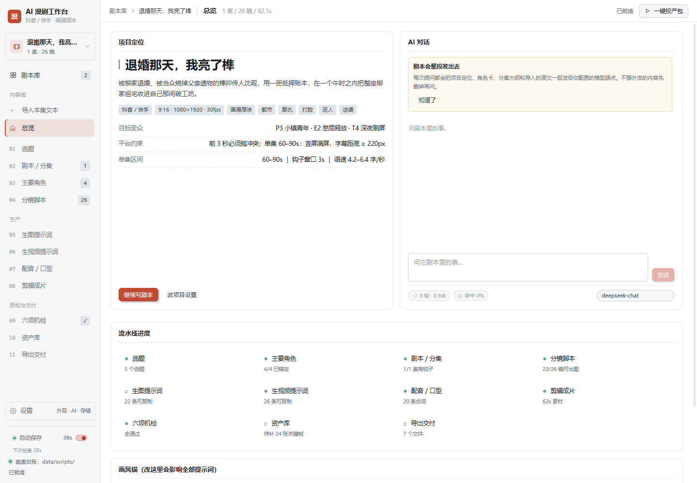
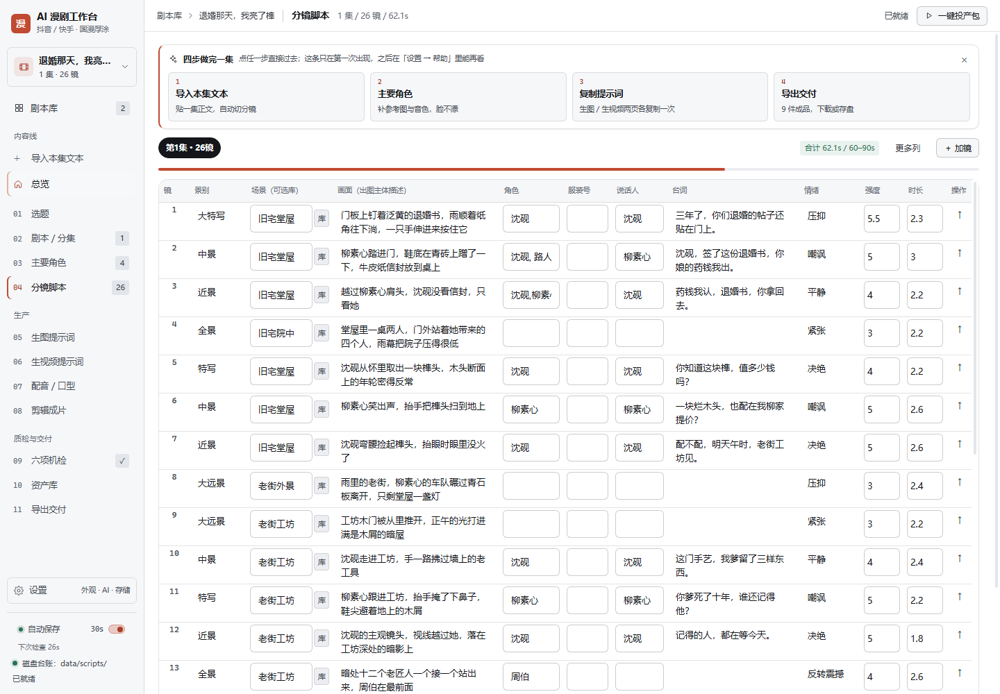
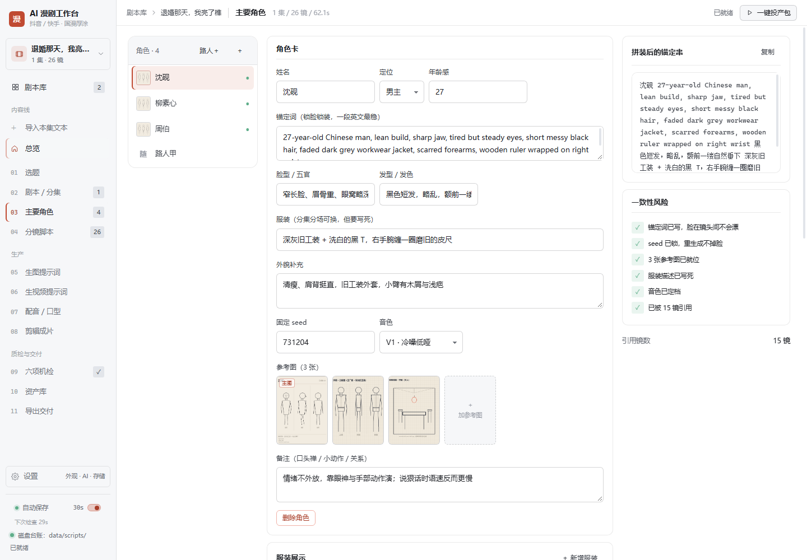
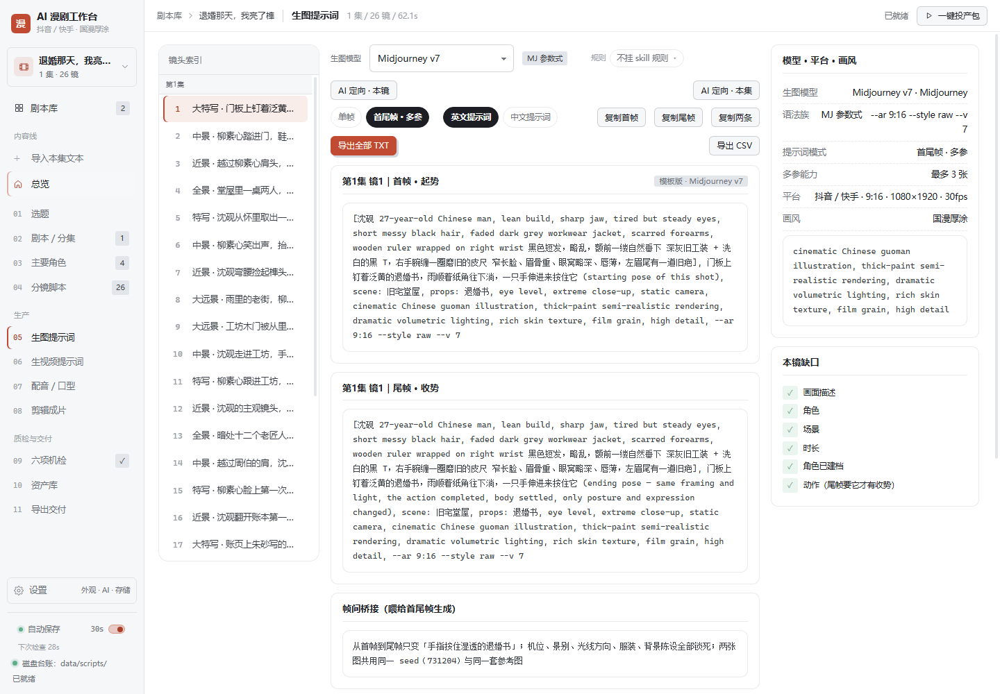
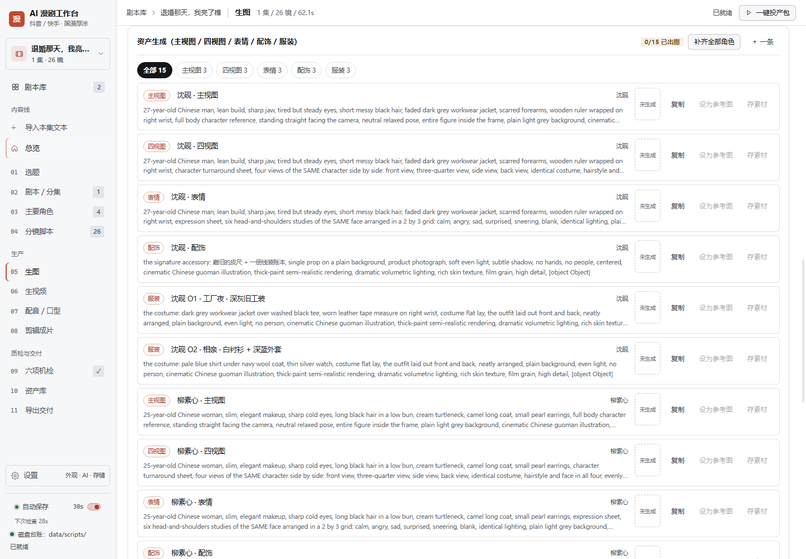

# AI 漫剧工作台

> 把「AI 漫剧」从选题到成片交付的整条链，压进一个跑在自己电脑上的界面。

[](https://github.com/OWNER/ai-manju-workbench/actions/workflows/ci.yml)
[](LICENSE)
[](package.json)
[](package.json)

**剧本库 → 选题 → 剧本分集 → 主要角色 → 分镜脚本 → 生图 → 生视频 → 配音口型 → 剪辑成片 → 六项机检 → 资产对账 → 投产包导出**，一条链在一个界面里走完。多剧本共存，一部剧一套完全隔离的台账，全部数据存在你自己的磁盘上。

没有账号、没有云同步、没有统计上报。打开就是一个本地网页，关掉就是一个文件夹。




## 它解决什么

做 AI 漫剧最费劲的不是生图，是**一致性**和**返工**：角色第三集开始掉脸、服装张冠李戴、提示词换个模型就得全部重写、交付前才发现第 12 镜没台词。

这个工作台把这些都变成有字段可查、有机检可拦的东西：

| 容易出问题的地方 | 工作台里的应对 |
|---|---|
| 角色换脸 | 参考图可挂多张（主视图 / 表情表 / 配饰），`refImage` 永远是首图镜像；每镜固定 seed；音色也锁成一档参数 |
| 换场景忘了换衣服 | 服装有序列号 `O1/O2`，分镜里填号，提示词自动展开英文服装串 |
| 提示词每个模型都要重写 | 29 个生图模型 × 5 个语法族、27 个视频模型 × 5 个语法族，按模型语法定向输出；可选让接入的模型再重写一遍 |
| 交出去才发现念不完 | 六项机检（台词时长、镜头时长、钩子、悬念、素材缺口…）在交付前把不合规的点列出来 |
| 交付靠手工打包 | 一键投产包 9 件：剧本 / 分镜 CSV / 提示词 TXT+CSV / 视频提示词 TXT+CSV / SRT / 配音表 / 素材清单，可单件去掉 |

## 快速开始

三种用法，按需要选一种。

### A. 便携版（不想碰命令行）

```bash
npm run portable
```

产物在 `exports/portable/ai-manju-workbench-<版本>-portable.zip`。解压 → 双击 `start.bat` → 浏览器自动打开 `http://127.0.0.1:5273`。需要本机装一次 [Node.js 18+](https://nodejs.org)，不需要 `npm install`。

### B. 源码运行

```bash
git clone <this-repo>
cd ai-manju-workbench
npm ci
npm run build
npm start          # → http://127.0.0.1:5273
```

开发模式：`npm run dev`（vite 热更新）。
自检：`npm run verify`（台账机检 100 分）+ `npm run smoke`（9 个接口断言，不需要任何 key）。

### D. 装成 Windows 程序（推荐给非开发者）

```bash
npm run app:dir      # 解包 Electron 运行时（跳过 7za）
npm run app:pack     # 写图标/版本 → exports/app/AI漫剧工作台 + 便携版 zip
npm run app:install  # 装到 %LOCALAPPDATA%\Programs + 桌面图标 + 卸载脚本
```

装完双击桌面「AI漫剧工作台」，没有命令行窗口。数据在 `%APPDATA%\ai-manju-workbench\data-root`，卸载不删，安装目录里有「卸载.bat」。

**两个坑**：① 不要从项目目录里直接双击 exe —— 本机项目树带「拒绝删除子项」的 ACL，Electron 会静默退出；装到用户目录或解压到任意正常目录都行。② 分发用 `exports/app/*-便携版.zip`，里面不含 `data/`，不会覆盖别人的台账。

### C. 桌面窗口版

```bash
npm i -D electron electron-builder
# 然后任选一行：
npm run app            # 正常桌面窗口
npm run app:trouble    # 受限终端 / CI / 容器里用这个（带 --no-sandbox）
npm run app         # 直接开一个窗口
npm run app:dist    # 产出 exe（exports/app/）
```

桌面版的数据存在系统 userData 目录（不是安装目录），升级软件不会冲掉台账。

## AI 接入（可选）

默认**完全离线**：分集、分镜、提示词、机检全部由本地规则算出，不联网也能跑通全流程。

接上模型后会多三件事：导入整段/整集文本自动出镜头、按模型语法族定向重写提示词、总览里的 AI 对话（能读到你的角色卡、分集、原文与分镜）。

设置路径：侧栏左下「设置 → AI 接入」，填 OpenAI 兼容的 `baseUrl` / 模型名 / key。

- key 只写在本机 `data/ai-config.json`，浏览器侧永远拿不到（所有调用走 `/api/*` 代理）
- 支持 DeepSeek / 通义 / 智谱 / Kimi / OpenAI / 本地 Ollama，填的是 baseUrl 所以任意兼容端点都行
- 对话条上有模型下拉、token 速度与缓存命中率；同一份剧本资料只上传一次，之后复用快照

⚠️ **发给模型的包含整部剧本与导入的原文**，界面有一次性提示。不想外发的稿子别配 key。

## ComfyUI（可选）

想把提示词变成真的图，可以接本机或局域网的 ComfyUI：

1. 设置 → ComfyUI：填地址（如 `http://127.0.0.1:8188`）+ 测试连通
2. 上传工作流：在 ComfyUI 里用 **Export (API)** 导出，再传进来
3. 工作流里放 `{{prompt}}` `{{negative}}` `{{seed}}` `{{width}}` `{{height}}` `{{filename_prefix}}` `{{image}}` `{{image2}}` 任选占位符
4. 生图 / 生视频页 → ComfyUI 面板 → 导出任务包 → 在别处 `node comfy-run.mjs` → 回来点「回收渲染结果」

工作台不直连 ComfyUI（它默认不发 CORS 头），一律走本机 `/api/comfy/*` 代理。任务包自带断点续跑：脚本中途 Ctrl+C，再跑一遍会跳过已完成的镜。

## 数据在哪

全部在你自己的磁盘上，纯文件，没有数据库：

```
data/library.json          剧本库索引（标题 / 平台 / 画风 / 集数 / 机检分）
data/scripts/{id}.json     每部剧的完整台账（互不干扰）
data/ai-config.json        AI 端点与 key（明文，别进 git）
data/comfy.json            ComfyUI 地址与默认工作流
uploads/                   界面上传的图（台账只存相对路径）
assets/ref/                手工维护的素材图
renders/                   ComfyUI 回来的成品
exports/                   投产包与便携版
```

想整体搬迁或换电脑：把整个目录拷走即可。设置 → 存储 里能看到这些路径的真实位置，也能改数据目录（改完重启生效，旧数据不会自动搬）。

写入是**原子**的（临时文件 + fsync + rename），断电不会把台账截断成半个 JSON；同一部剧多窗口同时改时，带 `rev` 版本号的那次写入赢，过期写入被拒（409）而不是覆盖。

## 目录结构

```
ai-manju-workbench/
├─ index.html
├─ vite.config.js        开发服务器 + 把 /api 挂到 vite 中间件
├─ api.mjs               全部后端：剧本库 / AI 代理 / 小说转镜头 / 提示词定向 / Skill 市场 / ComfyUI / 导出
├─ server.mjs            生产模式：静态 dist + 复用 api.mjs（支持 PORT / HOST / MJW_ROOT）
├─ electron/             可选桌面壳（main.js 起后端 + 开窗口，preload 只暴露版本号）
├─ public/seed.json      示例项目（26 镜满配，机检 100 分）
├─ docs/screens/         README 与交接文档引用的截图
├─ scripts/
│  ├─ verify-seed.mjs   台账机检（npm run verify）
│  ├─ smoke.mjs         接口冒烟（npm run smoke）
│  ├─ build-portable.mjs 便携版打包（npm run portable）
│  ├─ pack-handoff.mjs / unpack-handoff.mjs  交接包（npm run pack / unpack）
│  └─ cdp.mjs / page-shot.mjs   CDP 调试与整页截图
└─ src/
   ├─ App.jsx           剧本库入口 + 侧栏 + hash 路由
   ├─ ui.jsx            Icon / Btn / Seg / Ring / Modal / Panel 等基础件
   ├─ styles.css        token 化的 6 套主题（默认白色）
   ├─ components/       AiPanel / ChatPanel / SettingsDrawer / SkillPanel / SkillSelect / ComfyPanel / OnboardingBar
   ├─ lib/              schema / checks / prompts / imageModels / videoModels / voice / splitter / media / exporters / comfy / comfyRun / uiPrefs / store
   └─ pages/            Home + 12 项导航对应的页面
```

## 截图

| | |
|---|---|
|  |  |
|  |  |
|  |  |

## 路线图

- [x] 连载体检：rev 乐观锁、原子写、Host/Origin 闸门、路径校验
- [x] 生图 / 生视频提示词按模型语法族定向
- [x] ComfyUI 任务包（含断点续跑）与结果回收
- [x] 角色资产生成（主视图 / 四视图 / 表情 / 配饰 / 服装）
- [ ] ComfyUI 二期：工作台内队列、进度条、失败重试
- [ ] 导出 FCPX / 剪映工程文件
- [ ] 英文界面
- [ ] 插件机制：让第三方往提示词拼装链里插自己的规则

## 贡献

见 [CONTRIBUTING.md](CONTRIBUTING.md)。安全问题看 [SECURITY.md](SECURITY.md)。

这个项目的硬约束只有几条：运行时依赖不扩、数据字段不改名、AI 一律走本机代理、没有 key 也能跑通全流程。

## 许可

[MIT](LICENSE)。

---


## 3. 页面职责

**剧本库主页（`#/home`，默认落地页）**：多剧本入口。四指标（剧本总数 / 累计集数 / 累计分镜 / 平均机检分）+ 搜索 + 平台筛选 + 剧本卡片网格（画风渐变封面、平台 chip、机检分环、硬伤提示、更新时间、「当前打开」标记）。新建 / 重命名 / 复制 / 删除都在这里。

剧本之间的分隔靠三处：主页卡片各自独立、侧栏顶部切换器（当前剧名 + 集数·镜数，下拉即切）、顶栏面包屑「剧本库 › 剧名」。切换剧本 = 换整套台账，选题/角色/分镜/资产/导出互不串味。

| 页 | 干什么 | 关键输出 |
|---|---|---|
| 00 总览 | 项目定位 + AI 对话（接上模型后能读整部剧本与导入的原文）+ 十步流水线进度（含资产库）+ 画风锚 | 一眼看清卡在哪一环，顺手问它剧本的问题 ｜底部统计条：轮数 / token / 速度 / 缓存命中 + 模型下拉；剧本没改就不重复上传资料（只发 ctxId，标签显示「资料复用」） |
| ＋ 导入本集文本 | 粘贴或读入**一集**正文，生成本集镜头（集纲 + 分镜 + 角色自动并入），镜头数按正文量自动推算（1 镜 ≈75 字，夹在平台时长区间内），预览后写进指定集（新建或覆盖） | 一集一集往下推，不动已有集的精修成果；整本 / 多章也能直接贴，用「自动分集」按字数 + 爆点切成多集，一次写入；也可以切「手动」——按你自己写的分隔行（`---`）或按「第X章」章节标题切，切完的集自带你那段原文；也能「按顺接续」一集一集往下写，写一集就落一集盘、下一集自动接住上一集的钩子；「规则」下拉可挂一个已下载 skill 的方法论 |
| 01 选题 | 选题池 + 爆款三项自检（logline / 记忆点 / 人群） | 三项全绿才允许进剧本 |
| 02 剧本 / 分集 | 集纲（钩子类型、前 3 秒钩子、梗概）+ **本集原文 · 锚点**（逐句列出这一集的原文，钩子 / 冲突 / 反转 / 打脸 / 爽点 / 悬念 / 情绪七类锚点点一下就标，锚点句带朱砂竖条与对应镜号）+ 节拍表（强度曲线对比教科书基线，一眼看出哪拍塌）+ 未解悬念（≤3） | 每集的骨架与切镜依据 |
| 03 主要角色 | 一张角色卡锁死脸/发/服装/锚定词/seed/参考图（列表内 hover 出 × 可直接删（选题 / 分集 / 角色同款，台词表行尾 1 键清空这一镜）；定位 14 档：男主/女主/男配/女配/兄弟/妹妹/姐姐/学长/学姐/学妹/学弟/同学/群演/路人 + 自定义；列表头「路人＋」可加**随机路人**：不锁脸不锁 seed，提示词写成 random background passerby，每次出图可以换张脸），下方「服装展示」按场景管多套衣服（每套一张图 + 序列号 O1/O2…，分镜只写号）、「音色档案」再锁死声音（8 项参数 + TTS 工具 + voice_id + 参考音频/文本 + 锁定串）；参考图与服装图都能上传或 Ctrl+V 粘贴；可一键拼锚定串、复制音色锁定串 | 全剧同一张脸、同一条嗓子、换场不穿错衣服 |
| 04 分镜脚本 | 全宽行内编辑表 16 列（镜/景别/机位/运镜/场景/画面/角色/服装号/道具/说话人/台词/情绪/强度/时长/动作/配音）+ 上移下移删除；⧉ 把本镜复制成一行 TSV 到剪贴板（粘进表格自动分列）；「画面」「台词」两格随内容自动长高且始终等高；场景格可按「库」从场景库挑图 | 分镜表正本 |
| 05 生图 | **先选生图模型**（MJ / SDXL / Pony / FLUX / SD3 / 即梦 / 万相 / 可灵 / 混元 / DALL·E / Nano Banana，共 12 个），提示词按该模型语法生成；可切**单帧 / 首尾帧·多参**（两种模式都能切中英文提示词：英文跟当前模型语法走，中文按中文族语法另出一条）——首尾帧模式一镜出「起势 + 收势」两张，附帧间桥接与参考图编号（角色脸 / 服装 / 场景），一致性靠同 seed + 同参考图锁死；模板版离线可用，配了 key 可让 AI 按同套语法定向重写本镜/本集；toolbar 的「规则」下拉可挂一个已下载 skill，把它的文档当规则附录压进 system；页面底部「ComfyUI 任务包」可挂工作流 → 导出任务包 → 在跑图机上 `node comfy-run.mjs` → 回来点「回收渲染结果」，成品直接进分镜表「图」列；导出时旁边「规则」选的 skill 会随包多带一件 `_skill-rules.md`（工作流里有 LLM / 文本节点时才需要把它贴进 system，prompt 本身已经在 AI 定向时就按规则写好了） | 可直接粘进对应模型  页面下半还有**资产生成**：人物主视图 / 四视图 / 表情 / 配饰 / 服装五类提示词一次备齐，可整包丢给 ComfyUI 出图再回收； |
| 06 生视频 | **先选视频模型**（可灵 1.6 / 即梦 Seedance / Runway Gen-4 / Pika / 海螺 02 / 混元 / 万相 / Vidu / Luma / Sora 2，共 10 个，分 5 个语法族），按该模型语法写「这一镜里发生了什么变化」：主体 + 动作 + 运镜 + 时长 + 不动的部分锁死；模式可切文生视频 / 图生视频（首帧）/ 首尾帧；英文族自动把中文动作换成英文短语，也可以在「英文动作」框里自己写；分镜时长超出模型区间会在时长行下用黄字报出来；配了 key 可让 AI 按同套语法批量重写整集（重写版按七要素与长度下限：中文 ≥110 字、英文 50–110 词，模板版只有一句话剧情，实测字数涨 3–4 倍、要素覆盖 3.0/7 → 6.3/7），toolbar 的「规则」下拉能挂 skill 文档当规则附录，规则换掉会出黄条提示重生成 | 可直接粘进对应视频模型 |
| 07 配音 / 口型 | 台词表实时字/秒配色（快/慢直接标红）、音色表（每角色 12 档预设 + voice_id + 样本 + seed）、音色一致性告警、复制全集台词 | 配音清单 + 音色锁定串 |
| 08 剪辑成片 | 时间轴强度色带、导出参数、SRT 预览下载、剪辑顺序、粗剪六项检查 | 剪辑指令 |
| 09 六项机检 | 分数 + 六规则卡 + 问题清单（点规则跳对应编辑页）+ 判定口径 | 交付门槛把关 |
| 10 资产库 | 素材库：人物三视图 / 表情 / 配饰 / 场景 / 道具（点选或拖入上传，来自主要角色的图自动汇总；卡片名字都能改，三视图的自动名只作 placeholder；场景卡上传即命名，分镜里可按「库」直选）+ 关键帧对账表与命名规范 | 素材清单 |
| 11 导出交付 | 9 件投产包（含生图 / 生视频两套提示词包），逐件下载 / 一键写进 `exports/` | 交付物 |
| 侧栏左下「设置」 | 抽屉：主题色（6 套，默认白色）/ 字体（3 套）/ 界面密度、AI 接入、存储路径与台账目录、当前剧本元信息、**画风（29 种内置分六组 + 自定义画风增删）**、**Skill 市场（GitHub 上的 AI 漫剧开源 skill，按 Star / 下载量排行，一键下载到 `skills/`）**、**ComfyUI（地址 + 测试连通 + 默认工作流 + 自动回收）**、帮助（重看新手引导 / 清提示偏好 / 快捷键） | 外观存本机，目录写 settings.json 重启生效，skill 下载到本机 `skills/{owner}__{repo}/` |
| #/settings | 完整设置页：项目与台账只读总览 + 导入导出/恢复/清空、完整 AI 接入面板、运行环境诊断（改剧名/平台/画风请用左下角抽屉） | 不常用，从抽屉进 |

## 4. 数据与保存（多剧本）

- 磁盘结构：`data/library.json` 只存索引摘要；每部剧本完整数据在 `data/scripts/{id}.json`（`id` 形如 `sc_mw0nqxlu93hg`）。
- 加载顺序：`/api/library` + `/api/script?id=`（磁盘）→ `localStorage`（`mjw:library:v1` / `mjw:active:v1` / `mjw:script:{id}`）→ `/seed.json`（示例）。
- 每次编辑：内存深拷贝 → 700ms 防抖 `POST /api/script`（写剧本文件 + 更新索引摘要，含机检分），同时写 localStorage。磁盘写失败降级为「已存本地缓存」。
- 切剧本前先 `flushSave()`，避免把 A 剧的改动写进 B 剧。
- 索引里缺机检分的历史条目（例如从旧 `data/project.json` 迁移来的）会在打开主页时自动补算并回写。
- 换机器：设置页「导出 project.json」→ 另一台「导入」。整库搬家直接拷 `data/` 目录。

接口一览：

| 方法 | 路径 | 作用 |
|---|---|---|
| GET / POST | `/api/library` | 读 / 写剧本库索引 |
| GET | `/api/script?id=` | 读一部剧本 |
| POST | `/api/script` | `{id, project, summary}` 写一部剧本并 upsert 索引 |
| POST | `/api/script/delete` | `{id}` 删除剧本文件与索引项 |
| POST | `/api/script/copy` | `{from, id, title}` 复制剧本 |
| POST | `/api/export` | `{name, content}` 写进 `exports/` |
| GET | `/api/styles` | 读自定义画风（内置 29 条在 `src/lib/schema.js`，自定义存 `data/styles.json`） |
| POST | `/api/styles` | 新建 / 更新自定义画风（`anchor` 少于 8 字会被拒） |
| POST | `/api/styles/delete` | 删除自定义画风（内置的删不掉） |
| GET | `/api/skills` | Skill 榜单（GitHub 实时搜，缓存 24h；`refresh=1` 强制重拉） |
| GET | `/api/skills/installed` | 已下载 skill 列表（含文档字数与预览），给「规则」下拉用 |
| POST | `/api/skills/install` | `{fullName}` 下载到 `skills/{owner}__{repo}/` |
| POST | `/api/skills/remove` | `{fullName}` 删除已下载 skill |
| GET | `/api/health` | 健康检查 |

## 5. 六项机检（`src/lib/checks.js`）

| 规则 | 判据 | 级别 |
|---|---|---|
| 对白语速 | 每镜台词去标点字数 ÷ 时长，抖音 4.2–6.4 字/秒；超上限 +0.6 或低于下限 −0.8 报警；有台词但时长 0 直接 error | warn / error |
| 视觉变化密度 | 连续 3 镜「景别 + 机位 + 场景」全同 → 动态漫显呆；镜长越出 1.2–6s 记 info | warn / info |
| 悬念上限 | 单集未解悬念 > 3 条 | warn |
| 钩子 | 钩子不足 8 字 → error；首镜超钩子窗口（抖音 3s）；前 3 秒无冲突词；集间首句 bigram 相似度 > 0.5 判重复；镜里引用未建档角色 | error / warn / info |
| 一镜多动作 | 动作链按 `→ ；;` 与 然后/接着/随后/再/又 切分 > 2 段 → AI 视频必崩 | warn |
| 情绪强度 | 首镜 < 3、峰值 < 4、末镜 < 4、连续 3 镜同强度 | warn |

评分：`100 − error×12 − warn×4 − info×1`（下限 0）。交付门槛：error = 0、warn ≤ 8、分数 ≥ 80。

## 6. 命令行版 skill 市场（npx mjw-skills）

工作台里的「设置 → Skill」是一个带界面的市场；同一个引擎也提供命令行版，可以脱离工作台单独用——比如你想先把规则拉下来看一遍，再决定挂哪份。

```bash
npx mjw-skills list                      # 榜单，默认按 Star
npx mjw-skills list --sort downloads     # 按下载量（GitHub 没有仓库级下载数，这里汇总 Release 资产）
npx mjw-skills list --refresh            # 强制重拉（默认缓存 24 小时）
npx mjw-skills search 分镜                # 在 60 个榜单仓库里搜
npx mjw-skills install owner/repo        # 下载到 ~/.ai-manju-workbench/skills/
npx mjw-skills docs owner/repo           # 打印规则正文，可直接贴进任何 LLM 的 system
npx mjw-skills remove owner/repo
npx mjw-skills where                     # 数据落在哪、装了哪些
```

- 数据目录：`~/.ai-manju-workbench/`（`MJW_SKILL_HOME` 可改）；`GITHUB_TOKEN` 可提高速率限制。
- 与工作台共用 `src/lib/skills.js`：榜单查询、两层过滤、下载模式（≤8MB 整包 / 否则只取文档）、6000 字截断全部同一份实现，不会出现「界面里排第一、命令行里没有」这种事。
- 装完想在工作台里用：把 `skills/` 拷进工作台根目录，或在「设置 → Skill」里重新下载一次。

## 6. 提示词五件套（`src/lib/prompts.js`）

```
[角色锚定串（锚定词+发+服装+脸）], 画面描述, scene: 场景, props: 道具,
机位英文, 景别英文, 运镜英文, 画风锚
negative: 画风负面 + text/watermark/extra fingers/deformed hands/face inconsistency...
--ar 9:16 --style raw
```

角色锚定串由角色卡自动拼，所以「同一张脸」不靠人肉复制。图生视频提示另给五行：首帧 / 运镜 / 时长 / 约束（运动幅度小、锁首尾帧）/ 尾帧。

## 7. 九件投产包

1. `投产包_*.md` —— 六章全流程文档（选题/角色/分集分镜/提示词/机检/剪辑发布）
2. `分镜表_*.csv` —— 场记表正本
3. `提示词包_*.csv` —— 给批量脚本
4. `提示词包_*.txt` —— 整段贴进生图工具
5. `字幕_*.srt` —— 按集累计时长生成，空镜不占字幕
6. `配音清单_*.csv` —— 按说话人分音色，含去标点字/秒
7. `素材清单_*.csv` —— 缺哪张关键帧

命名规范（脚本与对账都认这个）：

```
assets/S01/S01E01_SH03_v01.png
S{集:02}E{集:02}_SH{镜:02}_v{版本:02}.png
v01 起版，返工出 v02，不覆盖原件
```

## 8. 实测记录（2026-11-03，多剧本版）

- `npm run build` 通过（50 modules / 232KB js / 27.3KB css）。
- 旧台账迁移：`data/project.json` 首次启动自动变成 `sc_seed_legacy`（26 镜 / 62.6s / 3 角色），机检 100 分并回写索引。
- 新建剧本：弹窗选平台 + 画风 + 标题 + 一句话定位 → 自动建 1 集空镜并落盘 `data/scripts/sc_mw0nqxlu93hg.json`，索引出现 `score=75`（硬伤 1 / 提醒 3），主页卡片黄环 + 红字提示。
- 剧本切换：主页点旧剧本「打开」→ 顶栏面包屑与统计切到 1 集 / 26 镜 / 62.6s，数据完全换套。
- 删除剧本：菜单 → 删除 → 确认弹窗（写明会删磁盘文件）→ 索引只剩 1 条，`data/scripts/` 下对应文件消失。
- 主页统计随操作实时变化（2 剧本 / 2 集 / 27 镜 / 平均 88 分）。
- 12 项导航逐页渲染无白屏；一键导出 9 件落盘；`npm run verify` → 100 分 0/0/0。
- 已修四个坑：`server.mjs` 语法错；`mutate()` 把 `Object.assign(p.meta, patch)` 返回值当整个 project；配音/导出字数口径与机检不一致；迁移剧本缺 score 时主页显示 0 分红环（改为自动补算 + 缺失显示「—」）。

## 9. UI 规范（照站酷《UI 界面优化改版 35 个小妙招》落地）

参考图存在 `docs/ui-ref/`（两张 1600×22000+ 长图，切成 2200px 块）。落地的条款：

| 条款 | 落在哪 |
|---|---|
| 01 配色 60/30/10 | `--bg` 深底 60% + `--panel` 三层 30% + `--accent #e3b15f` 点缀 10%；主按钮、选中态、分数环才用金色 |
| 02 阴影不用纯黑 | `--shadow-*` 全部带色相（`rgba(0,0,0,.5)` → 偏冷/偏暖加 `rgba(227,177,95,.55)` 光晕） |
| 04 卡片承载信息 | 剧本卡、统计卡、规则卡、Panel 统一卡片化，不再裸标签堆叠 |
| 05 / 25 层级关系 | 标题 3 级（页标题 / 卡片标题 / 字段名），字号 30 / 17 / 12 三档，副信息统一 `--muted`、`--dim` |
| 07 空状态 | 无剧本、无素材、无问题、无搜索结果都有图 + 一句解释 + 一个动作按钮（`Empty` 组件） |
| 08 / 35 图标一致 | 24 网格、1.6px 描边、单色 `currentColor`，全部走 `Icon(name)`，不混用 emoji |
| 10 毛玻璃 | 顶栏与下拉面板走 `backdrop-filter: blur(14px)`，正文区不透明保证可读 |
| 13 / 15 按钮层级 | `primary`（金色，一屏一个）/ 默认 / `ghost` 三档；破坏性操作用 `danger` |
| 16 / 20 / 23 / 34 文字与字体 | 拉丁栈（Inter/Segoe UI）+ 中文栈（PingFang SC/鸿蒙/微软雅黑）分开；英文数字用 `--mono` + `tabular-nums`，中文正文用中文字体，不再让中文落到等宽字体 |
| 17 / 31 留白 | 卡片内 16–18px、卡片间 18px、区块间 28–34px；`--gap` 系列统一 |
| 18 视觉对齐 | 表单标签 96px 定宽、指标数右对齐 `tabular-nums`、按钮基线统一 34px |
| 21 超椭圆圆角 | `--r-1 10 / --r-2 14 / --r-3 18`，弹窗内层圆角 `calc(-1px)` 做「双边框圆角半径」 |
| 22 减少分割线 | 列表项靠间距与 hover 面色分区，去掉大部分 `border-bottom` |
| 26 / 30 渐变与蒙版 | 主页 hero 径向渐变 + 网格纹理；剧本封面用画风渐变 + 底部 `cover-shade` 蒙版压住标题 |
| 27 卡片排版 | 封面（图/渐变 + chip + 分数）→ 标题 → 一句定位 → 四格指标 → 页脚时间与动作，信息密度从上到下递减 |
| 09 单选按钮 | 新建剧本/设置页的平台与画风用 `Seg` 单选卡（含比例与分辨率副标题），不用下拉 |

## 10. 还没做（按需再长）

| 项 | 说明 |
|---|---|
| B6 图生视频 | 现在只有提示词与首尾帧约束文本；接即梦/可灵/可灵 API 或本地模型在这里加一层任务队列 |
| B9 发布 | 多平台发布（标题/封面/话题/定时），需平台侧授权 |
| B10 数据回填 | 播放/完播/涨粉回填，做“哪一集掉量”归因 |
| B11 商业化 | 分账/买量/植入位设计 |
| B12 合规 | 素材版权、肖像、擦边词扫描 |
| H2 多人 | 角色/集数级权限与审稿流 |

扩展方式：新增页面放 `src/pages/`，在 `App.jsx` 的 `NAV` 里加一项；数据字段进 `schema.js` 的 `emptyProject()` 与 `normalizeProject()`；导出物加进 `exporters.js` 的 `buildPackage()`。

## 安全与隐私

- 服务只监听本机（127.0.0.1:5273），接口会校验 `Host` 与 `Origin`：非本机来源（DNS rebinding）与跨站写请求一律 403。
- AI 能力全部经由本机 `/api/ai` 代理转发，key 只存在 `data/ai-config.json`，浏览器拿不到明文。
- 用 AI 对话时，整部剧本（含导入的原文）会发给你配置的模型端点；对话框首次打开会告知一次，每轮回答后也会标出去向。
- 对话资料按内容指纹缓存：同一份剧本只上传一次，之后再问只发指纹（`ctxId`）；剧本改过会自动重新上传并提示「资料已更新」。
- Skill 市场会去 GitHub 搜 AI 漫剧相关开源仓库（只读公开数据），下载内容落在本机 `skills/`，不上传任何东西。
- 数据默认放 `data/`，可在「设置 → 存储」改到别的磁盘；含 `..`、UNC 路径会被拒绝。
- Skill 市场只读 GitHub 公开数据（可选设 `GITHUB_TOKEN` 提高额度）；下载内容只落本机 `skills/`，不进交接包。
